# Lab Kubernetes GitOps — cluster kubeadm sur VMs

> Un cluster Kubernetes de trois nœuds monté avec **kubeadm**, entièrement construit par du code (Vagrant + Ansible), puis piloté en **GitOps** : l'état du cluster est décrit dans Git et appliqué automatiquement par Argo CD.
>
> **Projet terminé le 10/11/2026.** Le cluster (un control plane, deux workers, réseau des pods Calico) publie ses applications derrière un point d'entrée HTTP unique (Gateway API, Envoy Gateway), et Argo CD les applique en continu depuis ce dépôt. Détruit puis reconstruit depuis ce dépôt, le lab revient entièrement, application comprise, en **15 minutes, sans aucune intervention manuelle**.

## En bref

- **Ce que c'est** : un cluster Kubernetes 1.37 de trois nœuds (un control plane, deux workers) sur des VMs Debian 12, créé avec kubeadm, réseau des pods assuré par Calico, adresses externes attribuées par MetalLB, point d'entrée HTTP unique avec la Gateway API (Envoy Gateway). Le socle est provisionné par Ansible, sur un réseau privé dédié ; les applications (dossier `apps/`) sont appliquées et surveillées par **Argo CD**, depuis ce dépôt.
- **Pourquoi kubeadm** : installer moi-même chaque brique (runtime, control plane, réseau des pods, exposition des services) pour comprendre ce qu'une distribution comme k3s fait à ma place.
- **Contrôlé** : idempotence vérifiée (`changed=0` au second passage), `ansible-lint` en profil `production`, configuration vérifiée après redémarrage, et des contrôles intégrés au playbook qui le font échouer si le résultat n'est pas celui attendu (runtime, résolution de noms, nœuds prêts, adresses utilisées par Kubernetes et par Calico, Gateway opérationnelle et joignable depuis le poste de contrôle). Les rôles de la Gateway et d'Argo CD ont aussi été testés sur un API server Kubernetes avant leur premier lancement. Un script (`scripts/verifier-lab.sh`) vérifie tout le lab en une commande. Le lab a été reconstruit deux fois depuis zéro, chronomètre en main : la seconde fois en 15 min 02 s, sans aucune intervention, et il revient de lui-même en 4 minutes après un redémarrage à froid.
- **Documenté** : les notions sont expliquées dans des guides dédiés ([le cluster](doc/kubernetes-fondamentaux.md), [le runtime de conteneurs](doc/runtime-et-paquets.md), [kubeadm init et join](doc/cluster-kubeadm.md), [le réseau des pods](doc/reseau-des-pods.md), [déployer une application](doc/deployer-une-application.md), [exposer les services](doc/exposition-des-services.md), [le point d'entrée HTTP](doc/gateway-api.md), [le GitOps avec Argo CD](doc/gitops-argocd.md)), et chaque problème rencontré est décrit dans le [journal de bord](#journal-de-bord).

**Compétences mises en œuvre** (à ce stade) : Vagrant sur VMware Workstation, Ansible, administration système Linux (noyau, modules, paramètres réseau, ifupdown, dépôts APT signés), containerd et le CRI, kubeadm et la PKI du cluster, réseau des pods avec Calico, exposition des services avec MetalLB, point d'entrée HTTP avec la Gateway API et Envoy Gateway, GitOps avec Argo CD, déploiement d'une application selon les bonnes pratiques de sécurité, diagnostic méthodique. [Liste détaillée](#compétences-démontrées).

## Sommaire

**L'essentiel**
- [Objectif](#objectif)
- [Architecture](#architecture)
- [Démarrage rapide](#démarrage-rapide)
- [Stack technique](#stack-technique)

**Pour aller plus loin**
- [Choix techniques](#choix-techniques)
- [Sécurité et limites](#sécurité-et-limites)
- [Pistes d'évolution](#pistes-dévolution)
- [Structure du projet](#structure-du-projet)
- [Avancement](#avancement)
- [Journal de bord](#journal-de-bord)
  - [25/10/2026 — Démarrage du projet : pourquoi kubeadm plutôt que k3s](#25102026--démarrage-du-projet--pourquoi-kubeadm-plutôt-que-k3s)
  - [27/10/2026 — Diagnostic réseau : adaptateur VMnet3 sans adresse IP](#27102026--diagnostic-réseau--adaptateur-vmnet3-sans-adresse-ip)
  - [27/10/2026 (suite) — Phase 1 : VMs et prérequis de kubeadm](#27102026-suite--phase-1--vms-et-prérequis-de-kubeadm)
  - [27/10/2026 (suite) — Le réseau privé disparaît après un vagrant reload](#27102026-suite--le-réseau-privé-disparaît-après-un-vagrant-reload)
  - [03/11/2026 — Phase 2 : container runtime et paquets Kubernetes](#03112026--phase-2--container-runtime-et-paquets-kubernetes)
  - [04/11/2026 — Phase 3 : création du cluster avec kubeadm](#04112026--phase-3--création-du-cluster-avec-kubeadm)
  - [04/11/2026 (suite) — Phase 4 : réseau des pods avec Calico](#04112026-suite--phase-4--réseau-des-pods-avec-calico)
  - [06/11/2026 — Phase 5a : adresses externes avec MetalLB](#06112026--phase-5a--adresses-externes-avec-metallb)
  - [09/11/2026 — Phase 5b : point d'entrée HTTP avec la Gateway API](#09112026--phase-5b--point-dentrée-http-avec-la-gateway-api)
  - [09/11/2026 (suite) — Phase 6 : GitOps avec Argo CD](#09112026-suite--phase-6--gitops-avec-argo-cd)
  - [10/11/2026 — Phase 7 : test de reproductibilité](#10112026--phase-7--test-de-reproductibilité)
- [Compétences démontrées](#compétences-démontrées)
- Guides détaillés :
  - [Kubernetes : les notions avant les commandes](doc/kubernetes-fondamentaux.md)
  - [Dépannage : le réseau privé disparaît après un vagrant reload](doc/depannage-reseau-vagrant.md)
  - [Le runtime de conteneurs et les paquets Kubernetes](doc/runtime-et-paquets.md)
  - [Créer le cluster : kubeadm init et kubeadm join](doc/cluster-kubeadm.md)
  - [Le réseau des pods avec Calico](doc/reseau-des-pods.md)
  - [Déployer une application, pas à pas](doc/deployer-une-application.md)
  - [Exposer les services : MetalLB](doc/exposition-des-services.md)
  - [Le point d'entrée HTTP : Gateway API et Envoy Gateway](doc/gateway-api.md)
  - [Le GitOps avec Argo CD](doc/gitops-argocd.md)

---

## Objectif

Troisième projet de mon portfolio, après `lab-infra-as-code` (infrastructure 3-tiers) et `lab-cicd-pipeline` (GitLab CE auto-hébergé). Je veux comprendre Kubernetes **de l'intérieur** : ce que fait chaque composant, comment ils communiquent, et comment le cluster ramène en permanence son état réel vers l'état décrit.

L'accent reste mis sur l'**infrastructure**. L'application déployée sera volontairement triviale : elle ne sert qu'à prouver que la chaîne fonctionne.

## Architecture

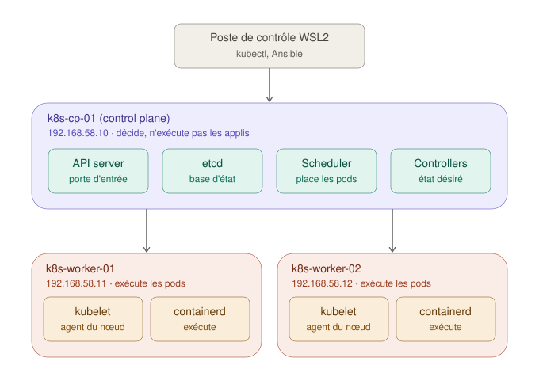

| Nœud | Rôle | IP | vCPU | RAM |
|---|---|---|---|---|
| `k8s-cp-01` | Control plane | 192.168.58.10 | 2 | 4 Go |
| `k8s-worker-01` | Worker | 192.168.58.11 | 2 | 4 Go |
| `k8s-worker-02` | Worker | 192.168.58.12 | 2 | 4 Go |

Un cluster utilise trois plages d'adresses, qui ne doivent jamais se chevaucher ([explication](doc/kubernetes-fondamentaux.md#4-les-trois-réseaux-dun-cluster)) :

| Réseau | Plage |
|---|---|
| Nœuds (réseau privé VMware, distinct de celui de `lab-cicd-pipeline`) | `192.168.58.0/24` |
| Pods | `10.244.0.0/16` |
| Services | `10.96.0.0/12` |

Dans le réseau des nœuds, MetalLB distribue les adresses `192.168.58.50` à `.59` aux Services `LoadBalancer`. La `.50` est celle de la Gateway, le point d'entrée HTTP sous lequel les applications sont publiées, avec des noms en `*.lab.internal`.

## Démarrage rapide

### Prérequis

| Côté | Élément |
|---|---|
| Matériel | Environ 12 Go de RAM libres pour les VMs (projet réalisé sur un poste de 32 Go) |
| Windows | VMware Workstation Pro ; Vagrant avec le plugin `vagrant-vmware-desktop` et Vagrant VMware Utility |
| WSL2 (Ubuntu) | Ansible (ici installé avec `pipx`) ; client OpenSSH ; kubectl 1.37 ; `direnv` (charge `ansible.cfg` et le kubeconfig du lab) |

### 1. Préparer le poste de contrôle (une seule fois)

```bash
# Collections Ansible du projet
ansible-galaxy collection install -r requirements.yml

# Clé SSH du compte d'administration des VMs (si elle n'existe pas déjà)
ssh-keygen -t ed25519 -f ~/.ssh/id_ed25519_lab -C "lab"

# kubectl, depuis le dépôt de Kubernetes (même version mineure que le cluster)
sudo mkdir -p -m 755 /etc/apt/keyrings
curl -fsSL https://pkgs.k8s.io/core:/stable:/v1.37/deb/Release.key | sudo tee /etc/apt/keyrings/kubernetes.asc > /dev/null
sudo tee /etc/apt/sources.list.d/kubernetes.sources > /dev/null <<'EOF'
Types: deb
URIs: https://pkgs.k8s.io/core:/stable:/v1.37/deb/
Suites: /
Signed-By: /etc/apt/keyrings/kubernetes.asc
EOF
sudo apt-get update && sudo apt-get install -y kubectl && sudo apt-mark hold kubectl

# Charger ansible.cfg et le kubeconfig du lab automatiquement dans ce dossier
direnv allow
```

### 2. Construire l'environnement

```powershell
# PowerShell, à la racine du projet
vagrant up
```
```bash
# WSL2, à la racine du projet
./scripts/sync-vagrant-keys.sh
ansible-playbook site.yml
```
Compter quelques minutes pour la création du cluster (téléchargement des images du control plane, puis de la Gateway et d'Argo CD). À la fin, le kubeconfig administrateur est copié sur WSL2 dans `~/.kube/lab-k8s-gitops.conf`.

Argo CD lit les applications sur GitHub, dans le dépôt et la branche définis par `k8s_gitops_repo_url` et `k8s_gitops_revision` (`inventory/group_vars/all/vars.yml`) : ce dépôt doit être poussé, et public. Pour une copie de ce projet, y mettre l'adresse de sa propre copie du dépôt.

### 3. Vérifier

Une seule commande vérifie tout le lab, couche par couche :

```bash
./scripts/verifier-lab.sh
```

| Vérification | Attendu |
|---|---|
| API server, nœuds | Joignable ; autant de nœuds `Ready` que dans l'inventaire |
| Calico, `kube-system`, MetalLB, Envoy Gateway, Argo CD | Tous les Deployments, StatefulSets et DaemonSets prêts |
| Gateway `lab-gateway` | `Programmed`, à l'adresse `k8s_gateway_address` |
| Applications d'Argo CD | `Synced` et `Healthy`, sur le **dernier commit** de la branche sur GitHub |
| Chaque route publiée sur la Gateway | Une réponse HTTP 2xx ou 3xx |

Juste après le playbook, Argo CD n'a pas forcément fini de synchroniser : chaque vérification est retentée toutes les 5 secondes, pendant 10 minutes au plus (`./scripts/verifier-lab.sh 0` : un seul essai). Le script se termine par « Tout est opérationnel à HH:MM:SS », ou par le nombre de vérifications en échec (code de retour 1).

Le détail, commande par commande :

```bash
kubectl get nodes -o wide
```
Les trois nœuds doivent apparaître à l'état `Ready`, avec leur adresse du réseau privé (`INTERNAL-IP` en `192.168.58.x`). Puis :

| Commande | Attendu |
|---|---|
| `kubectl get tigerastatus` | `apiserver` et `calico` à `True` dans `AVAILABLE` |
| `kubectl get pods -n kube-system -o wide` | Les deux `coredns` en `Running`, avec une IP en `10.244.x.x` |
| `kubectl get blockaffinities.projectcalico.org` | Un bloc `/26` par nœud |

Test de bout en bout, d'un pod à l'autre sur deux workers : voir [le guide du réseau des pods](doc/reseau-des-pods.md#8-tester-le-réseau).

Sur un nœud (`vagrant ssh k8s-worker-01`) :

| Commande | Attendu |
|---|---|
| `free -h` | Swap à `0B` |
| `lsmod \| grep -E 'overlay\|br_netfilter'` | Les deux modules |
| `sudo sysctl net.ipv4.ip_forward net.bridge.bridge-nf-call-iptables` | `= 1` pour les deux |
| `sudo crictl version` | `RuntimeName: containerd`, `RuntimeApiVersion: v1` |
| `apt-mark showhold` | `containerd.io`, `cri-tools`, `kubeadm`, `kubelet`, `kubernetes-cni` (et `kubectl` sur `k8s-cp-01`) |

Le playbook vérifie lui-même l'essentiel : configuration effective de containerd, réponse du CRI, résolution du nom `k8s-api`, présence, état `Ready` et adresse de chaque nœud, aussi bien pour Kubernetes que pour Calico.

### 4. Les applications, déployées par Argo CD

Le playbook installe le socle, dont la Gateway et Argo CD. Argo CD crée ensuite une application par sous-dossier de `apps/` dans le dépôt, et l'applique au cluster : aucun `kubectl apply` n'est nécessaire ([le principe](doc/gitops-argocd.md#1-le-principe--le-dépôt-fait-foi)).

```bash
kubectl -n argocd get applications          # whoami : Synced, Healthy
kubectl -n demo get httproute whoami
for i in $(seq 1 6); do curl -s --resolve whoami.lab.internal:80:192.168.58.50 http://whoami.lab.internal | grep Hostname; done
```

Les requêtes doivent être réparties entre les pods whoami. `--resolve` indique à curl l'adresse du nom, faute de serveur DNS. Pour le navigateur, ajouter la ligne `192.168.58.50 whoami.lab.internal` au fichier hosts de Windows, puis ouvrir `http://whoami.lab.internal`.

| Commande | Attendu |
|---|---|
| `kubectl get gatewayclass` | `envoy-gateway`, `ACCEPTED True` |
| `kubectl -n gateway get gateway` | `lab-gateway`, `ADDRESS 192.168.58.50`, `PROGRAMMED True` |
| `kubectl -n demo describe httproute whoami` | Conditions `Accepted` et `ResolvedRefs` à `True` |
| `kubectl -n envoy-gateway-system get pods -o wide` | Le contrôleur, et un proxy Envoy (`2/2`) sur chaque worker |
| `kubectl -n argocd get pods` | Les sept composants d'Argo CD en `Running` |
| `kubectl -n argocd get application whoami -o jsonpath='{.status.sync.revision}'` | Le même commit que `git rev-parse HEAD` sur `main` |

L'interface d'Argo CD : ajouter `192.168.58.50 argocd.lab.internal` au fichier hosts de Windows, ouvrir `http://argocd.lab.internal`, et se connecter avec l'utilisateur `admin` et le mot de passe initial :

```bash
kubectl -n argocd get secret argocd-initial-admin-secret -o jsonpath='{.data.password}' | base64 -d; echo
```

Modifier une application, c'est la modifier dans le dépôt, puis pousser : voir [travailler en GitOps](doc/gitops-argocd.md#8-travailler-en-gitops). Lecture détaillée des résultats : [la Gateway](doc/gateway-api.md#7-vérifier-et-lire-les-résultats), [Argo CD](doc/gitops-argocd.md#7-vérifier-et-lire-les-résultats).

### Reconstruire depuis zéro

```powershell
# PowerShell
vagrant destroy -f
vagrant up
```
```bash
# WSL2
./scripts/sync-vagrant-keys.sh
ansible-playbook site.yml
./scripts/verifier-lab.sh
```

Vagrant génère de nouvelles clés SSH à chaque création de VM : le script de synchronisation est à relancer. Le cluster recréé a une nouvelle CA : le kubeconfig de WSL2 est réécrit par le playbook. Argo CD redéploie seul les applications depuis le dépôt, et son mot de passe `admin` initial est nouveau.

Mesuré le 10/11/2026, entre le lancement de `vagrant up` et « Tout est opérationnel » :

| Essai | Durée | Interventions manuelles |
|---|---|---|
| Première reconstruction | 15 min 29 s | Une relance du playbook, deux nœuds n'étant pas encore joignables ; corrigé depuis (premier play qui attend la connexion SSH) |
| Seconde reconstruction | **15 min 02 s** (`vagrant up` : 3 min 34 s ; playbook : 10 min 29 s, dont 43 % d'attente de Calico, c'est-à-dire de téléchargement d'images) | **Aucune** |
| Redémarrage à froid (`vagrant halt`, puis `vagrant up`) | **4 min 14 s** après la fin de `vagrant up`, sans playbook | Aucune |

Détail dans le [journal de la phase 7](#10112026--phase-7--test-de-reproductibilité).

Si `kubeadm init` ou `kubeadm join` échoue après avoir commencé à écrire des fichiers, remettre le nœud à zéro avant de relancer le playbook : `vagrant ssh <nœud>`, puis `sudo kubeadm reset -f`.

> **Si les VMs sont injoignables** (`ping` ou Ansible) : vérifier que l'adaptateur Windows du réseau VMware a bien une adresse dans `192.168.58.0/24` ([journal du 27/10/2026](#27102026--diagnostic-réseau--adaptateur-vmnet3-sans-adresse-ip)).

## Stack technique

| Outil / Techno | Rôle dans le projet |
|---|---|
| VMware Workstation Pro | Hyperviseur |
| Vagrant (`generic/debian12`) | Création des VMs et configuration du réseau privé |
| Debian 12 | Système des nœuds |
| Ansible (depuis WSL2) | Configuration de tous les nœuds |
| containerd 2.x (dépôt Docker) | Container runtime, piloté par le kubelet à travers le CRI |
| kubeadm, kubelet, kubectl 1.37 (dépôt pkgs.k8s.io) | Installation du cluster, agent de chaque nœud, administration |
| crictl | Diagnostic du runtime sur chaque nœud |
| Calico 3.33 (opérateur Tigera) | Réseau des pods : adresses, routage entre nœuds, politiques réseau |
| MetalLB 0.16 (mode L2) | Adresses externes des Services `LoadBalancer`, sur le réseau des nœuds |
| Gateway API 1.6 (canal standard) | Description du point d'entrée HTTP et des routes, commune à toutes les implémentations |
| Envoy Gateway 1.10 | Mise en œuvre de la Gateway API : un contrôleur, et des proxys Envoy qui reçoivent le trafic |
| `traefik/whoami` | Application de démonstration : renvoie le nom du pod qui répond |
| Argo CD 3.6 | GitOps : applique en continu le dossier `apps/` du dépôt au cluster, et corrige les écarts |

## Choix techniques

| Sujet | Choix | Raison |
|---|---|---|
| Distribution | kubeadm (Kubernetes « vanilla ») | Installer chaque brique moi-même ; outil officiel du projet et base de la certification CKA ([détail](#25102026--démarrage-du-projet--pourquoi-kubeadm-plutôt-que-k3s)) |
| Nœuds | 1 control plane + 2 workers | Deux workers pour voir les pods se répartir et survivre à la perte d'un nœud |
| Box Vagrant | `generic/debian12` | La même que `lab-cicd-pipeline`, compatible avec le provider VMware |
| Configuration du réseau privé | Écrite par un provisioner Vagrant au premier démarrage, pas par Vagrant à chaque démarrage (`auto_config: false`) | La reconfiguration à chaque démarrage coupait le réseau privé ([diagnostic](doc/depannage-reseau-vagrant.md)) ; Ansible ne peut pas la faire, puisqu'il passe par ce réseau |
| Résolution de noms | `/etc/hosts` généré par Ansible | Pas de serveur DNS dans le lab ; chaque nœud joint les autres par leur IP du réseau privé |
| Runtime | containerd, driver cgroup `systemd` | Standard de fait ; kubelet et runtime doivent utiliser le même gestionnaire de cgroups ([explication](doc/runtime-et-paquets.md#5-isoler-et-limiter--namespaces-et-cgroups)) |
| Source de containerd | Paquet `containerd.io` du dépôt Docker (sans Docker Engine) | Debian 12 fournit containerd 1.6, alors que Kubernetes exige containerd 2.x depuis la version 1.36 |
| Configuration de containerd | Fichier minimal (format version 4, `SystemdCgroup = true`), contrôlé sur la configuration effective | Ne déclarer que ce qui change ; le fichier du paquet désactive le CRI, et la méthode des tutoriels (`sed` sur la configuration par défaut) ne fonctionne plus avec containerd 2.x |
| Dépôts APT | Format deb822, une clé de signature par dépôt (`Signed-By`) | Une clé ne peut authentifier que son propre dépôt |
| Versions | Kubernetes 1.37, dépôt propre à la version mineure, paquets bloqués (`hold`) | Les mises à jour de Kubernetes et du runtime suivent une procédure, jamais un `apt upgrade` |
| kubectl | Installé seulement sur le control plane (variable du groupe `control_plane`) et sur WSL2 | Les workers n'administrent pas le cluster : moins d'outils, moins de surface d'attaque |
| Configuration de kubeadm | Fichier `kubeadm.k8s.io/v1beta4` généré par Ansible, plutôt que des options en ligne de commande | Méthode recommandée, lisible et versionnée ; le fichier reste sur le control plane comme trace de la création du cluster |
| Adresse des nœuds | `advertiseAddress` et `node-ip` fixés sur le réseau privé | Sinon kubeadm et le kubelet prennent `eth0`, l'interface NAT, dont l'adresse DHCP peut changer ([explication](doc/cluster-kubeadm.md#7-trois-adresses-à-ne-pas-confondre)) |
| Point d'entrée de l'API server | Un nom (`k8s-api`), déclaré dans `/etc/hosts`, plutôt que l'adresse du control plane | Permet de passer plus tard à plusieurs control planes derrière un load balancer, sans reconstruire le cluster : ce nom est inscrit dans les certificats dès la création |
| Jeton d'amorçage | Créé à la demande, valable 30 minutes, fichier supprimé après le join | Un jeton n'existe que s'il sert, et ne reste pas sur le disque |
| Administration | Kubeconfig copié sur WSL2 (droits `0600`), sélectionné par `KUBECONFIG` dans `.envrc` | On administre depuis le poste de travail, pas depuis le control plane ; le `~/.kube/config` habituel n'est pas touché |
| CNI | Calico 3.33, testé sur Kubernetes 1.35 à 1.37 | Applique les NetworkPolicies, très répandu en entreprise |
| Installation de Calico | Par son opérateur, méthode officielle : CRD au format `projectcalico.org/v3`, opérateur, puis objet `Installation` ; fichiers en version figée, empreinte SHA-256 vérifiée | L'opérateur installe et entretient Calico à partir d'une description ([explication](doc/reseau-des-pods.md#5-installer-calico--crd-opérateur-et-installation)) |
| Application des fichiers | Une seule fois, si l'objet témoin est absent | L'opérateur réécrit l'objet `Installation` pour y ajouter ses valeurs par défaut : le réappliquer à chaque passage créerait un conflit permanent |
| Pool d'adresses | `10.244.0.0/16`, blocs `/26` | La même plage que le `podSubnet` de kubeadm ; le pool du fichier officiel (`192.168.0.0/16`) engloberait le réseau des nœuds |
| Adresse des nœuds pour Calico | `NodeInternalIP` (l'adresse annoncée par le kubelet) | Par défaut, Calico prendrait la première interface, `eth0` (NAT) |
| Encapsulation | `VXLANCrossSubnet` | Routage direct entre nœuds du même sous-réseau, encapsulation VXLAN seulement entre sous-réseaux |
| Adresses externes | MetalLB en mode L2, manifeste « native » en version figée (`v0.16.2`), empreinte SHA-256 vérifiée | Pas de fournisseur cloud pour attribuer les adresses ; le mode L2 ne demande aucun routeur, il convient à un réseau local ([explication](doc/exposition-des-services.md#3-le-mode-l2--répondre--cette-adresse-cest-moi-)) |
| Pool d'adresses externes | `192.168.58.50` à `.59`, défini avec le reste du plan d'adressage (`k8s_lb_address_range`) | Hors des adresses de Windows, des nœuds et de la plage DHCP de VMware |
| Annonces de MetalLB | Sur `eth1` seulement ; control plane exclu (étiquette posée par kubeadm, respectée par MetalLB) | Les adresses appartiennent au réseau privé, pas au réseau NAT ; le control plane garde ses ressources pour l'API server et etcd |
| Application des fichiers de MetalLB | Le logiciel une seule fois ; la configuration comparée au cluster (`kubectl diff`) à chaque passage, et appliquée si elle diffère | Le contrôleur modifie certains objets de son manifeste ; la configuration n'appartient qu'à nous et doit suivre le code ([explication](doc/exposition-des-services.md#6-lautomatisation--installer-une-fois-configurer-à-chaque-passage)) |
| Point d'entrée HTTP | Gateway API, une seule Gateway partagée, à l'adresse `192.168.58.50` | Une adresse pour toutes les applications, routage par nom ; Ingress NGINX n'est plus maintenu, la Gateway API est son successeur ([explication](doc/gateway-api.md#1-pourquoi-un-point-dentrée-unique)) |
| Implémentation | Envoy Gateway v1.10.0 | Seule version testée sur Kubernetes 1.37 ; Envoy, projet diplômé de la CNCF, très répandu |
| CRD de la Gateway API | Canal standard (v1.6.1), appliquées à part ; du manifeste d'Envoy Gateway, seuls les objets du contrôleur (`kubectl apply --selector`) | Le manifeste officiel contient les CRD du canal expérimental ; la règle `safe-upgrades` des CRD standard interdit ensuite de les remplacer ([explication](doc/gateway-api.md#les-crd-du-canal-standard-gérées-à-part)) |
| Application des fichiers de la Gateway | CRD et namespaces comparés à chaque passage ; contrôleur une seule fois ; configuration comparée à chaque passage | Les CRD n'appartiennent qu'à nous et se mettent à jour par une montée de version ; le manifeste du contrôleur contient un Job, qui ne peut pas être modifié |
| Répartition des rôles | GatewayClass et Gateway gérées par Ansible (l'infrastructure), HTTPRoute avec l'application | Le modèle de la Gateway API : l'application décrit ses routes, sans pouvoir modifier l'entrée |
| Accès à la Gateway | Seuls les namespaces étiquetés `lab.internal/gateway-access: "true"` peuvent publier des routes | Une application doit demander à être publiée |
| Domaine des applications | `lab.internal` | `.internal` est réservé par l'ICANN aux réseaux privés : aucun conflit possible avec un vrai domaine |
| Proxys Envoy | Deux copies, une par worker ; politique `externalTrafficPolicy: Local` (par défaut) | L'adresse du client est conservée ; avec `Local`, MetalLB n'annonce que depuis un nœud qui héberge un proxy : deux proxys pour survivre à la perte d'un nœud |
| Applications | Manifestes dans `apps/`, appliqués par Argo CD, pas par Ansible | Séparer le socle (Ansible) des applications, dont le cycle de vie suit le dépôt |
| Application de démonstration | Namespace en Pod Security `restricted`, exécution sans root, sondes, ressources, répartition sur les nœuds ; Service `ClusterIP`, publié sous `whoami.lab.internal` par une HTTPRoute | Appliquer les bonnes pratiques dès la première application ([détail des réglages](doc/deployer-une-application.md#lire-les-fichiers-de-appswhoami)) |
| GitOps | Argo CD v3.6.1 (testé sur Kubernetes 1.34 à 1.37), manifeste non haute disponibilité | Le plus répandu ; son interface rend la réconciliation visible ([explication](doc/gitops-argocd.md#1-le-principe--le-dépôt-fait-foi)) |
| Installation d'Argo CD | Entièrement déclarative : manifeste comparé au cluster et réappliqué s'il diffère | Aucun objet du manifeste n'est réécrit par un contrôleur, et la mise à jour officielle consiste à le réappliquer ([comparaison avec les autres composants](doc/gitops-argocd.md#une-installation-entièrement-déclarative)) |
| Réglages d'Argo CD | Appliqués côté serveur sous un gestionnaire de champs distinct (`lab-k8s-gitops`) | Nos clés vivent dans des ConfigMaps du manifeste officiel : chaque source ne réécrit que ses propres champs |
| Accès à l'interface | `argocd.lab.internal`, par la Gateway ; `argocd-server` en HTTP simple (`server.insecure`), réglé avant son premier démarrage | La méthode d'Argo CD pour un point d'entrée Gateway API |
| Applications du dépôt | Un ApplicationSet (générateur Git) : une application par sous-dossier de `apps/` | Ajouter une application, c'est ajouter un dossier |
| Garde-fous | Projet `lab` : une seule source (ce dépôt), namespaces du socle interdits, seul objet sans namespace permis : `Namespace` | Une application ne peut ni modifier le socle, ni s'attribuer des droits sur tout le cluster |
| Synchronisation | Automatique, avec `prune`, `selfHeal` et nouvelles tentatives ; pas de suppression en cascade | Le dépôt fait foi, et une modification à la main est annulée ; un dossier retiré par erreur ne supprime pas une application en service |
| Accès au dépôt | Dépôt public, lu en HTTPS sans identifiants | Aucun secret à gérer dans le lab |

## Sécurité et limites

| Limite | Détail | En production |
|---|---|---|
| Pas de haute disponibilité | Un seul control plane | Trois control planes (etcd a besoin d'une majorité) et un load balancer devant l'API server |
| Pas de pare-feu UFW sur les nœuds | kube-proxy et Calico écrivent leurs propres règles iptables, et UFW bloque par défaut le trafic transféré, celui des pods | Filtrage entre pods par les NetworkPolicies de Calico ; pare-feu des hôtes conçu avec les ports de Kubernetes. Hors du périmètre de ce lab |
| Debian 12 en support étendu | La sécurité de Debian 12 est assurée par l'équipe LTS depuis juillet 2026 | Debian 13 pour une installation neuve |
| Vérification des clés d'hôte SSH désactivée | `StrictHostKeyChecking=no` : les VMs changent de clé à chaque reconstruction | Clés d'hôte connues et distribuées, ou certificats SSH |
| Résolution de noms statique | `/etc/hosts`, à mettre à jour si un nœud est ajouté (le rôle le régénère) | Serveur DNS interne |
| Paquets bloqués | containerd et Kubernetes ne reçoivent aucune mise à jour automatique, y compris de sécurité | Veille sur les vulnérabilités et mises à jour planifiées, nœud par nœud |
| Certificats valables un an | Les certificats des composants expirent un an après la création du cluster (la CA, dix ans) | Renouvellement par `kubeadm certs renew` ou lors des mises à jour (`kubeadm upgrade`), et supervision des dates d'expiration |
| Accès administrateur complet sur WSL2 | Le kubeconfig copié sur WSL2 donne tous les droits sur le cluster | Comptes nominatifs aux droits limités (RBAC), authentification par l'annuaire de l'entreprise (OIDC) |
| Politiques réseau limitées à Argo CD | Seules les sept NetworkPolicies du manifeste d'Argo CD existent : ailleurs, tout pod peut joindre tout autre pod | Politiques par namespace, avec un refus par défaut et des autorisations explicites |
| Calico, MetalLB et Envoy Gateway installés une seule fois | Le playbook n'applique pas les nouvelles versions des contrôleurs, ni les modifications ultérieures de la configuration de Calico (celles de MetalLB et de la Gateway, et les CRD de la Gateway API, sont tenues à jour) | Procédure de mise à jour, ou gestion par un outil GitOps qui tient compte des champs complétés par les contrôleurs |
| Mode L2 : un seul nœud par adresse | Tout le trafic d'une adresse externe entre par le nœud élu ; en cas de panne, la bascule prend quelques secondes | Mode BGP de MetalLB avec les routeurs du réseau, ou équilibreur de charge du fournisseur cloud |
| Adresse du client masquée pour les Services `LoadBalancer` directs | Avec `externalTrafficPolicy: Cluster`, les pods voient une adresse du nœud. Réglé pour le trafic HTTP : la Gateway conserve l'adresse et la transmet dans `X-Forwarded-For` | `Local` pour les autres Services qui en ont besoin |
| Pas de HTTPS | Le trafic HTTP circule en clair jusqu'à la Gateway | Écouteur HTTPS sur la Gateway, certificats délivrés et renouvelés par cert-manager |
| Résolution des noms à la main | `curl --resolve` ou fichier hosts de Windows, une ligne par application | Serveur DNS interne, alimenté à partir des routes (external-dns) |
| Envoy Gateway 1.10.0 très récent | Publié quatre jours avant son installation, faute de version plus ancienne testée sur Kubernetes 1.37 | Attendre les premiers correctifs avant une mise en production |
| Interface d'Argo CD en HTTP, compte `admin` local | Le mot de passe d'administration circule en clair jusqu'à la Gateway ; un seul compte, tous les droits | HTTPS sur la Gateway ; connexion par l'annuaire de l'entreprise (SSO), droits par équipe, compte `admin` désactivé |
| Dépôt public, relu toutes les trois minutes | La configuration des applications est lisible par tous ; un `git push` met jusqu'à trois minutes à s'appliquer | Dépôt privé avec une clé de déploiement en lecture seule ; webhook de GitHub vers Argo CD (impossible ici : GitHub ne peut pas joindre le réseau du lab) |
| Argo CD sans haute disponibilité, installé par Ansible | Une copie de chaque composant ; Argo CD ne se gère pas lui-même | Manifeste haute disponibilité, trois nœuds au moins ; Argo CD géré depuis le dépôt (modèle « app of apps »), Ansible ne servant qu'à l'amorçage |
| Pas de gestion des secrets | Aucun secret ne doit être commité en clair dans le dépôt | Sealed Secrets ou External Secrets |
| Reconstruction dominée par le téléchargement des images | Sur des VMs neuves, chaque nœud télécharge toutes ses images : l'attente de Calico représente à elle seule 46 % du playbook | Miroir de registre local, ou images de VM préparées à l'avance avec les conteneurs (Packer) |
| Retour après un redémarrage à froid | Mesuré à 4 min 14 s. Une fois, après un arrêt d'une nuit, un proxy Envoy est resté indisponible plus de dix minutes avant de revenir seul ; non reproduit, cause non établie | Supervision qui alerte quand un composant reste indisponible (le rôle que joue ici `verifier-lab.sh`, mais en continu) |
| Observabilité réseau non installée | Goldmane et Whisker (visualisation des flux), prévus par la configuration officielle, sont laissés de côté | À installer avec les premières politiques réseau |

## Pistes d'évolution

Par ordre de priorité, en partant des limites ci-dessus :

| Piste | Pourquoi |
|---|---|
| HTTPS sur la Gateway, avec cert-manager et une autorité de certification interne | Supprime la principale limite : l'interface d'Argo CD et son mot de passe circulent en clair. Reprend la PKI de `lab-cicd-pipeline` |
| Politiques réseau par défaut (refus, puis autorisations explicites), avec Whisker pour visualiser les flux | Aujourd'hui, seuls les composants d'Argo CD sont protégés par des NetworkPolicies |
| Supervision : Prometheus et Grafana, déployés par Argo CD | Remplacer la vérification ponctuelle de `verifier-lab.sh` par une surveillance continue, avec alertes |
| Mise à jour du cluster (`kubeadm upgrade`, vers Kubernetes 1.38) | La maintenance d'un cluster en production : mise à jour nœud par nœud, sans interrompre les applications |
| Argo CD géré par lui-même (modèle « app of apps »), et premiers charts Helm | Réduire Ansible à l'amorçage, et tenir tout le reste dans le dépôt |
| Gestion des secrets (Sealed Secrets ou External Secrets) | Prérequis à toute application qui a besoin d'un mot de passe |
| Control plane hautement disponible (trois nœuds, et une adresse virtuelle devant l'API server) | La limite d'architecture principale, au prix de deux VMs de plus |

## Structure du projet

```
lab-k8s-gitops/
├── Vagrantfile                  Les 3 VMs (VMware Workstation, réseau 192.168.58.0/24)
├── site.yml                     Playbook principal
├── ansible.cfg
├── requirements.yml             Collections Ansible nécessaires
├── .envrc                       Charge ansible.cfg et le kubeconfig du lab automatiquement (direnv)
├── .gitignore
├── .editorconfig                Règles d'édition communes (fins de ligne, retour à la ligne final)
├── inventory/
│   ├── hosts.ini                Nœuds et groupes (control_plane, workers, k8s_cluster)
│   └── group_vars/
│       ├── all/vars.yml         Plan d'adressage et version de Kubernetes
│       ├── k8s_cluster.yml      Connexion SSH aux nœuds, pare-feu désactivé
│       └── control_plane.yml    kubectl installé sur le control plane
├── roles/
│   ├── common/                  Durcissement de base (repris de lab-cicd-pipeline)
│   ├── k8s_prereqs/             Swap, modules du noyau, paramètres réseau, /etc/hosts et nom k8s-api
│   ├── containerd/              Container runtime (dépôt Docker), configuration et contrôle
│   ├── kubernetes_packages/     kubeadm, kubelet, kubectl, crictl (dépôt pkgs.k8s.io)
│   ├── kubeadm_init/            Création du control plane, kubeconfig copié sur WSL2
│   ├── kubeadm_join/            Ajout des workers (jeton d'amorçage à la demande)
│   ├── calico/                  Réseau des pods : manifestes vérifiés, opérateur, configuration
│   ├── metallb/                 Adresses externes : manifeste vérifié, pool et annonce L2
│   ├── envoy_gateway/           Point d'entrée HTTP : CRD de la Gateway API, contrôleur, Gateway
│   ├── argocd/                  GitOps : Argo CD, sa route, le projet et l'ApplicationSet des applications
│   └── cluster_verify/          Contrôle des nœuds : enregistrement, état Ready, adresses
├── apps/                        Applications, appliquées par Argo CD (une par sous-dossier)
│   └── whoami/
│       ├── 01-namespace.yaml    Namespace demo, Pod Security restricted
│       ├── 02-deployment.yaml   Deux copies, sans root, sondes et ressources
│       ├── 03-service.yaml      Service ClusterIP
│       └── 04-httproute.yaml    Route whoami.lab.internal, rattachée à la Gateway
├── scripts/
│   ├── sync-vagrant-keys.sh     Copie les clés SSH des VMs vers WSL2
│   └── verifier-lab.sh          Vérifie tout le lab, couche par couche, jusqu'aux routes HTTP
└── doc/
    ├── kubernetes-fondamentaux.md   Guide des notions de Kubernetes
    ├── depannage-reseau-vagrant.md  Diagnostic de la panne réseau du 27/10/2026
    ├── runtime-et-paquets.md        Guide du runtime de conteneurs et des paquets Kubernetes
    ├── cluster-kubeadm.md           Guide de la création du cluster (kubeadm init et join)
    ├── reseau-des-pods.md           Guide du réseau des pods avec Calico
    ├── deployer-une-application.md  Guide pas à pas : namespace, Deployment, Service
    ├── exposition-des-services.md   Guide de l'exposition des services avec MetalLB
    ├── gateway-api.md               Guide du point d'entrée HTTP (Gateway API, Envoy Gateway)
    ├── gitops-argocd.md             Guide du GitOps avec Argo CD
    └── images/                      Schémas et captures d'écran
```

## Avancement

- [x] Phase 1 : VMs et prérequis de kubeadm (swap, modules du noyau, paramètres réseau), vérifiés après redémarrage
- [x] Phase 2 : containerd, kubeadm, kubelet, kubectl, crictl, avec contrôles intégrés au playbook
- [x] Phase 3 : création du cluster (`kubeadm init` / `kubeadm join`), kubeconfig sur WSL2, contrôle des nœuds
- [x] Phase 4 : réseau des pods (Calico), testé de pod à pod entre deux nœuds
- [x] Phase 5 : exposition des services
  - [x] 5a : adresses externes (MetalLB) et application de démonstration, joignable depuis Windows
  - [x] 5b : point d'entrée HTTP unique (Gateway API, Envoy Gateway), adresse du client conservée
- [x] Phase 6 : GitOps (Argo CD), autocorrection et modification par Git vérifiées
- [x] Phase 7 : test de reproductibilité et documentation finale
  - [x] Première reconstruction depuis zéro, chronométrée (15 min 29 s), et corrections qu'elle a révélées
  - [x] Seconde reconstruction sans aucune intervention manuelle (15 min 02 s), et redémarrage à froid (4 min 14 s)
  - [x] Documentation finale

## Journal de bord

### 25/10/2026 — Démarrage du projet : pourquoi kubeadm plutôt que k3s

**Contexte :** le projet était initialement prévu avec k3s, une distribution légère de Kubernetes. Ce choix venait de mon ancien poste (8 Go de RAM), sur lequel k3s était le seul moyen d'avoir plusieurs nœuds. Avec le nouveau poste (32 Go), cette contrainte a disparu.

**Les notions :**
- **Kubernetes** (abrégé « k8s ») est l'orchestrateur ; **k3s** n'est pas un concurrent mais une **distribution** de Kubernetes, comme Ubuntu est une distribution de Linux. Elle est certifiée conforme, mais empaquetée pour être légère : un seul binaire, et des composants fournis d'office (réseau des pods, ingress, stockage).
- **kubeadm** est l'outil officiel du projet Kubernetes pour monter un cluster « vanilla » (sans surcouche).

**La décision :** kubeadm. Ce que k3s simplifie (runtime, réseau des pods, exposition des services) est justement ce que je veux apprendre et pouvoir expliquer. kubeadm se découpe aussi naturellement en rôles Ansible, dans la continuité des projets précédents, et c'est la base de la certification CKA. Le prix : plus de travail avant d'avoir un cluster fonctionnel.

**Architecture retenue :** un control plane et deux workers (2 vCPU, 4 Go chacun), sans haute disponibilité. Les notions de Kubernetes sont posées dans le [guide dédié](doc/kubernetes-fondamentaux.md), avant toute commande.

---

### 27/10/2026 — Diagnostic réseau : adaptateur VMnet3 sans adresse IP

**Symptôme :** après le premier `vagrant up`, les VMs sont injoignables (`ping` et `ssh` en échec).

**Cause :** la même que pour `lab-cicd-pipeline` ([journal du 05/10/2026 de ce projet](https://github.com/artuthur/lab-cicd-pipeline#05102026-suite--diagnostic-réseau--adaptateur-vmnet2-sans-adresse-ip)) : l'adaptateur Windows `VMware Network Adapter VMnet3`, créé par Vagrant pour le réseau `192.168.58.0/24`, avait une adresse APIPA (`169.254.x.x`). Sans adresse dans ce réseau, Windows n'a aucune route vers les VMs.

**Solution appliquée :**
```powershell
New-NetIPAddress -InterfaceAlias "VMware Network Adapter VMnet3" -IPAddress 192.168.58.1 -PrefixLength 24
Restart-Service "VMware NAT Service","VMware DHCP Service" -ErrorAction SilentlyContinue
```

**Résultat :** `ping` puis `ansible k8s_cluster -m ping` répondent sur les 3 VMs.

**Enseignement :** le problème se reproduit à chaque nouveau réseau privé créé par Vagrant sur ce poste. Ce n'est donc pas un incident ponctuel lié à la réinstallation du poste, comme je le supposais dans le projet précédent. La vérification de l'adresse de l'adaptateur fait désormais partie de mes premiers réflexes, et elle est rappelée dans le [démarrage rapide](#démarrage-rapide).

---

### 27/10/2026 (suite) — Phase 1 : VMs et prérequis de kubeadm

#### Les notions

kubeadm impose des prérequis système sur chaque nœud, avant même l'installation de Kubernetes :

| Prérequis | Pourquoi |
|---|---|
| **Swap désactivé** | Par défaut, le kubelet refuse de démarrer si du swap est actif : la mémoire qu'il réserve aux pods doit être de la vraie RAM, pas du disque |
| **Module `overlay`** | Système de fichiers en couches utilisé par les images de conteneurs |
| **Module `br_netfilter`** | Fait passer le trafic des ponts réseau (*bridges*) par iptables ; sans lui, les règles des Services ne s'appliquent pas au trafic entre deux pods d'un même nœud |
| **`net.ipv4.ip_forward = 1`** | Autorise le nœud à router des paquets qui ne lui sont pas destinés, ce qu'il fait en permanence pour ses pods |
| **`net.bridge.bridge-nf-call-iptables = 1`** | Active effectivement le passage du trafic ponté par iptables (ce paramètre n'existe qu'une fois `br_netfilter` chargé) |

`sysctl` lit et modifie les paramètres du noyau pendant qu'il tourne. Ces paramètres sont exposés comme des fichiers dans `/proc/sys/` : `net.ipv4.ip_forward` correspond à `/proc/sys/net/ipv4/ip_forward`.

#### Les décisions

- **Un nouveau rôle `k8s_prereqs`**, séparé de `common` : `common` reste le durcissement générique de toute VM du portfolio, `k8s_prereqs` contient ce qui est propre à Kubernetes.
- **Chaque réglage est appliqué immédiatement et rendu permanent** : `swapoff -a` et entrées commentées dans `/etc/fstab` ; modules chargés et déclarés dans `/etc/modules-load.d/` ; paramètres écrits dans `/etc/sysctl.d/99-kubernetes.conf`.
- **Pas d'UFW sur les nœuds**, via une variable `common_firewall_enabled` ajoutée au rôle `common`. kube-proxy et Calico écrivent leurs propres règles iptables, et UFW bloque par défaut le trafic transféré, celui des pods. C'est le problème inverse de celui rencontré avec Docker dans `lab-cicd-pipeline`, qui contournait UFW. La limite est documentée [plus haut](#sécurité-et-limites).
- **Des noms identiques partout** : `k8s-cp-01` est à la fois l'identifiant Vagrant, le nom d'hôte Linux et le nom d'hôte Ansible, car Kubernetes enregistre chaque nœud sous son nom d'hôte.
- **Le Vagrantfile décrit les nœuds dans une liste** parcourue par une boucle, plutôt que trois blocs copiés-collés.

#### Les vérifications et leur interprétation

Après le playbook puis un redémarrage complet des VMs, sur `k8s-worker-02` :

```
$ free -h
               total        used        free      shared  buff/cache   available
Mem:           3.8Gi       371Mi       3.3Gi       688Ki       424Mi       3.5Gi
Swap:             0B          0B          0B
$ lsmod | grep -E 'overlay|br_netfilter'
br_netfilter           32768  0
bridge                311296  1 br_netfilter
overlay               163840  0
$ sudo sysctl net.ipv4.ip_forward net.bridge.bridge-nf-call-iptables
net.ipv4.ip_forward = 1
net.bridge.bridge-nf-call-iptables = 1
```

| Résultat | Interprétation |
|---|---|
| Ligne `Swap` à `0B` | Le swap n'est pas revenu au démarrage : l'entrée de `/etc/fstab` est bien neutralisée |
| `br_netfilter` et `overlay` présents | Les modules sont rechargés au démarrage. `bridge` apparaît aussi : c'est une dépendance de `br_netfilter` (colonne « Used by ») |
| Les deux paramètres à `1` | Le fichier de `/etc/sysctl.d/` est bien appliqué au démarrage |

`sysctl` s'utilise avec `sudo` : sur Debian, il est dans `/usr/sbin`, qui n'est pas dans le `PATH` des utilisateurs non root. Sans `sudo`, on obtient `command not found`.

**Idempotence**, au second passage du playbook :

```
k8s-cp-01      : ok=15   changed=0    unreachable=0    failed=0    skipped=4
k8s-worker-01  : ok=15   changed=0    unreachable=0    failed=0    skipped=4
k8s-worker-02  : ok=15   changed=0    unreachable=0    failed=0    skipped=4
```

Les 4 tâches ignorées (`skipped`) sont attendues : `swapoff`, qui ne s'exécute que s'il reste du swap, et les 3 tâches UFW, désactivées pour les nœuds Kubernetes.

**Qualité :** `ansible-lint --profile production` passe sans erreur ni avertissement.

#### Validation

- Les 3 nœuds sont joignables sur le réseau privé et se joignent entre eux par leur nom.
- Les prérequis de kubeadm sont en place et survivent à un redémarrage.
- Le redémarrage a révélé une panne de Vagrant, décrite dans l'entrée suivante.

---

### 27/10/2026 (suite) — Le réseau privé disparaît après un `vagrant reload`

**Symptôme :** pour tester la persistance de la phase 1, je lance `vagrant reload`. Il échoue à l'étape « Configuring network adapters within the VM » (`The SSH connection was unexpectedly closed by the remote end`). Ensuite, les trois nœuds n'ont plus d'adresse sur `eth1`, l'interface du réseau privé, alors que `vagrant ssh` fonctionne toujours.

**Démarche :** je suis parti de la couche la plus basse, du côté Windows vers l'intérieur de la VM : quel chemin fonctionne encore, état de l'interface (`ip -br a`, `ip link show`), configuration (`/etc/network/interfaces`), activation manuelle (`ifup -v`), puis journal complet du démarrage (`journalctl -b`).

**Cause :** à chaque démarrage d'une VM existante, Vagrant désactive puis réactive `eth1`. Le journal montre que la VM exécute la désactivation, puis que la réactivation n'arrive jamais : la connexion SSH de Vagrant, qui passe par la redirection de port du service NAT de VMware, est coupée au moment où `eth1` tombe. Au premier `vagrant up`, `eth1` n'est pas encore active, la désactivation n'a aucun effet et tout se passe bien. Le mécanisme exact de la coupure, côté VMware, n'est pas prouvé.

**Solution :** Vagrant ne configure plus le réseau privé (`auto_config: false`). Un provisioner écrit une fois pour toutes la configuration de `eth1` dans `/etc/network/interfaces.d/eth1`, et Debian l'active à chaque démarrage.

**Résultat :** après reconstruction des VMs, `vagrant reload` va au bout, `eth1` reste active, et le playbook reste idempotent.

**Pourquoi pas dans `lab-cicd-pipeline` :** les redémarrages s'y faisaient par le module Ansible `reboot` (de l'intérieur de la VM, sans Vagrant) ou par `vagrant destroy` puis `vagrant up` (toujours un premier démarrage). Le déclencheur n'a jamais été rencontré.

Diagnostic complet, avec les commandes décortiquées et les sorties interprétées : [doc/depannage-reseau-vagrant.md](doc/depannage-reseau-vagrant.md).

**Prochaine étape :** phase 2, installation de containerd et des paquets Kubernetes.

---

### 03/11/2026 — Phase 2 : container runtime et paquets Kubernetes

#### Les notions

Les notions de cette phase sont détaillées, avec une analogie et un exercice, dans le guide [Le runtime de conteneurs et les paquets Kubernetes](doc/runtime-et-paquets.md). L'essentiel :

- Le **kubelet** sait quels conteneurs doivent tourner sur le nœud, mais ne les lance pas lui-même. Il le demande au **container runtime** (ici containerd) à travers le **CRI**, une interface standard qui passe par le socket `/run/containerd/containerd.sock`.
- **containerd** télécharge les images et prépare les conteneurs, puis délègue : un **shim** par pod surveille le conteneur, et **runc** le crée avant de se terminer.
- Un conteneur est un processus ordinaire du nœud, isolé par les **namespaces** du noyau (ce qu'il voit) et limité par les **cgroups** (ce qu'il consomme). containerd et le kubelet doivent confier la gestion des cgroups au même gestionnaire, **systemd**.

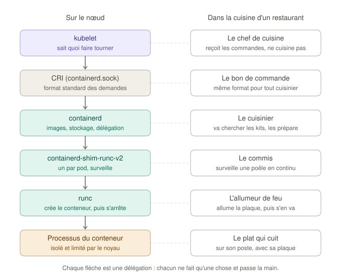

#### Les décisions

- **containerd 2.x depuis le dépôt de Docker**, paquet `containerd.io` seul (containerd et runc, sans Docker Engine). Kubernetes n'accepte plus containerd 1.x depuis la version 1.36, et Debian 12 fournit la 1.6.
- **Kubernetes 1.37**, la version mineure la plus récente, installée depuis `pkgs.k8s.io`, qui publie un dépôt par version mineure. La version est définie une seule fois (`k8s_version`).
- **Une configuration de containerd minimale** : format version 4, et uniquement `SystemdCgroup = true`. Tout le reste prend les valeurs par défaut de la version installée.
- **Des dépôts au format deb822**, chacun avec sa propre clé de signature (`Signed-By`).
- **Des paquets bloqués (`hold`)** : une mise à jour de Kubernetes ou du runtime se fait volontairement, nœud par nœud.
- **kubectl uniquement sur le control plane**, grâce à une variable du groupe `control_plane`.
- **Le kubelet activé, mais pas démarré** : sans configuration, il s'arrêterait aussitôt. `kubeadm init` et `kubeadm join` le démarreront en phase 3.
- **Deux contrôles intégrés aux rôles**, qui font échouer le playbook si le résultat n'est pas le bon : lecture de la configuration effective de containerd (`containerd config dump`) avec une tâche `assert`, et `crictl version`, qui joint containerd par le même chemin que le kubelet.

#### Les problèmes rencontrés

| Problème | Cause | Correction |
|---|---|---|
| Dès la conception : le fichier fourni par `containerd.io` contient `disabled_plugins = ["cri"]` | Le paquet est prévu pour Docker, qui n'utilise pas le CRI. Laissé tel quel, il aurait fait échouer `kubeadm init` en phase 3 | Le fichier est entièrement remplacé |
| Dès la conception : la méthode des tutoriels (`containerd config default`, puis `sed` de `SystemdCgroup = false` en `true`) ne fonctionne plus | En containerd 2.x, la ligne n'apparaît plus dans la configuration par défaut : le `sed` ne modifierait rien, sans erreur | Fichier minimal écrit par Ansible, et contrôle de la configuration effective |
| `WARN ... Configuration migrated from version 3` à la lecture de la configuration | containerd 2.4 a introduit le format version 4 et convertit l'ancien à chaque lecture | Passage en `version = 4` ; l'`assert` échoue si l'avertissement revient |
| `crictl: command not found` | `cri-tools` (et `kubernetes-cni`) ne sont plus des dépendances de kubeadm et du kubelet dans les versions récentes. Je m'étais fié à une information devenue fausse | Les deux paquets sont déclarés explicitement |
| Kubelet `inactive (dead)` et journal vide, alors que j'attendais un redémarrage en boucle | Le paquet active le service sans le démarrer : il n'a jamais été lancé | Aucune : c'est l'état voulu. C'était mon attente qui était fausse ([les états d'un service](doc/runtime-et-paquets.md#9-le-kubelet-avant-kubeadm--activé-mais-à-larrêt)) |

#### Les vérifications et leur interprétation

Sur `k8s-worker-02`, après le playbook :

```
$ containerd --version
containerd containerd v2.4.2 b7a25261e029d68978bbf290df0a62fc819b3c51
$ sudo containerd config dump > /dev/null
$ sudo crictl version
Version:  0.1.0
RuntimeName:  containerd
RuntimeVersion:  v2.4.2
RuntimeApiVersion:  v1
$ stat -fc %T /sys/fs/cgroup
cgroup2fs
$ apt-mark showhold
containerd.io
cri-tools
kubeadm
kubelet
kubernetes-cni
$ kubeadm version -o short
v1.37.2
$ command -v kubectl
$
```

| Résultat | Interprétation |
|---|---|
| `containerd v2.4.2` | containerd 2.x, issu du dépôt Docker |
| `config dump` sans aucune sortie d'erreur | La configuration est au format actuel (plus d'avertissement de migration) |
| `RuntimeName: containerd`, `RuntimeApiVersion: v1` | Le CRI répond, par le même chemin que le kubelet. `Version: 0.1.0` est la version de l'interface CRI, pas celle de crictl |
| `cgroup2fs` | Les nœuds utilisent cgroups v2 |
| Cinq paquets bloqués | Aucun `apt upgrade` ne pourra les mettre à jour |
| `v1.37.2` | La bonne version mineure, au dernier correctif disponible lors de l'installation |
| `command -v kubectl` vide sur un worker | kubectl n'est installé que sur le control plane |

**Idempotence :** `changed=0` sur les trois nœuds au second passage. **Qualité :** `ansible-lint --profile production` passe sans erreur ni avertissement.

**Observation de la chaîne :** avec `ctr`, le client de débogage de containerd, j'ai lancé un conteneur à la main ([exercice du guide](doc/runtime-et-paquets.md#4-exercice--voir-la-chaîne-de-ses-propres-yeux)). Dans l'arbre des processus, le conteneur a pour parent le shim, lui-même rattaché à systemd et non à containerd, et runc n'apparaît pas. Depuis l'intérieur, le même processus porte le numéro 1 : c'est l'isolation par les namespaces.

**crictl ou ctr ?** Les deux parlent à containerd, mais pas dans la même langue : crictl passe par le CRI et voit le nœud comme le kubelet (des pods), ctr parle l'interface propre à containerd et voit ses objets internes, sans connaître les pods. Les deux sont des outils de débogage. Sur un nœud Kubernetes, crictl est l'outil de diagnostic principal ; ctr sert aux cas que le CRI ne couvre pas, comme importer une image depuis un fichier sur un nœud sans accès à Internet ([comparaison détaillée](doc/runtime-et-paquets.md#crictl-et-ctr--deux-outils-qui-ne-font-pas-la-même-chose)).

#### Validation

- containerd 2.x tourne sur les trois nœuds, CRI actif, driver cgroup systemd, et le playbook le vérifie lui-même.
- kubeadm et kubelet 1.37 sont installés et bloqués sur tous les nœuds, kubectl sur le control plane.
- Les nœuds sont prêts à être assemblés en cluster.

**Prochaine étape :** phase 3, création du cluster avec `kubeadm init` sur le control plane et `kubeadm join` sur les workers.

---

### 04/11/2026 — Phase 3 : création du cluster avec kubeadm

#### Les notions

Les notions de cette phase sont détaillées, avec des schémas et des exercices, dans le guide [Créer le cluster : kubeadm init et kubeadm join](doc/cluster-kubeadm.md). L'essentiel :

- **`kubeadm init`** crée le control plane en une série de phases : contrôles préalables, CA et certificats du cluster, kubeconfigs, manifestes du control plane, démarrage du kubelet, puis CoreDNS et kube-proxy.
- Les composants du control plane sont des **static pods** : des fichiers dans `/etc/kubernetes/manifests/`, que le kubelet lance lui-même, sans passer par l'API server, qui n'existe pas encore.
- **`kubeadm join`** fait entrer un worker en deux temps. Il vérifie d'abord qu'il parle au vrai control plane (empreinte de la CA), puis il présente un **jeton d'amorçage**, dont la seule permission est de demander un certificat. Le kubelet obtient alors son propre certificat, signé par la CA du cluster.
- Un **kubeconfig** indique à un client l'adresse de l'API server, la CA à reconnaître et l'identité à présenter.

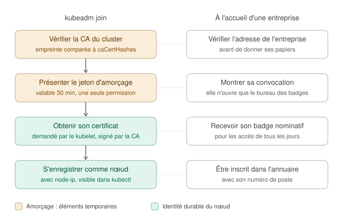

#### Les décisions

- **Un fichier de configuration kubeadm** (`v1beta4`), généré par Ansible, plutôt que des options en ligne de commande. Il reste sur le control plane (`/etc/kubernetes/kubeadm-config.yaml`).
- **Le réseau privé partout** : `advertiseAddress` pour l'API server et `node-ip` pour chaque kubelet. Sans eux, kubeadm et le kubelet prennent `eth0`, l'interface NAT de Vagrant, dont l'adresse DHCP peut changer.
- **Un nom pour l'API server**, `k8s-api` (`controlPlaneEndpoint`), déclaré dans `/etc/hosts`. Il désigne aujourd'hui `k8s-cp-01`, et pourrait désigner demain un load balancer devant plusieurs control planes, sans reconstruire le cluster.
- **Un jeton d'amorçage à la demande** : créé sur le control plane uniquement s'il reste un worker à ajouter, valable 30 minutes, et supprimé du disque après le join, même en cas d'échec.
- **L'administration depuis WSL2** : le kubeconfig administrateur y est copié (droits `0600`), avec l'IP du control plane à la place du nom `k8s-api`, que WSL2 ne connaît pas. `.envrc` le sélectionne avec `KUBECONFIG` dans le dossier du projet.
- **Un contrôle final** (rôle `cluster_verify`) : chaque nœud de l'inventaire doit être enregistré dans le cluster, avec l'adresse de l'inventaire. Testé sur des données simulées, il échoue avec un message clair si un nœud manque ou s'il annonce son adresse NAT.

#### Les problèmes rencontrés

**1. Fichier de configuration refusé par kubeadm.**

```
error: invalid configuration for GroupVersionKind /, Kind=: kind and apiVersion is mandatory information that must be specified
```

kubeadm découpe le fichier à chaque ligne `---`, et l'en-tête de commentaires placé avant le premier `---` était lu comme un document sans type. Le contrôle que j'avais fait avec la bibliothèque YAML de Python ne l'avait pas vu, car elle ignore un document vide. Correction : le fichier commence par `---`. Pour vérifier la correction, j'ai reproduit la règle de découpage de kubeadm dans un script : l'ancien fichier est refusé, le nouveau accepté. L'erreur s'est produite en 0,15 seconde, avant toute écriture : aucun `kubeadm reset` n'était nécessaire.

**2. Nom `k8s-api` introuvable à la création du jeton.**

```
dial tcp: lookup k8s-api on 4.2.2.1:53: no such host
```

En mettant à jour mes fichiers à partir de l'archive de la phase 3, je n'avais pas reporté la ligne ajoutée au rôle `k8s_prereqs`, qui déclare `k8s-api` dans `/etc/hosts`. Le control plane a donc interrogé le DNS public configuré dans la box, qui ne connaît pas ce nom. Diagnostic : `getent hosts k8s-api` sur le control plane et `grep` dans le rôle ne renvoyaient rien.

Ce qui rendait l'erreur déroutante, c'est que `kubeadm init` avait réussi. Dans le code de kubeadm, l'`init` dirige ses propres connexions vers l'adresse locale du control plane, et non vers `controlPlaneEndpoint`, car un load balancer n'est souvent pas encore prêt à ce moment-là. `kubeadm token create`, qui lit `admin.conf`, était donc la première commande à utiliser vraiment le nom.

Corrections : la ligne manquante, et une nouvelle tâche dans `k8s_prereqs` qui vérifie que `k8s-api` se résout vers l'adresse du control plane sur chaque nœud (`getent hosts`). L'erreur serait maintenant détectée dès la phase 1. Aucun `kubeadm reset` n'était nécessaire : le control plane était correct, et le jeton n'avait pas été créé.

#### Les vérifications et leur interprétation

**Idempotence**, au second passage du playbook :

```
k8s-cp-01      : ok=45   changed=0    unreachable=0    failed=0    skipped=4
k8s-worker-01  : ok=36   changed=0    unreachable=0    failed=0    skipped=9
k8s-worker-02  : ok=36   changed=0    unreachable=0    failed=0    skipped=8
```

`k8s-worker-01` a une tâche ignorée de plus que `k8s-worker-02` : la création du jeton est une tâche `run_once`, évaluée pour le seul premier hôte du play. Ignorée (aucun worker à ajouter), elle n'est comptée que pour lui. Sur les workers, les quatre tâches du bloc de join sont aussi ignorées, puisqu'ils sont déjà membres du cluster.

**Les nœuds**, depuis WSL2 :

```
$ kubectl get nodes -o wide
NAME            STATUS     ROLES           AGE   VERSION   INTERNAL-IP     EXTERNAL-IP   OS-IMAGE                         KERNEL-VERSION           CONTAINER-RUNTIME
k8s-cp-01       NotReady   control-plane   16m   v1.37.2   192.168.58.10   <none>        Debian GNU/Linux 12 (bookworm)   6.1.0-17-amd64 (amd64)   containerd://2.4.2
k8s-worker-01   NotReady   <none>          55s   v1.37.2   192.168.58.11   <none>        Debian GNU/Linux 12 (bookworm)   6.1.0-17-amd64 (amd64)   containerd://2.4.2
k8s-worker-02   NotReady   <none>          54s   v1.37.2   192.168.58.12   <none>        Debian GNU/Linux 12 (bookworm)   6.1.0-17-amd64 (amd64)   containerd://2.4.2
```

| Colonne | Valeur | Interprétation |
|---|---|---|
| `STATUS` | `NotReady` | Attendu : pas encore de réseau des pods (CNI), installé en phase 4 |
| `ROLES` | `control-plane` sur `k8s-cp-01` | Le marquage posé par kubeadm, avec la taint qui écarte les applications du control plane |
| `AGE` | 16 minutes contre 55 secondes | Le control plane créé lors du premier lancement, les workers ajoutés au lancement suivant, après correction |
| `VERSION` | `v1.37.2` partout | Kubelets alignés sur la version du control plane |
| `INTERNAL-IP` | `192.168.58.10` à `.12` | Les kubelets annoncent bien le réseau privé (`node-ip`), pas l'adresse NAT |
| `CONTAINER-RUNTIME` | `containerd://2.4.2` | Le runtime de la phase 2, joint par le CRI |

Le fait que kubectl réponde depuis WSL2 valide aussi le kubeconfig copié (adresse, CA, certificat administrateur) et la sélection par direnv.

**Qualité :** `ansible-lint --profile production` passe sans erreur ni avertissement.

#### Validation

- Le cluster existe : un control plane et deux workers, en version 1.37.2, chacun annonçant son adresse du réseau privé.
- Le cluster s'administre depuis WSL2.
- Le playbook est idempotent, et vérifie lui-même la résolution du nom de l'API server et l'enregistrement des nœuds.

**Prochaine étape :** phase 4, réseau des pods avec Calico, pour que les nœuds passent `Ready` et que CoreDNS démarre.

---

### 04/11/2026 (suite) — Phase 4 : réseau des pods avec Calico

#### Les notions

Les notions de cette phase sont détaillées, avec des schémas, dans le guide [Le réseau des pods avec Calico](doc/reseau-des-pods.md). L'essentiel :

- Un **pod** est un groupe d'un ou plusieurs conteneurs qui partagent **la même adresse IP**, tenue par un petit conteneur `pause`. C'est l'unité que Kubernetes place sur les nœuds.
- Kubernetes impose un **modèle réseau** : chaque pod a sa propre IP, et peut joindre tout autre pod, sur n'importe quel nœud, sans traduction d'adresse. Il ne le met pas en œuvre : c'est le rôle du **CNI**.
- **Calico** attribue les adresses (par **blocs** de 64 adresses, réservés à la demande par chaque nœud), relie chaque pod à son nœud par un câble virtuel, indique à chaque nœud où sont les blocs des autres, et peut appliquer des **NetworkPolicies**.
- Calico est installé par un **opérateur** : un programme qui lit un objet `Installation` (un type ajouté par une **CRD**) et crée lui-même tous les composants, dont `calico-node` sur chaque nœud (un **DaemonSet**).

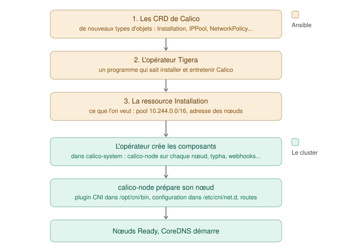

#### Les décisions

- **Calico 3.33.0**, la version actuelle, testée sur Kubernetes 1.35 à 1.37, installé selon sa méthode officielle : CRD au format `projectcalico.org/v3` (recommandé à partir de Kubernetes 1.36), opérateur, puis configuration.
- **Des fichiers en version figée, avec empreinte SHA-256 vérifiée**, téléchargés sur le control plane. J'ai calculé les empreintes sur les fichiers publiés et vérifié qu'ils correspondent au code source de la version.
- **Une configuration adaptée au lab** : pool `10.244.0.0/16` (le `podSubnet` de kubeadm, au lieu du `192.168.0.0/16` du fichier officiel, qui engloberait le réseau des nœuds), adresse des nœuds prise sur `NodeInternalIP` (au lieu de la première interface, `eth0`, celle du NAT), encapsulation `VXLANCrossSubnet` (routage direct entre nœuds du même sous-réseau), data plane iptables. Goldmane et Whisker laissés de côté.
- **Chaque fichier appliqué une seule fois**, si son objet témoin est absent. En lisant le code de l'opérateur, j'ai constaté qu'il réécrit l'objet `Installation` pour y ajouter ses valeurs par défaut : le réappliquer à chaque passage provoquerait un conflit sans fin entre Ansible et l'opérateur.
- **Attendre le résultat, puis le vérifier** : le playbook attend que l'opérateur déclare Calico opérationnel, que les nœuds soient `Ready` et que CoreDNS tourne. Le rôle `cluster_verify` contrôle ensuite l'état `Ready` de chaque nœud et l'adresse que Calico a retenue pour lui (annotation `projectcalico.org/IPv4Address`, repérée dans le code de Calico).
- **Tester avant usage** : chaque champ de la configuration validé contre le schéma officiel de l'objet `Installation` (le validateur repère un champ mal orthographié et une valeur invalide introduits exprès), téléchargements testés avec une bonne et une fausse empreinte, contrôles de `cluster_verify` testés sur quatre cas simulés.

#### Les problèmes rencontrés

**1. L'attente de Calico expire : une réaction en chaîne.**

Au premier lancement, la tâche `Attendre que Calico soit opérationnel` a expiré au bout de 60 tentatives. Les workers étaient `Ready`, le control plane non, et l'opérateur signalait :

```
failed calling webhook "tiered-rbac.api.projectcalico.org": ... context deadline exceeded
```

J'ai remonté la chaîne maillon par maillon (détail complet dans [le guide](doc/reseau-des-pods.md#9-la-panne--une-copie-périmée-de-etchosts)) :

| Maillon | Observation | Commande |
|---|---|---|
| Le pod en échec | `calico-node` du control plane en `Init:CrashLoopBackOff`, conteneur `install-cni` | `kubectl -n calico-system get pod ... -o jsonpath='{...initContainerStatuses...}'` |
| Son erreur | `dial tcp 10.96.0.1:443: connect: connection refused` en créant un jeton | `kubectl logs ... -c install-cni --previous` |
| Pourquoi `10.96.0.1` ne répond pas | Cette adresse de Service n'existe que par les règles de kube-proxy, et celui du control plane ne trouvait pas l'API server : `lookup k8s-api on 4.2.2.1:53: no such host` | `kubectl -n kube-system logs kube-proxy-...` |
| Pourquoi ce nom introuvable | `k8s-api` présent dans `/etc/hosts` du nœud, mais **absent de la copie** propre au pod | `grep` sur `/etc/hosts` et sur `/var/lib/kubelet/pods/<id>/etc-hosts` |

La cause : un pod qui utilise le réseau du nœud reçoit une **copie** de `/etc/hosts`, faite par le kubelet à sa création (vérifié dans le code de Kubernetes). Le kube-proxy du control plane avait été créé par `kubeadm init`, avant la correction de `/etc/hosts` de la phase 3 : sa copie était périmée. Ceux des workers, créés après, fonctionnaient.

La conséquence : sans `calico-node`, le control plane n'avait aucune route vers les pods. L'API server, qui y tourne, ne pouvait donc pas joindre les webhooks de validation de Calico, hébergés sur un worker, et l'opérateur, dont les écritures passent par ces webhooks, restait bloqué.

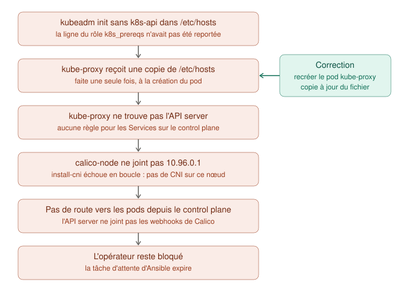

La correction : recréer le pod kube-proxy du control plane (`kubectl -n kube-system delete pod ...`), que son DaemonSet relance aussitôt avec une copie à jour, puis le pod `calico-node` en échec, pour ne pas attendre son prochain essai. En quelques secondes, `calico-node` a démarré sur le control plane, l'opérateur s'est débloqué et les trois nœuds sont passés `Ready`.

La leçon : **corriger un fichier de configuration ne suffit pas, il faut aussi relancer les programmes qui l'ont lu ou copié avant la correction.** En corrigeant `/etc/hosts` à la phase 3, j'aurais dû recréer les pods démarrés avant. Pour une reconstruction depuis zéro, le problème ne peut pas se reproduire : `/etc/hosts` est écrit en phase 1, avant `kubeadm init`, et la résolution du nom est vérifiée. Aucune modification du code n'était donc nécessaire.

**2. `nslookup kubernetes.default` répond `NXDOMAIN`.**

Ce n'était pas une panne du DNS : la commande `nslookup` de busybox gère mal la liste de recherche du DNS depuis sa version 1.29, et cherchait `kubernetes.default` tel quel. La réponse venait bien de CoreDNS (`Server: 10.96.0.10`). Avec le nom complet, `kubernetes.default.svc.cluster.local`, la résolution fonctionne.

#### Les vérifications et leur interprétation

**État de Calico et des nœuds**, après correction :

```
$ kubectl get nodes
NAME            STATUS   ROLES           AGE     VERSION
k8s-cp-01       Ready    control-plane   3h17m   v1.37.2
k8s-worker-01   Ready    <none>          3h1m    v1.37.2
k8s-worker-02   Ready    <none>          3h1m    v1.37.2
$ kubectl get tigerastatus
NAME        AVAILABLE   PROGRESSING   DEGRADED   SINCE   MESSAGE
apiserver   True        False         False      4m34s   All objects available
calico      True        False         False      4m39s   All objects available
ippools     True        False         False      59m     All objects available
tiers       True        False         False      59m     All objects available
```

Dans `kube-system`, les deux pods CoreDNS sont `Running`, avec des adresses en `10.244.36.x` : ce sont les premiers vrais pods à avoir reçu une adresse de Calico.

**Les blocs d'adresses** :

```
$ kubectl get blockaffinities.projectcalico.org
NAME                             CIDR               NODE            TYPE
k8s-cp-01-10-244-184-64-26       10.244.184.64/26   k8s-cp-01       host
k8s-worker-01-10-244-36-192-26   10.244.36.192/26   k8s-worker-01   host
k8s-worker-02-10-244-118-64-26   10.244.118.64/26   k8s-worker-02   host
```

Un bloc `/26` par nœud, choisi librement par Calico dans le pool. Celui du control plane n'est apparu qu'après la correction, au premier pod qui en a eu besoin.

**Les routes**, sur `k8s-worker-01` :

```
$ ip route | grep 10.244
blackhole 10.244.36.192/26 proto 80
10.244.36.193 dev calic7761382390 scope link metric 1024
...
10.244.118.64/26 via 192.168.58.12 dev eth1 proto 80 onlink
10.244.184.64/26 via 192.168.58.10 dev eth1 proto 80 onlink
```

| Route | Interprétation |
|---|---|
| `blackhole 10.244.36.192/26` | Le bloc de ce nœud : une adresse non attribuée est jetée au lieu de partir sur le réseau |
| `10.244.36.193 dev cali...` | Un pod de ce nœud, joint par son câble virtuel |
| `... via 192.168.58.12 dev eth1` et `... via 192.168.58.10 dev eth1` | Les blocs des deux autres nœuds, joints **par le réseau privé et sans encapsulation** : le réglage `NodeInternalIP` et l'encapsulation `CrossSubnet` font ce qu'on attend |

**D'un pod à l'autre, d'un worker à l'autre** :

```
$ kubectl get pods -o wide
NAME     READY   STATUS    RESTARTS   AGE   IP              NODE
test-a   1/1     Running   0          17s   10.244.36.199   k8s-worker-01
test-b   1/1     Running   0          9s    10.244.118.66   k8s-worker-02
$ kubectl exec test-a -- ping -c 3 10.244.118.66
64 bytes from 10.244.118.66: seq=0 ttl=62 time=0.481 ms
...
3 packets transmitted, 3 packets received, 0% packet loss
```

Chaque pod a reçu une adresse dans le bloc de son nœud, et le premier joint le second directement par son IP : c'est le modèle réseau de Kubernetes. Le `ttl=62` (64 moins 2) indique que le paquet a été routé par chacun des deux nœuds.

**Idempotence**, au second passage du playbook :

```
k8s-cp-01      : ok=59   changed=0    unreachable=0    failed=0    skipped=7
k8s-worker-01  : ok=36   changed=0    unreachable=0    failed=0    skipped=9
k8s-worker-02  : ok=36   changed=0    unreachable=0    failed=0    skipped=8
```

Sur le control plane, `skipped=7` : les quatre tâches ignorées habituelles, plus les trois étapes d'installation de Calico, déjà faites.

**Qualité :** `ansible-lint --profile production` passe sans erreur ni avertissement.

#### Validation

- Les trois nœuds sont `Ready`, Calico est opérationnel, CoreDNS tourne.
- Les pods de deux nœuds différents se joignent directement, par le réseau privé et sans encapsulation.
- Le playbook est idempotent, et vérifie lui-même l'état des nœuds et l'adresse utilisée par Calico.

**Prochaine étape :** phase 5, exposition des services hors du cluster (MetalLB, puis Gateway API).

---

### 06/11/2026 — Phase 5a : adresses externes avec MetalLB

#### Les notions

Les notions de cette étape sont détaillées dans deux guides : [Déployer une application, pas à pas](doc/deployer-une-application.md), qui reprend à la main chaque objet (namespace, Deployment, Service), et [Exposer les services : MetalLB](doc/exposition-des-services.md). L'essentiel :

- Une application se décrit par trois objets : un **namespace** (une partition du cluster, qui délimite les noms et les règles), un **Deployment** (l'image et le nombre de copies, maintenues par un ReplicaSet) et un **Service** (une adresse stable devant les pods, qu'il retrouve par leur **étiquette**).
- Un Service `LoadBalancer` demande une adresse externe, que Kubernetes ne sait pas fournir hors du cloud. **MetalLB** en attribue une, prise dans un pool d'adresses libres du réseau des nœuds (son `controller`), puis l'annonce depuis un nœud (son `speaker`, un par nœud).
- En **mode L2**, le speaker du nœud élu répond aux requêtes **ARP** (« qui a cette adresse ? ») avec l'adresse MAC de son nœud. Le trafic arrive donc sur ce nœud, où kube-proxy l'envoie à l'un des pods, sur ce nœud ou sur un autre.

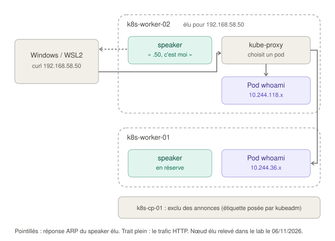

#### Les décisions

- **MetalLB 0.16.2**, version « native » (sans les composants du mode BGP), en version figée avec empreinte SHA-256 vérifiée, installé par un rôle Ansible après Calico : son contrôleur est un pod ordinaire, qui a besoin du réseau des pods.
- **Un pool de dix adresses**, `192.168.58.50` à `.59`, déclaré avec le reste du plan d'adressage, hors des adresses de Windows (`.1`), des nœuds (`.10` à `.12`) et de la plage DHCP de VMware.
- **Des annonces limitées** à `eth1`, l'interface du réseau privé. Le control plane n'annonce rien : kubeadm lui pose l'étiquette `node.kubernetes.io/exclude-from-external-load-balancers`, que MetalLB respecte.
- **Deux façons d'appliquer** : le manifeste de MetalLB une seule fois (son contrôleur y inscrit lui-même le certificat de ses webhooks, comme l'opérateur de Calico réécrit sa configuration), et la configuration (pool et annonce) de façon déclarative : `kubectl diff --server-side` à chaque passage, puis `apply` seulement si le code de retour signale une différence. Le playbook réessaie tant que le webhook de validation, encore en démarrage, ne répond pas.
- **Une application de démonstration hors d'Ansible** : les manifestes de `apps/whoami/` sont appliqués par kubectl, et le seront par Argo CD en phase 6. Ansible construit le socle ; les applications ont leur propre cycle de vie.
- **Les bonnes pratiques dès la première application** : namespace au niveau Pod Security `restricted`, exécution sans root et système de fichiers en lecture seule, sondes `readiness` et `liveness`, ressources réservées et plafonnées, copies réparties sur les deux workers, adresse externe fixe (`192.168.58.50`) demandée par annotation. Les manifestes ont été validés contre les schémas de Kubernetes (kubeconform) avant d'être appliqués.
- **Des fichiers numérotés** (`01-namespace.yaml`, `02-deployment.yaml`, `03-service.yaml`) : `kubectl apply -f <dossier>` traite les fichiers par ordre alphabétique, et le namespace doit exister avant les objets qu'il contient.

#### Les vérifications et leur interprétation

**Le Service a reçu son adresse externe :**

```
$ kubectl -n demo get service whoami
NAME     TYPE           CLUSTER-IP      EXTERNAL-IP     PORT(S)
whoami   LoadBalancer   10.107.70.103   192.168.58.50   80:30756/TCP
```

`EXTERNAL-IP` n'est plus `<pending>`. Le Service a aussi une ClusterIP et un NodePort (`30756`) : chaque type de Service s'appuie sur le précédent.

**Le trafic est réparti entre les pods :**

```
$ for i in $(seq 1 6); do curl -s http://192.168.58.50 | grep Hostname; done
Hostname: whoami-dd4d65c86-szpd2
Hostname: whoami-dd4d65c86-wklsx
...
```

Les deux pods répondent tour à tour, y compris celui de `k8s-worker-01`, alors que tout le trafic entre par un seul nœud : kube-proxy en fait suivre une partie vers l'autre worker, par les routes de Calico.

**Les composants de MetalLB :** un `controller` (sur `k8s-worker-02`) et un `speaker` sur chacun des trois nœuds. Celui du control plane tourne, mais n'est jamais élu.

**Le nœud élu**, dans les événements du Service :

```
announcing from node "k8s-worker-02" with protocol "layer2"
```

**La preuve côté Windows**, avec `arp -a` :

```
  192.168.58.12         00-0c-29-43-35-75     dynamique
  192.168.58.50         00-0c-29-43-35-75     dynamique
```

L'adresse `.50` a la même adresse MAC que `.12`, celle de `k8s-worker-02` : Windows envoie le trafic de `.50` à ce nœud, exactement comme annoncé par son speaker. C'est le mécanisme du mode L2, observé de bout en bout.

**Idempotence**, au second passage du playbook : `changed=0` sur les trois nœuds. Sur le control plane, `skipped=9` : les sept tâches ignorées de la phase 4, plus l'installation de MetalLB (déjà faite) et l'application de sa configuration (`kubectl diff` n'a trouvé aucune différence).

**Qualité :** `ansible-lint --profile production` passe sans erreur ni avertissement.

#### Validation

- Un Service `LoadBalancer` reçoit une adresse du pool, annoncée par un worker sur le réseau privé.
- L'application répond depuis Windows et WSL2 à `http://192.168.58.50`, et le trafic est réparti entre ses deux pods, sur deux nœuds.
- La configuration de MetalLB est déclarative, et le playbook reste idempotent.

**Prochaine étape :** étape 5b, un point d'entrée HTTP unique avec la Gateway API, derrière une seule adresse de MetalLB.

---

### 09/11/2026 — Phase 5b : point d'entrée HTTP avec la Gateway API

#### Les notions

Les notions de cette étape sont détaillées, avec des schémas, dans le guide [Le point d'entrée HTTP : Gateway API et Envoy Gateway](doc/gateway-api.md). L'essentiel :

- Avec MetalLB seul, chaque application exposée prend sa propre adresse. Un **reverse proxy** partagé reçoit toutes les requêtes HTTP sur **une seule adresse**, lit le nom demandé (l'en-tête `Host`) et transmet chaque requête à la bonne application. La **Gateway API** décrit ce point d'entrée ; elle succède à Ingress, dont le contrôleur le plus utilisé, Ingress NGINX, n'est plus maintenu.
- Trois objets, trois propriétaires : la **GatewayClass** (le logiciel qui met en œuvre l'entrée) et la **Gateway** (l'entrée : port, protocole, noms acceptés, namespaces autorisés) appartiennent à l'infrastructure ; l'**HTTPRoute** (« tel nom vers tel Service ») appartient à l'application.
- **Envoy Gateway** met en œuvre la Gateway API : un **contrôleur** (le plan de contrôle) lit les objets et configure des **proxys Envoy** (le plan de données), qui transportent le trafic. Pour chaque Gateway, il crée un Deployment de proxys et un Service `LoadBalancer`, qui reçoit son adresse de MetalLB.

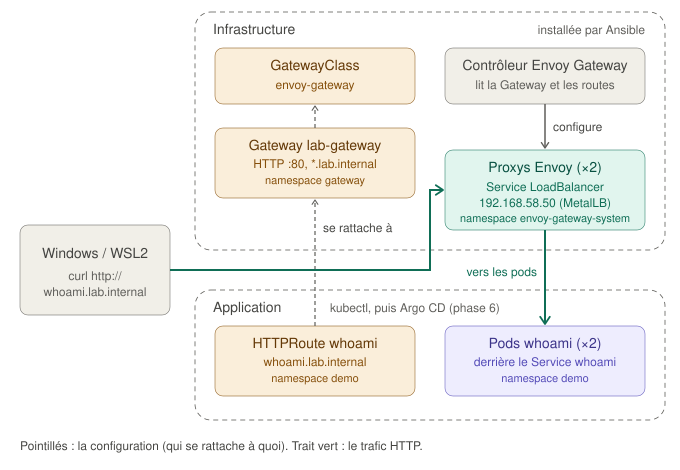

#### Les décisions

- **Envoy Gateway v1.10.0**, la seule version testée sur Kubernetes 1.37, avec la Gateway API v1.6.1. J'ai vérifié dans son code source les comportements dont dépend la configuration du lab : politique de trafic par défaut, contextes de sécurité des proxys, étiquettes et noms des ressources créées.
- **Les CRD du canal standard**, sans les fonctionnalités expérimentales. Le manifeste officiel d'Envoy Gateway contient les CRD expérimentales : j'applique les CRD standard depuis le projet Gateway API, les CRD propres à Envoy Gateway, puis **seulement le contrôleur** du manifeste, avec `kubectl apply --selector app.kubernetes.io/instance=eg`. Le fichier officiel n'est pas modifié, et son empreinte SHA-256 reste vérifiée.
- **Trois étages, trois méthodes** : les CRD et les namespaces sont comparés au cluster à chaque passage (une montée de version suffit à les mettre à jour) ; le contrôleur est appliqué une seule fois (son manifeste contient un Job, qui ne peut pas être modifié) ; la configuration (GatewayClass, EnvoyProxy, Gateway) est comparée et appliquée à chaque passage.
- **Une Gateway partagée**, gérée par Ansible, à l'adresse `192.168.58.50`, qui accepte les noms `*.lab.internal` (domaine réservé par l'ICANN aux réseaux privés) venant des seuls namespaces étiquetés `lab.internal/gateway-access: "true"`.
- **Deux proxys Envoy**, un par worker. Envoy Gateway règle son Service en `externalTrafficPolicy: Local`, qui conserve l'adresse du client ; mais MetalLB n'annonce alors l'adresse que depuis un nœud qui héberge un proxy prêt. Avec un proxy sur chaque worker, l'adresse survit à la perte d'un nœud.
- **Le niveau Pod Security `restricted`** sur les deux namespaces de la Gateway, après vérification dans le code que les pods d'Envoy Gateway le respectent. Mémoire réservée par proxy réduite à 128 Mio (512 Mio par défaut).
- **whoami derrière la Gateway** : son Service redevient un `ClusterIP`, et une HTTPRoute (`apps/whoami/04-httproute.yaml`) le publie sous `whoami.lab.internal`.
- **Un rôle qui vérifie son résultat** : GatewayClass `Accepted`, Gateway `Programmed` (proxys prêts et adresse attribuée), adresse conforme à la variable, puis une requête HTTP depuis WSL2, qui doit recevoir le `404` d'Envoy pour un nom sans route. En cas d'échec, le rôle affiche le message du contrôleur et la cause la plus probable.

#### Les problèmes rencontrés

**1. Tester le rôle avant le premier lancement.**

Pour ne pas découvrir les erreurs sur le lab, j'ai lancé un API server Kubernetes 1.37 réel, avec etcd (les binaires d'envtest, publiés par le projet Kubernetes pour tester les contrôleurs), et j'y ai fait tourner le rôle. Un petit script jouait le rôle du contrôleur d'Envoy Gateway, en écrivant les états qu'il publierait (`Accepted`, `Programmed`, adresse).

Le test a révélé un défaut : au premier passage, `kubectl diff` échouait (code de retour 2) sur la configuration, avec `namespaces "gateway" not found`. `kubectl diff` **simule** la création des objets, et cette simulation échoue pour un objet placé dans un namespace qui n'existe pas encore, même s'il est créé par le même fichier. Le rôle aurait réessayé six fois, puis échoué. La correction : créer les deux namespaces dès le premier étage, avec les CRD. MetalLB n'avait pas ce problème, parce que son namespace est créé par son manifeste d'installation.

Le même banc d'essai a confirmé le reste avant le lancement réel : idempotence (`changed=5`, puis `changed=0`), empreintes vérifiées sur les vrais téléchargements, refus du manifeste complet par la règle `safe-upgrades` (« Installing experimental CRDs on top of standard channel CRDs is prohibited »), admission des pods du contrôleur et d'un proxy au niveau `restricted`, migration du Service de whoami, et message d'erreur du rôle quand la Gateway n'obtient pas d'adresse.

Autre leçon, en préparant le rôle : une empreinte SHA-256 recopiée à la main était fausse. `get_url` l'aurait refusée au premier téléchargement. Les empreintes sont désormais calculées sur les fichiers téléchargés et insérées par script, jamais recopiées.

**2. L'adresse `192.168.58.50` était encore prise.**

La Gateway reprend l'adresse de whoami, qui la détenait depuis l'étape 5a. Si le playbook passait le premier, MetalLB ne pouvait pas attribuer l'adresse à la Gateway, et celle-ci restait `Programmed: False` (`AddressNotAssigned`). L'ordre de migration a donc été :

1. `kubectl apply -f apps/whoami/03-service.yaml` : whoami passe en `ClusterIP`, MetalLB libère l'adresse (le test avait vérifié que le changement de type retire aussi le NodePort, l'annotation et la politique de trafic) ;
2. `ansible-playbook site.yml` : la Gateway obtient l'adresse ;
3. `kubectl apply -f apps/whoami/` : l'étiquette d'accès et la route.

Pour une reconstruction depuis zéro, la question ne se pose pas : whoami est déjà en `ClusterIP`.

#### Les vérifications et leur interprétation

**Les trois objets sont en service :**

```
$ kubectl get gatewayclass
NAME            CONTROLLER                                      ACCEPTED   AGE
envoy-gateway   gateway.envoyproxy.io/gatewayclass-controller   True       93s
$ kubectl -n gateway get gateway
NAME          CLASS           ADDRESS         PROGRAMMED   AGE
lab-gateway   envoy-gateway   192.168.58.50   True         106s
$ kubectl -n demo describe httproute whoami | sed -n '/^Status:/,$p'
      Message:               Route is accepted
      Type:                  Accepted
      Message:               Resolved all the Object references for the Route
      Type:                  ResolvedRefs
```

| Objet | Interprétation |
|---|---|
| GatewayClass `ACCEPTED True` | Le contrôleur d'Envoy Gateway a reconnu la classe comme la sienne |
| Gateway `PROGRAMMED True`, `ADDRESS 192.168.58.50` | Les proxys tournent, et MetalLB a donné l'adresse prévue à leur Service |
| HTTPRoute `Accepted`, `ResolvedRefs` | La Gateway accepte la route (namespace autorisé, nom compatible avec `*.lab.internal`), et le Service visé existe |

**Les proxys, un par worker :**

```
$ kubectl -n envoy-gateway-system get pods -o wide
NAME                                                  READY   STATUS    IP              NODE
envoy-gateway-7b99796d48-wf5sb                        1/1     Running   10.244.118.97   k8s-worker-02
envoy-gateway-lab-gateway-00ec3056-7d979f8b65-8t9vw   2/2     Running   10.244.118.98   k8s-worker-02
envoy-gateway-lab-gateway-00ec3056-7d979f8b65-r8dg8   2/2     Running   10.244.36.234   k8s-worker-01
```

Le contrôleur, et deux proxys (`2/2` : Envoy et le conteneur qui gère leur arrêt), répartis sur les deux workers. Le suffixe `00ec3056` est le début de l'empreinte SHA-256 de `gateway/lab-gateway` : Envoy Gateway nomme les ressources d'une Gateway d'après son namespace et son nom.

**Une requête complète :**

```
$ curl -s --resolve whoami.lab.internal:80:192.168.58.50 http://whoami.lab.internal
Hostname: whoami-dd4d65c86-8kzb5
IP: 10.244.118.92
RemoteAddr: 10.244.118.98:38388
Host: whoami.lab.internal
X-Envoy-External-Address: 192.168.58.1
X-Forwarded-For: 192.168.58.1
X-Forwarded-Proto: http
X-Request-Id: 11312655-f98b-4a6d-8c86-9743765c5b15
```

| Ligne | Interprétation |
|---|---|
| `RemoteAddr: 10.244.118.98` | La connexion vers whoami vient du proxy Envoy de `k8s-worker-02` : c'est par ce nœud que le trafic est entré |
| `Host: whoami.lab.internal` | Le nom qu'Envoy a lu pour choisir la route |
| `X-Forwarded-For: 192.168.58.1` | L'adresse réelle du client (Windows), conservée grâce à la politique `Local` et transmise par Envoy. À l'étape 5a, elle était perdue |
| `X-Request-Id` | Un identifiant unique créé par Envoy, qui permet de suivre la requête dans les journaux |

Dans le navigateur, après l'ajout de `192.168.58.50 whoami.lab.internal` au fichier hosts de Windows, la page s'affiche à `http://whoami.lab.internal`. La requête est entrée par le même proxy de `k8s-worker-02`, mais a été servie par un pod de `k8s-worker-01` : Envoy choisit le pod sur tout le cluster. Le navigateur signale « Non sécurisé » : il n'y a pas encore de HTTPS.

La boucle de six requêtes répartit les réponses entre les pods, sans alternance stricte : Envoy Gateway configure Envoy en *least request* (vérifié dans le code), qui tire deux pods au hasard et retient le moins occupé.

**Un nom sans route :**

```
$ curl -s -o /dev/null -w '%{http_code}\n' -H 'Host: inconnu.lab.internal' http://192.168.58.50
404
```

Le `404` vient d'Envoy : le nom entre dans `*.lab.internal`, mais aucune route ne le déclare.

**Idempotence**, au second passage du playbook :

```
k8s-cp-01      : ok=81   changed=0    unreachable=0    failed=0    skipped=12
k8s-worker-01  : ok=36   changed=0    unreachable=0    failed=0    skipped=9
k8s-worker-02  : ok=36   changed=0    unreachable=0    failed=0    skipped=8
```

Sur le control plane, `skipped=12` : les neuf tâches ignorées de l'étape 5a, plus les trois applications d'Envoy Gateway (aucune différence sur les CRD ni sur la configuration, contrôleur déjà installé).

**Qualité :** `ansible-lint --profile production` passe sans erreur ni avertissement.

#### Validation

- Toutes les applications HTTP passent par une seule adresse, `192.168.58.50`, et sont triées par leur nom.
- L'adresse du client est conservée jusqu'à l'application.
- Le point d'entrée a un proxy sur chaque worker, et MetalLB peut basculer de l'un à l'autre.
- Le rôle est idempotent, vérifie son résultat de bout en bout, et a été testé sur un API server avant son premier lancement.

**Prochaine étape :** phase 6, le GitOps avec Argo CD, qui surveillera le dossier `apps/` du dépôt et sera lui-même publié derrière la Gateway.

---

### 09/11/2026 (suite) — Phase 6 : GitOps avec Argo CD

#### Les notions

Les notions de cette phase sont détaillées, avec un schéma, dans le guide [Le GitOps avec Argo CD](doc/gitops-argocd.md). L'essentiel :

- Jusqu'ici, une application se déployait par `kubectl apply` : un modèle **poussé et ponctuel**, où personne ne vérifie ensuite que le cluster reste conforme. Avec le **GitOps**, l'état voulu est versionné dans Git, et un agent qui tourne **dans** le cluster le **tire** et le **réconcilie en continu**. Le dépôt fait foi.
- **Argo CD** est cet agent. Ses composants principaux : l'`applicationset-controller` (crée les applications), le `repo-server` (lit le dépôt), l'`application-controller` (compare et synchronise) et l'`argocd-server` (l'interface).
- Ses trois objets : l'**Application** (« ce dossier de ce dépôt, appliqué à ce cluster »), l'**ApplicationSet** (un modèle d'Application, rempli par un générateur) et l'**AppProject** (les règles d'un groupe d'applications).
- Une application a deux états indépendants : sa **synchronisation** (`Synced` ou `OutOfSync` : le cluster est-il conforme au dépôt ?) et sa **santé** (`Healthy`, `Progressing`, `Degraded`, `Missing` : ce qui tourne fonctionne-t-il ?).

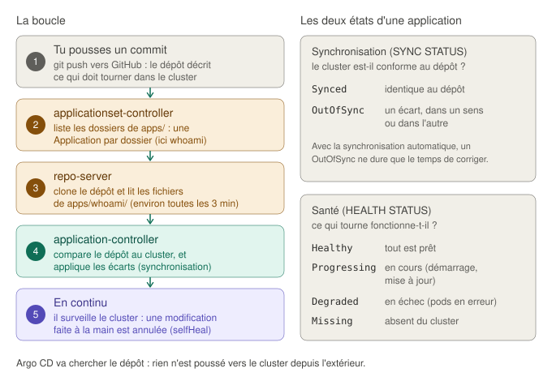

#### Les décisions

- **Argo CD v3.6.1**, la version testée sur Kubernetes 1.37, avec le manifeste officiel « non haute disponibilité » (une copie de chaque composant). Empreinte SHA-256 vérifiée, calculée par script.
- **Une installation entièrement déclarative**, contrairement à Calico, MetalLB et Envoy Gateway. Aucun objet du manifeste n'est réécrit par un contrôleur, et la procédure officielle de mise à jour est justement de réappliquer le manifeste : une montée de version suffit.
- **Deux gestionnaires de champs.** Nos réglages se trouvent dans des ConfigMaps qui existent aussi dans le manifeste officiel. Appliqués côté serveur sous un nom distinct (`lab-k8s-gitops`), ils ne peuvent pas être effacés par une réapplication du manifeste : l'API server note, champ par champ, qui l'a écrit.
- **L'interface par la Gateway**, sous `argocd.lab.internal`, avec `argocd-server` en HTTP simple (`server.insecure`), la méthode décrite par Argo CD pour un point d'entrée Gateway API. Ce réglage est posé avant le premier démarrage du serveur ; s'il change, le rôle le redémarre.
- **Un ApplicationSet à générateur Git** : une application par sous-dossier de `apps/`. Ajouter une application, c'est ajouter un dossier et pousser.
- **Des garde-fous**, dans le projet `lab` : une seule source (ce dépôt), les namespaces du socle interdits (`kube-*`, `calico-*`, MetalLB, la Gateway, Argo CD), et un seul type d'objet sans namespace permis, `Namespace`.
- **Une synchronisation automatique** avec `prune` (un objet retiré du dépôt est retiré du cluster), `selfHeal` (une modification faite à la main est annulée) et des nouvelles tentatives. **Pas de suppression en cascade** : un dossier retiré par erreur supprime l'Application, mais pas une application en service.
- **Un dépôt public**, lu sans identifiants : poussé sur GitHub avant le lancement, après vérification que `.gitignore` exclut l'état de Vagrant, les clés et les kubeconfig.
- **Le niveau Pod Security `restricted`** sur le namespace `argocd`, après vérification de l'admission des sept composants. Le manifeste apporte aussi les **sept premières NetworkPolicies** du cluster, que Calico applique.

#### Les problèmes rencontrés

**1. Tester avant le premier lancement.**

Comme pour la Gateway, j'ai fait tourner le rôle sur un API server Kubernetes 1.37 réel, avec un script qui jouait les contrôleurs d'Argo CD. Le test a vérifié :

- l'idempotence (`changed=6`, puis `changed=0`) ;
- l'admission des sept composants au niveau `restricted` ;
- la cohabitation des deux gestionnaires de champs : `argocd-cm` contient les clés du manifeste et la nôtre ;
- l'absence de différence après les écritures d'Argo CD lui-même (ses secrets, un redémarrage de composant) ;
- le redémarrage d'`argocd-server` après un changement de réglage, et la disparition d'un réglage retiré du modèle ;
- le rendu du modèle de l'ApplicationSet : Ansible et Argo CD utilisent la même syntaxe `{{ }}`, et le modèle Ansible protège celle d'Argo CD par `` ;
- le message d'erreur du rôle quand le dépôt est illisible.

**2. L'application créée trois minutes après l'ApplicationSet.**

Le premier passage du playbook s'est arrêté sur le message du rôle « Argo CD n'arrive pas à lire le dépôt », alors que le dépôt était public et poussé sur la bonne branche. Relancé quelques secondes plus tard, il est passé sans erreur.

Dans l'interface, l'ApplicationSet `apps` a été créé à 14:27:13, et l'application `whoami` à 14:30:19 : la première lecture du dépôt par le générateur avait échoué, et la suivante avait réussi. En lisant le code d'Argo CD, j'ai trouvé l'explication du délai : quand la génération échoue, l'ApplicationSet réessaie **trois minutes plus tard** (constante `ReconcileRequeueOnValidationError`). L'attente du rôle, lancée juste après la création de l'ApplicationSet, s'est terminée au bout de 180 secondes, quatre secondes avant ce second essai : le second passage du playbook a trouvé l'application déjà créée.

Le rôle attendait 180 secondes : trop juste pour encaisser un essai manqué. Il attend désormais 240 secondes, et sur l'état `ResourcesUpToDate`, qu'Argo CD ne publie qu'**après** la création des applications. L'attente précédente portait sur `ParametersGenerated`, publié dès la lecture du dépôt. Le nouveau rôle a été testé sur l'API server, avec un premier essai simulé sans résultat.

#### Les vérifications et leur interprétation

**Les composants et l'application :**

```
$ kubectl -n argocd get pods -o wide
NAME                                                READY   STATUS    NODE
argocd-application-controller-0                     1/1     Running   k8s-worker-01
argocd-applicationset-controller-794bb95c9d-d67xr   1/1     Running   k8s-worker-01
argocd-dex-server-66cf64bfcf-pgvsp                  1/1     Running   k8s-worker-02
argocd-notifications-controller-5878c8d644-rstq9    1/1     Running   k8s-worker-02
argocd-redis-5869b7547-vms5h                        1/1     Running   k8s-worker-02
argocd-repo-server-7d55cc466b-75cmj                 1/1     Running   k8s-worker-01
argocd-server-85b849c688-fnjqg                      1/1     Running   k8s-worker-02
$ kubectl -n argocd get applications
NAME     SYNC STATUS   HEALTH STATUS
whoami   Synced        Healthy
```

Les sept composants tournent, répartis sur les deux workers. L'application `whoami`, créée par l'ApplicationSet, est conforme au dépôt (`Synced`) et fonctionne (`Healthy`).

**Argo CD applique exactement le dernier commit :**

```
$ kubectl -n argocd get application whoami -o jsonpath='{.status.sync.revision}{"\n"}'; git rev-parse HEAD
45a26cfe55fb73083c44d82458ef5a0c58f22703
45a26cfe55fb73083c44d82458ef5a0c58f22703
```

**Les objets existants ont été adoptés :**

```
$ kubectl -n demo get deployment whoami -o jsonpath='{.metadata.annotations.argocd\.argoproj\.io/tracking-id}{"\n"}'
whoami:apps/Deployment:demo/whoami
```

L'annotation de suivi (`<application>:<groupe>/<type>:<namespace>/<nom>`) montre qu'Argo CD considère le Deployment comme le sien. Les objets créés à la main aux phases 5a et 5b n'ont pas été recréés : dans l'interface, le namespace, le Service et le Deployment ont « 3 days », et les pods n'ont pas redémarré.

**La route et les politiques réseau :** `curl --resolve argocd.lab.internal:80:192.168.58.50 http://argocd.lab.internal/healthz` répond `200`, et `kubectl -n argocd get networkpolicies` liste les sept politiques du manifeste.

**L'interface**, à `http://argocd.lab.internal` après l'ajout du nom au fichier hosts de Windows :

- l'ApplicationSet `apps` est `Healthy`, avec une application ;
- l'application `whoami` (projet `lab`, chemin `apps/whoami`, branche `main`) est `Healthy` et `Synced`, avec la synchronisation automatique active ;
- l'arbre de l'application montre ses quatre objets, le ReplicaSet et les deux pods.

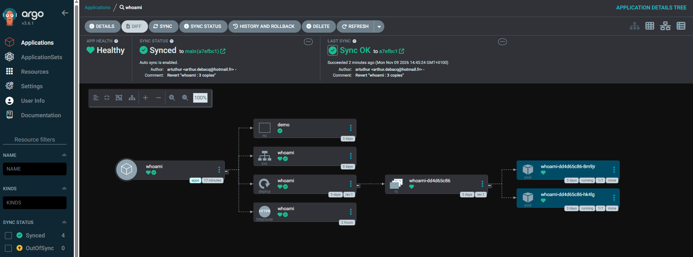

**L'autocorrection et la modification par Git**, lues dans les événements du Deployment :

| Heure | Événement | Ce qui s'est passé |
|---|---|---|
| 14:40 | 2 vers 10, puis 10 vers 2 | `kubectl scale --replicas=10` à la main : Argo CD rétablit les 2 copies du dépôt dans la même minute (`selfHeal`) |
| 14:40 | 2 vers 3, puis 3 vers 2 | Le même essai avec 3 copies |
| 14:44 | 2 vers 3 | Le commit « whoami : 3 copies », poussé sur GitHub et appliqué par Argo CD |
| 14:45 | 3 vers 2 | Le commit « Revert "whoami : 3 copies" » : retour en arrière **par Git**. L'interface affiche `Synced to main (a7efbc1)` et `Sync OK` avec le message de ce commit |

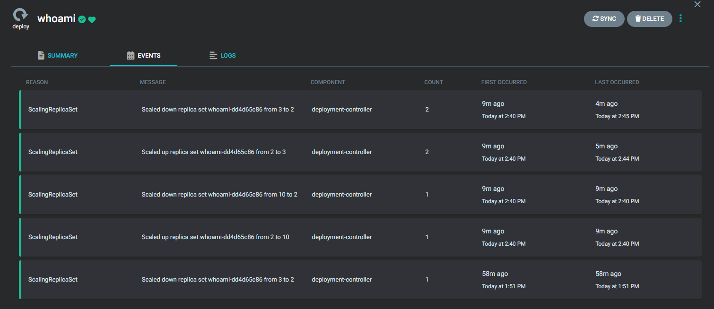

Ces événements viennent du `deployment-controller` de Kubernetes, et non d'Argo CD. Argo CD change le nombre de copies voulu, puis Kubernetes ajuste le ReplicaSet et les pods : ce sont deux boucles de réconciliation, l'une dans l'autre.

**Idempotence**, au second passage du playbook :

```
k8s-cp-01      : ok=96   changed=0    unreachable=0    failed=0    skipped=17
k8s-worker-01  : ok=36   changed=0    unreachable=0    failed=0    skipped=9
k8s-worker-02  : ok=36   changed=0    unreachable=0    failed=0    skipped=8
```

Sur le control plane, `skipped=17` : les douze tâches ignorées de l'étape 5b, plus les cinq du rôle `argocd` qui n'avaient rien à faire. Les quatre applications n'ont trouvé aucune différence, et `argocd-server` n'avait pas à être redémarré.

**Qualité :** `ansible-lint --profile production` passe sans erreur ni avertissement.

#### Validation

- Argo CD applique au cluster le contenu du dossier `apps/` du dépôt, exactement au dernier commit.
- Une modification faite à la main dans le cluster est annulée en moins d'une minute.
- Une modification et son retour en arrière passent par Git, avec leur historique.
- Les objets existants ont été adoptés sans interruption de service.
- Le rôle est idempotent, et vérifie lui-même l'interface, la lecture du dépôt et la création des applications.

**Prochaine étape :** phase 7, le test de reproductibilité (destruction et reconstruction complètes, chronométrées) et la documentation finale.

---

### 10/11/2026 — Phase 7 : test de reproductibilité

#### L'objectif

Tout le projet repose sur une promesse : **le dépôt suffit à reconstruire le lab**. Si un réglage n'existait que sur mon poste, ou dans le cluster en place, ce ne serait pas de l'infrastructure décrite par du code. Pour le prouver, je détruis les VMs, je reconstruis avec les seules commandes du README, je chronomètre, et je note chaque intervention manuelle. C'est aussi le vrai test du GitOps : l'application doit revenir **seule**, depuis le dépôt, sans aucun `kubectl apply`.

#### La préparation : un audit du dépôt

Avant de détruire quoi que ce soit, j'ai cloné le dépôt depuis GitHub et je l'ai comparé à ma copie de travail, comme s'il devait servir seul à tout reconstruire. Il était complet, mais quatre défauts sont apparus :

| Défaut | Conséquence | Correction |
|---|---|---|
| `no_log: false` sur la création du jeton de `kubeadm join` (passé à `false` en phase 3 pour lire un message d'erreur) | À chaque reconstruction, le jeton s'afficherait dans la console : pendant 30 minutes, il permet à n'importe quelle machine de rejoindre le cluster | `no_log: "{{ kubeadm_join_no_log }}"`, à `true` par défaut ; `-e kubeadm_join_no_log=false` pour un diagnostic ponctuel, sans modifier le code |
| Deux fichiers sans retour à la ligne final | `ansible-lint --profile production` échouait, contrairement à ce qu'affirmait ce README | Retours ajoutés, et un fichier `.editorconfig` pour que les éditeurs les ajoutent d'eux-mêmes |
| `sync-vagrant-keys.sh` enregistré sans droit d'exécution | Sur un vrai Linux, la première commande du README échouait (« Permission denied ») ; seul le disque Windows monté dans WSL2, qui présente tout comme exécutable, le masquait | Mode `100755` enregistré dans Git (`git add --chmod=+x`) |
| Deux commentaires inexacts | Un Service `ClusterIP` présenté comme ayant un NodePort, et une attente d'Argo CD décrite avec l'ancienne condition | Corrigés |

Deux risques ont été vérifiés et écartés. **Les empreintes SSH** changent avec les nouvelles VMs, mais l'inventaire ne les mémorise pas (`UserKnownHostsFile=/dev/null`). **Docker Hub** limite les téléchargements anonymes à 100 par 6 heures, et une reconstruction n'en consomme qu'environ 6 (whoami et Envoy) : le reste vient de quay.io, ghcr.io, ECR et registry.k8s.io.

J'ai aussi écrit **`scripts/verifier-lab.sh`**, qui vérifie tout le lab en une commande, couche par couche, jusqu'à la réponse HTTP de chaque route publiée, et qui contrôle que les applications tournent sur le **dernier commit** de GitHub. Je l'ai testé sur un API server, sur un lab sain, une application `OutOfSync`, un composant à 0 copie prête, des routes muettes et une panne réparée pendant l'attente. Le test a révélé un défaut du script lui-même : un champ vide (0 copie prête n'est pas écrit par Kubernetes) décalait les colonnes, d'où un « (1/) » au lieu de « (0/1) ». Il est corrigé, et le script passe `shellcheck`.

#### La mesure de référence, et une dégradation invisible

Lancé avant la destruction, sur le lab redémarré à froid (`vagrant halt` la veille, `vagrant up` le jour même), le script a signalé un échec :

```
  ÉCHEC  Envoy Gateway (envoy-gateway-system) : pas prêts : Deployment/envoy-gateway-lab-gateway-00ec3056 (1/2)
  OK     Gateway lab-gateway : Programmed, 192.168.58.50
  OK     Route http://argocd.lab.internal : HTTP 200
  OK     Route http://whoami.lab.internal : HTTP 200
```

L'un des deux proxys Envoy est resté indisponible pendant plus de dix minutes, puis il est revenu seul : le second lancement, à 15:50, était entièrement vert. **Côté utilisateur, rien ne se voyait** : la Gateway restait `Programmed`, et les routes répondaient par l'autre proxy. C'est exactement ce que le script doit repérer. La cause n'a pas pu être établie, le cluster ayant été détruit juste après.

#### La reconstruction

| Étape | Horaires | Durée |
|---|---|---|
| `vagrant destroy -f` | 15:52:50 → 15:53:39 | 49 s |
| `vagrant up` | 15:58:32 → 16:02:05 | 3 min 33 s |
| Clés, puis playbook | 16:02:36 → 16:13:18 | 10 min 42 s, dont 9 min 24 s pour le passage complet |
| `verifier-lab.sh` | 16:13:59 → 16:14:01 | 2 s : tout était déjà prêt |

**15 min 29 s** entre le lancement de `vagrant up` et « Tout est opérationnel », sans compter une pause de 5 minutes entre la destruction et la création.

La reconstruction a été faite dans le dossier de travail, et non dans un clone neuf. `git status --short --ignored` n'y montrait que `.vagrant/`, l'état de Vagrant, recréé par `vagrant up`, et le dernier commit était poussé : le dossier était donc équivalent à un clone du dépôt.

**Où passe le temps**, d'après `ansible.posix.profile_tasks` :

| Tâche | Durée | Part du playbook |
|---|---|---|
| Attendre que Calico soit opérationnel | 4 min 21 s | 46 % |
| Attendre que les composants d'Argo CD soient prêts | 1 min 18 s | 14 % |
| Créer le cluster (`kubeadm init`) | 35 s | 6 % |
| Installer les paquets Kubernetes | 27 s | 5 % |

Les trois premières attendent surtout la même chose : le **téléchargement des images**, sur des VMs neuves qui n'en ont aucune. Calico en télécharge le plus, et sur les trois nœuds.

#### Les problèmes rencontrés

**1. Une relance du playbook, la seule intervention manuelle.**

Lancé une trentaine de secondes après la fin de `vagrant up`, le premier passage n'a pu joindre que `k8s-worker-01` : `k8s-cp-01` et `k8s-worker-02` étaient injoignables. Relancé quelques secondes plus tard, il est allé au bout. Le PLAY RECAP en garde la trace : `k8s-worker-01` n'y a que `changed=4`, contre `28` pour `k8s-worker-02`. Ces quatre changements sont exactement les tâches d'ajout au cluster, que le premier passage n'avait pas pu faire sans control plane : le jeton, le fichier de configuration, `kubeadm join`, puis la suppression du fichier.

Le message d'erreur n'a pas été conservé, et la cause exacte reste inconnue. La correction ne dépend pas de la cause : un premier play attend la connexion SSH de chaque nœud (`ansible.builtin.wait_for_connection`, 5 minutes au plus) avant toute autre tâche, et sans collecter les faits, ce qui échouerait sur un nœud encore injoignable. Je l'ai testé avec un serveur SSH qui ne démarre qu'au bout de 15 secondes :

| Cas | Résultat |
|---|---|
| Sans l'attente | `UNREACHABLE` : le cas du premier passage, reproduit |
| Avec l'attente | Le play patiente 15 secondes, puis continue normalement |
| Avec l'attente, nœud qui ne revient jamais | Échec clair au bout du délai : « timed out waiting for ping module test » |

**2. Le premier essai manqué de l'ApplicationSet ne s'est pas reproduit.**

L'ApplicationSet a été créé à 15:13:15 UTC, et l'application `whoami` une seconde plus tard, au lieu de trois minutes lors de la phase 6 : c'était un incident passager. L'attente du rôle, désormais de 240 secondes, l'aurait de toute façon absorbé ; elle n'a duré que 1,5 seconde.

#### Les vérifications et leur interprétation

**Le lab reconstruit, vérifié en une commande :**

```
$ ./scripts/verifier-lab.sh
Vérification du lab (16:13:59, délai maximal : 600 s)
  OK     API server joignable : kubernetes-admin@lab-k8s-gitops
  OK     Nœuds prêts : 3/3 Ready
  OK     Réseau des pods (Calico) : tigerastatus Available
  OK     DNS du cluster et kube-proxy (kube-system) : 2 composant(s) prêt(s)
  OK     MetalLB (metallb-system) : 2 composant(s) prêt(s)
  OK     Envoy Gateway (envoy-gateway-system) : 2 composant(s) prêt(s)
  OK     Gateway lab-gateway : Programmed, 192.168.58.50
  OK     Argo CD (argocd) : 7 composant(s) prêt(s)
  OK     Applications d'Argo CD : whoami (Synced, Healthy)
  OK     Dernier commit appliqué : cc329ce, main sur GitHub
  OK     Route http://argocd.lab.internal : HTTP 200
  OK     Route http://whoami.lab.internal : HTTP 200

Tout est opérationnel à 16:14:01 (vérifié en 2 s).
```

**L'application est revenue seule, à l'identique :**

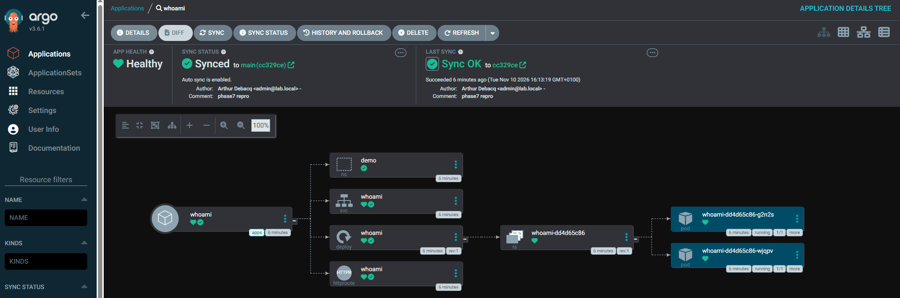

Argo CD a recréé les quatre objets de `whoami` depuis le dépôt, sur le commit `cc329ce`, avec deux pods. Le ReplicaSet s'appelle `whoami-dd4d65c86`, **exactement comme avant la destruction** : ce suffixe est une empreinte calculée à partir du modèle de pod du Deployment. Mêmes fichiers, même empreinte. Seuls les suffixes des pods, tirés au hasard, ont changé.

**Idempotence après reconstruction**, au second passage du playbook :

```
k8s-cp-01      : ok=96   changed=0    unreachable=0    failed=0    skipped=17
k8s-worker-01  : ok=36   changed=0    unreachable=0    failed=0    skipped=9
k8s-worker-02  : ok=36   changed=0    unreachable=0    failed=0    skipped=8
```

Exactement les mêmes compteurs qu'avant la destruction.

#### La seconde reconstruction : aucune intervention

Avec la correction publiée, j'ai refait la même séquence, en lançant cette fois le playbook **immédiatement** après le script des clés, pour me remettre dans les conditions de l'incident :

| Étape | Horaires | Durée |
|---|---|---|
| `vagrant destroy -f` | 16:45:45 → 16:47:30 | 1 min 45 s |
| `vagrant up` | 16:47:41 → 16:51:15 | 3 min 34 s |
| Clés, puis playbook | 16:51:27 → 17:02:11 | 10 min 44 s, dont 10 min 29 s pour le playbook, **en un seul passage** |
| `verifier-lab.sh` | 17:02:41 → 17:02:43 | 2 s : tout était déjà prêt |

**15 min 02 s** entre le lancement de `vagrant up` et « Tout est opérationnel », **sans aucune intervention**.

```
k8s-cp-01      : ok=112  changed=52   unreachable=0    failed=0    skipped=4
k8s-worker-01  : ok=45   changed=29   unreachable=0    failed=0    skipped=3
k8s-worker-02  : ok=44   changed=28   unreachable=0    failed=0    skipped=3
```

`unreachable=0` partout, et les deux workers ont désormais le même nombre de changements (29 et 28 : le jeton d'amorçage, créé une seule fois, est compté pour le premier). La nouvelle tâche « Attendre la connexion SSH à chaque nœud » a duré **12 secondes**, alors qu'elle passe en une ou deux secondes quand les nœuds répondent : un nœud au moins n'était pas encore joignable. Sans elle, ce passage aurait échoué comme le premier. Le correctif a donc servi, dans les conditions exactes de l'incident.

Le playbook a pris une minute de plus que lors de la première reconstruction : l'installation des paquets (50 s au lieu de 27 s) et celle de containerd (33 s au lieu de 15 s) dépendent de la vitesse des dépôts de paquets au moment du téléchargement. L'attente de Calico reste la plus longue (4 min 30 s, 43 % du playbook).

L'idempotence est conservée, avec un `ok` de plus par nœud, celui de la nouvelle tâche :

```
k8s-cp-01      : ok=97   changed=0    unreachable=0    failed=0    skipped=17
k8s-worker-01  : ok=37   changed=0    unreachable=0    failed=0    skipped=9
k8s-worker-02  : ok=37   changed=0    unreachable=0    failed=0    skipped=8
```

#### Le redémarrage à froid

Pour savoir si le proxy Envoy indisponible de la mesure de référence se reproduisait, j'ai arrêté toutes les VMs (`vagrant halt`), attendu une minute, puis les ai relancées (`vagrant up`), de 17:04:47 à 17:11:55. Aucun playbook : containerd et le kubelet redémarrent avec les VMs, et Kubernetes relance lui-même les pods.

```
$ ./scripts/verifier-lab.sh
Vérification du lab (17:12:18, délai maximal : 600 s)
  ...
  OK     Envoy Gateway (envoy-gateway-system) : 2 composant(s) prêt(s)
  ...
  OK     Dernier commit appliqué : edbff9a, main sur GitHub
  OK     Route http://argocd.lab.internal : HTTP 200
  OK     Route http://whoami.lab.internal : HTTP 200

Tout est opérationnel à 17:16:09 (vérifié en 231 s).
```

Le lab est revenu de lui-même, **4 min 14 s** après la fin de `vagrant up`, application comprise. L'incident du proxy Envoy ne s'est pas reproduit. La différence avec la mesure de référence tient à la durée de l'arrêt : une minute ici, une nuit la veille. Sa cause reste non établie, et le script la détecterait si elle revenait.

#### Validation

- Le dépôt suffit à reconstruire le lab : **15 min 02 s** depuis zéro, application comprise, **sans aucune intervention manuelle**, ni `kubectl apply`.
- Le cluster reconstruit est identique à l'ancien, jusqu'à l'empreinte du ReplicaSet de l'application.
- Après un redémarrage à froid, le lab revient seul en un peu plus de 4 minutes.
- Le playbook reste idempotent après reconstruction.
- La seule intervention manuelle de la première reconstruction a été corrigée, et la seconde reconstruction a montré que la correction servait.
- Le script de vérification rend chaque essai mesurable, et il a repéré une dégradation que rien ne laissait voir côté utilisateur.

**Le projet est terminé.** Les suites possibles sont listées dans les [pistes d'évolution](#pistes-dévolution).

---

<!-- Les prochaines entrées seront ajoutées ici, dans le même format -->

## Compétences démontrées

- Choix argumenté d'une distribution Kubernetes (kubeadm, k3s, RKE2) selon les objectifs d'apprentissage et les pratiques d'entreprise
- Compréhension de l'architecture d'un cluster Kubernetes (control plane, nœuds, réconciliation) et de ses trois plans d'adressage
- Préparation système de nœuds Kubernetes : swap, modules du noyau (`overlay`, `br_netfilter`), paramètres réseau du noyau, rendus persistants et vérifiés après redémarrage
- Rôles Ansible réutilisables et paramétrables (activation conditionnelle du pare-feu par variable de groupe), conformes à `ansible-lint` en profil `production`
- Vagrantfile piloté par les données (liste de nœuds et boucle) et répartition des responsabilités entre Vagrant (matériel, réseau d'amorçage) et Ansible (configuration)
- Administration réseau sous Debian avec ifupdown (`/etc/network/interfaces`, `interfaces.d`, `ifup`/`ifdown`, hooks)
- Diagnostic réseau méthodique en couches, de Windows jusqu'au noyau de la VM, avec lecture des indicateurs d'interface et du journal système complet
- Lecture du code source d'un outil (Vagrant et son plugin VMware) pour comprendre une panne, et distinction entre cause prouvée et déclencheur supprimé
- Installation d'un container runtime pour Kubernetes (containerd 2.x) et compréhension de la chaîne d'exécution d'un conteneur (kubelet, CRI, containerd, shim, runc, namespaces et cgroups)
- Configuration du driver cgroup systemd et vérification sur la configuration effective plutôt que sur le fichier écrit
- Gestion de dépôts APT tiers au format deb822, avec une clé de signature restreinte à chaque dépôt
- Gestion des versions d'un cluster Kubernetes : dépôt par version mineure, politique de version skew, blocage des paquets
- Contrôles automatiques intégrés à un playbook (`assert`, commandes de vérification en lecture seule) pour échouer tôt plutôt que trois étapes plus loin
- Diagnostic d'un nœud Kubernetes avec crictl, et choix entre crictl et ctr selon le besoin
- Création d'un cluster Kubernetes avec kubeadm à partir d'un fichier de configuration (`InitConfiguration`, `ClusterConfiguration`, `KubeletConfiguration`, `JoinConfiguration`)
- Compréhension de la PKI d'un cluster (CA, certificats des composants, kubeconfigs, TLS bootstrap des kubelets) et des static pods du control plane
- Choix des adresses d'un cluster sur des machines à plusieurs interfaces (`advertiseAddress`, `node-ip`) et d'un point d'entrée de l'API server compatible avec la haute disponibilité
- Automatisation de commandes non idempotentes avec Ansible (`creates`, détection de l'état, `run_once` avec condition portée sur tous les hôtes, `block`/`always`, `no_log`, délégation au poste de contrôle sans `become`)
- Diagnostic d'une erreur de résolution de noms et lecture du code source de kubeadm pour expliquer un comportement inattendu
- Compréhension du modèle réseau de Kubernetes (pods, conteneur `pause`, Services, CNI) et de la gestion des adresses de Calico (pool, blocs réservés à la demande)
- Installation d'un logiciel par un opérateur Kubernetes (CRD, ressource de configuration, état publié par l'opérateur) et adaptation de l'automatisation à un opérateur qui modifie ses propres ressources
- Vérification de l'intégrité des fichiers téléchargés (version figée, empreinte SHA-256) et validation d'une configuration contre le schéma officiel d'une CRD avant de l'appliquer
- Lecture de la table de routage d'un nœud Kubernetes (blocs, routes par pod, routage direct ou encapsulé) et test du réseau de pod à pod entre nœuds
- Diagnostic d'une panne en cascade (conteneur d'initialisation, Service virtuel, kube-proxy, copie de `/etc/hosts` propre au pod, webhooks d'admission) en remontant de l'effet à la cause
- Exposition de Services hors du cluster sans fournisseur cloud avec MetalLB en mode L2 (pool d'adresses, annonce ARP limitée à une interface, élection du nœud, exclusion du control plane), vérifiée jusqu'à la table ARP du client
- Automatisation déclarative d'une configuration Kubernetes avec Ansible (`kubectl diff` et ses codes de retour, `apply --server-side`, nouvelles tentatives pendant le démarrage d'un webhook)
- Déploiement d'une application selon les bonnes pratiques (namespace en Pod Security `restricted`, exécution sans root, sondes, ressources, répartition sur les nœuds), avec validation des manifestes avant application
- Séparation du socle (Ansible) et des applications (manifestes déclaratifs dans un dossier dédié), en préparation du GitOps
- Mise en place d'un point d'entrée HTTP avec la Gateway API (GatewayClass, Gateway, HTTPRoute) et Envoy Gateway, avec la répartition des responsabilités entre infrastructure et applications (namespaces autorisés par étiquette)
- Gestion du cycle de vie des CRD séparée de celui du contrôleur : canal standard, sélection des objets d'un manifeste officiel par étiquette, protection par la règle d'admission `safe-upgrades`
- Test d'un rôle Ansible contre un API server Kubernetes réel (etcd et kube-apiserver d'envtest) avant le premier lancement, avec simulation des états publiés par le contrôleur
- Conservation de l'adresse du client (`externalTrafficPolicy: Local`, `X-Forwarded-For`) et disponibilité du point d'entrée (proxys répartis sur les workers, annonce MetalLB limitée aux nœuds qui les hébergent)
- Lecture du code source d'un contrôleur (Envoy Gateway) pour vérifier ses comportements par défaut : politique de trafic, contextes de sécurité, nommage des ressources, répartition de charge
- Mise en place du GitOps avec Argo CD : Application, ApplicationSet (générateur Git : une application par dossier), AppProject (sources, destinations et types d'objets permis), synchronisation automatique avec `prune`, `selfHeal` et nouvelles tentatives
- Adoption sans interruption d'objets existants par Argo CD, et vérification de la chaîne de bout en bout (commit appliqué identique au dernier commit, autocorrection, retour arrière par `git revert`)
- Application côté serveur et gestionnaires de champs (`managedFields`) pour faire cohabiter, dans les mêmes objets, les réglages du manifeste officiel et ceux du projet
- Choix argumenté de la méthode d'installation de chaque composant (une seule fois ou déclarative) selon le comportement de ses contrôleurs et sa procédure de mise à jour
- Test de reproductibilité : destruction et reconstruction complètes depuis le dépôt, chronométrées (15 min 02 s, sans intervention), redémarrage à froid (4 min 14 s), analyse du temps passé tâche par tâche (`ansible.posix.profile_tasks`), et correction de la seule intervention manuelle (`wait_for_connection`), validée par une seconde reconstruction
- Script de vérification de bout en bout (`verifier-lab.sh`, contrôlé par `shellcheck`), qui a détecté une dégradation invisible côté utilisateur, et testé sur des états sains, en panne et en cours de rétablissement
- Audit d'un dépôt avant publication et reconstruction : secret affiché dans les journaux (`no_log`), qualité (`ansible-lint`), droits d'exécution enregistrés dans Git, règles d'édition communes (`.editorconfig`)
