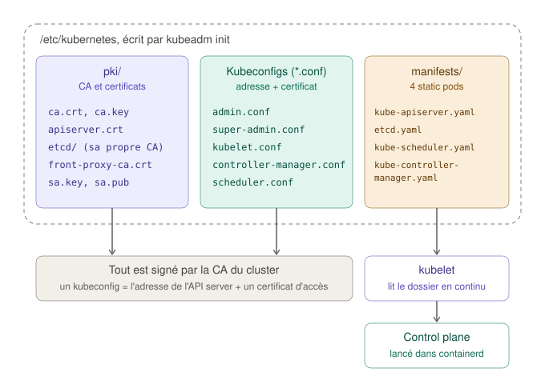
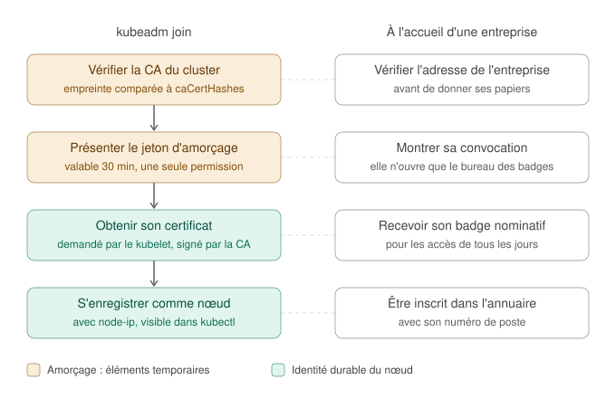

# Créer le cluster : kubeadm init et kubeadm join

Ce guide accompagne la phase 3 du projet : la création du control plane avec `kubeadm init`, puis l'ajout des workers avec `kubeadm join`. Il explique ce que fait chaque commande, ce qu'elle laisse sur le disque, et comment le vérifier soi-même.

Il fait suite aux guides [Kubernetes : les notions avant les commandes](kubernetes-fondamentaux.md) (le cluster dans son ensemble) et [Le runtime de conteneurs et les paquets Kubernetes](runtime-et-paquets.md) (l'intérieur d'un nœud).

## Sommaire

1. [L'idée : ouvrir la direction et rattacher les cuisines](#1-lidée--ouvrir-la-direction-et-rattacher-les-cuisines)
2. [Le fichier de configuration de kubeadm](#2-le-fichier-de-configuration-de-kubeadm)
3. [Ce que fait kubeadm init, étape par étape](#3-ce-que-fait-kubeadm-init-étape-par-étape)
4. [Les static pods : le control plane lancé par le kubelet](#4-les-static-pods--le-control-plane-lancé-par-le-kubelet)
5. [La PKI du cluster et les kubeconfigs](#5-la-pki-du-cluster-et-les-kubeconfigs)
6. [Rejoindre le cluster : kubeadm join](#6-rejoindre-le-cluster--kubeadm-join)
7. [Trois adresses à ne pas confondre](#7-trois-adresses-à-ne-pas-confondre)
8. [Administrer depuis le poste de contrôle](#8-administrer-depuis-le-poste-de-contrôle)
9. [Pourquoi les nœuds sont NotReady](#9-pourquoi-les-nœuds-sont-notready)
10. [Côté Ansible : rendre ces commandes rejouables](#10-côté-ansible--rendre-ces-commandes-rejouables)
11. [Les pièges rencontrés](#11-les-pièges-rencontrés)
12. [Glossaire](#12-glossaire)

---

## 1. L'idée : ouvrir la direction et rattacher les cuisines

On reprend l'analogie du restaurant des guides précédents. À la fin de la phase 2, chaque cuisine (chaque VM) est équipée : un cuisinier (containerd) et un chef de cuisine (le kubelet), qui attend sans savoir à quel restaurant il appartient. Il reste à :

- **ouvrir la direction** : c'est `kubeadm init` sur `k8s-cp-01`, qui crée le control plane ;
- **rattacher les autres cuisines** : c'est `kubeadm join` sur chaque worker.

kubeadm est un **outil d'installation**. Il ne tourne pas en permanence : il prépare les fichiers, démarre ce qu'il faut, puis s'arrête. Une fois le cluster créé, ce sont le kubelet et les composants du control plane qui travaillent.

## 2. Le fichier de configuration de kubeadm

kubeadm accepte des options en ligne de commande (`--pod-network-cidr=...`), mais la méthode recommandée est un **fichier de configuration**. Il est plus lisible, versionné dans le dépôt (le modèle Jinja), et il reste sur le control plane (`/etc/kubernetes/kubeadm-config.yaml`) comme trace de la façon dont le cluster a été créé.

### Plusieurs documents dans un fichier

Le fichier contient trois **documents YAML**, séparés par des lignes `---`. Chacun déclare son type avec `apiVersion` et `kind`, comme tous les objets Kubernetes :

| Document | Concerne | Contenu dans le projet |
|---|---|---|
| `InitConfiguration` | **Ce nœud-ci**, le premier control plane | Son adresse (`advertiseAddress`), son nom, le socket de containerd, l'adresse annoncée par son kubelet (`node-ip`) |
| `ClusterConfiguration` | **Tout le cluster** | Nom du cluster, version de Kubernetes, point d'entrée de l'API server, plages d'adresses des pods et des services |
| `KubeletConfiguration` | **Le kubelet de tous les nœuds** | Le driver cgroup `systemd` |

Le fichier généré pour `k8s-cp-01`, sans ses commentaires :

```yaml
---
apiVersion: kubeadm.k8s.io/v1beta4
kind: InitConfiguration
localAPIEndpoint:
  advertiseAddress: 192.168.58.10
  bindPort: 6443
nodeRegistration:
  name: k8s-cp-01
  criSocket: unix:///run/containerd/containerd.sock
  kubeletExtraArgs:
    - name: node-ip
      value: 192.168.58.10
---
apiVersion: kubeadm.k8s.io/v1beta4
kind: ClusterConfiguration
clusterName: lab-k8s-gitops
kubernetesVersion: v1.37.2
controlPlaneEndpoint: "k8s-api:6443"
networking:
  podSubnet: 10.244.0.0/16
  serviceSubnet: 10.96.0.0/12
---
apiVersion: kubelet.config.k8s.io/v1beta1
kind: KubeletConfiguration
cgroupDriver: systemd
```

`v1beta4` est la version actuelle du format de kubeadm. Une version `v1` est en préparation dans le code de Kubernetes 1.37, mais pas encore finalisée.

### Le piège du premier `---`

kubeadm découpe le fichier à chaque ligne `---` et exige que **chaque morceau** déclare `apiVersion` et `kind`. Un bloc de commentaires placé **avant** le premier `---` est donc lu comme un document à part entière, vide, et refusé :

```
error: invalid configuration for GroupVersionKind /, Kind=: kind and apiVersion is mandatory information that must be specified
```

`GroupVersionKind /, Kind=` signifie « type vide ». La correction : commencer le fichier par `---`, et placer les commentaires en dessous, dans le premier document. C'est ce qui s'est passé au premier lancement (voir la section 11).

## 3. Ce que fait kubeadm init, étape par étape

`kubeadm init` enchaîne des **phases**. Chacune apparaît dans sa sortie entre crochets, ce qui permet de savoir où une erreur s'est produite :

| Phase | Ce qu'elle fait | Dans le restaurant |
|---|---|---|
| `[preflight]` | Contrôle les prérequis : swap, `ip_forward`, containerd joignable, ports libres, images téléchargées | Vérifier que le local est aux normes avant l'ouverture |
| `[certs]` | Crée l'autorité de certification (CA) du cluster et un certificat pour chaque composant | Fabriquer le tampon officiel de la direction, puis les badges |
| `[kubeconfig]` | Écrit les fichiers d'accès à l'API server (`admin.conf`, `kubelet.conf`...) | Remettre à chacun son badge et l'adresse du bureau |
| `[etcd]` `[control-plane]` | Écrit les manifestes des composants du control plane dans `/etc/kubernetes/manifests/` | Écrire les fiches de poste de la direction |
| `[kubelet-start]` | Écrit la configuration du kubelet et le démarre | Le chef de cuisine reçoit sa lettre de mission |
| `[wait-control-plane]` | Attend que le kubelet ait lancé le control plane et que l'API server réponde | Attendre que la direction soit à son bureau |
| `[upload-config]` | Range la configuration du cluster dans le cluster lui-même (ConfigMap `kubeadm-config`) | Archiver les statuts de l'entreprise |
| `[mark-control-plane]` | Marque le nœud comme control plane et lui pose une *taint* (voir la section 9) | Réserver le bureau de la direction à la direction |
| `[bootstrap-token]` | Prépare l'arrivée des workers (jeton d'amorçage, informations publiques du cluster) | Préparer l'accueil des nouveaux employés |
| `[addons]` | Installe CoreDNS (le DNS interne) et kube-proxy (les règles réseau des Services) | Installer l'annuaire et le standard téléphonique |

Ce que tout cela laisse sur le disque :



Pour le voir sur `k8s-cp-01` :

```bash
sudo ls /etc/kubernetes /etc/kubernetes/pki /etc/kubernetes/manifests
```

### Si kubeadm init échoue

La phase affichée en dernier indique où l'erreur s'est produite :

- avant `[certs]` (fichier de configuration refusé, contrôle préalable en échec) : **rien n'a été créé**, on corrige et on relance ;
- après : des fichiers sont déjà écrits, et un nouveau `kubeadm init` refuserait de les écraser. On remet le nœud à zéro **sur le nœud lui-même** (kubeadm n'est pas installé sur WSL2) :

```bash
vagrant ssh k8s-cp-01          # depuis PowerShell
sudo kubeadm reset -f
```

## 4. Les static pods : le control plane lancé par le kubelet

### Le problème de l'œuf et de la poule

Dans un cluster qui fonctionne, on crée un pod en le demandant à l'API server. Mais l'API server est lui-même un pod : qui le lance, puisqu'il n'existe pas encore ?

La réponse : le **kubelet sait aussi lancer des pods sans l'API server**. Il surveille un dossier, `/etc/kubernetes/manifests/`, et fait tourner chaque pod décrit dans un fichier de ce dossier. On les appelle des **static pods**. kubeadm y écrit les quatre composants du control plane, et le kubelet du control plane les lance dans containerd, comme n'importe quel conteneur.

Dans le restaurant, c'est une fiche de poste affichée directement dans la cuisine : le chef l'applique sans attendre d'instruction de la direction, puisque c'est justement la direction qu'il est en train d'installer.

### Le voir

Sur `k8s-cp-01` :

```bash
ls /etc/kubernetes/manifests
sudo crictl ps
```

Exemple de sortie de `crictl ps` (les identifiants changeront) :

```
CONTAINER      IMAGE          CREATED        STATE     NAME                      POD ID         POD
3f1c...        a1b2...        20 minutes ago Running   kube-proxy                9e8d...        kube-proxy-x7k2p
5d2e...        c3d4...        21 minutes ago Running   kube-apiserver            7c6b...        kube-apiserver-k8s-cp-01
8a9b...        e5f6...        21 minutes ago Running   etcd                      1a2b...        etcd-k8s-cp-01
...
```

Depuis WSL2, ces pods apparaissent aussi, suffixés du nom du nœud (`kube-apiserver-k8s-cp-01`) :

```bash
kubectl get pods -n kube-system -o wide
```

Le kubelet en publie une copie dans l'API server, appelée *mirror pod*, pour qu'on puisse les voir avec kubectl. Mais c'est le fichier du dossier qui fait foi : supprimer le pod avec kubectl ne sert à rien, le kubelet le recrée aussitôt.

### Exercice : retirer puis remettre le scheduler

Sur `k8s-cp-01`, sans risque pour le cluster :

```bash
# Sortir le manifeste du dossier surveillé (pas dans le dossier lui-même : le
# kubelet lit TOUS les fichiers du dossier, une copie .bak y serait lue aussi)
sudo mv /etc/kubernetes/manifests/kube-scheduler.yaml /root/

# Après une vingtaine de secondes, le scheduler a disparu
sudo crictl ps --name kube-scheduler

# Le remettre en place : le kubelet le relance de lui-même
sudo mv /root/kube-scheduler.yaml /etc/kubernetes/manifests/
sudo crictl ps --name kube-scheduler
```

C'est la boucle de réconciliation du kubelet, à l'échelle d'un seul nœud : le dossier décrit l'état voulu, et le kubelet aligne ce qui tourne sur ce qui est décrit. Pendant l'absence du scheduler, un pod nouvellement créé serait resté `Pending`, faute de quelqu'un pour lui choisir un nœud.

## 5. La PKI du cluster et les kubeconfigs

### Une CA propre au cluster

Dans `lab-cicd-pipeline`, j'avais créé une CA interne pour que GitLab soit en HTTPS. kubeadm fait la même chose, à plus grande échelle : **chaque échange** entre composants du cluster est chiffré, et chaque composant prouve son identité par un certificat signé par la CA du cluster (`/etc/kubernetes/pki/ca.crt`).

| Fichier | Rôle |
|---|---|
| `ca.crt`, `ca.key` | La CA du cluster : elle signe les certificats des composants et des nœuds |
| `apiserver.crt` | Le certificat serveur de l'API server. Il contient les noms et adresses par lesquels on peut le joindre (dont `k8s-api` et `192.168.58.10`) |
| `apiserver-kubelet-client.crt` | Le certificat client avec lequel l'API server se connecte aux kubelets (pour `kubectl logs`, `kubectl exec`) |
| `etcd/` | Une CA séparée pour etcd : seuls l'API server et les membres etcd peuvent lui parler |
| `front-proxy-ca.crt` | Une CA pour les extensions de l'API (utilisée plus tard, par exemple, par metrics-server) |
| `sa.key`, `sa.pub` | La paire de clés qui signe les jetons des *service accounts*, les identités des applications |

Pour voir les dates d'expiration :

```bash
sudo kubeadm certs check-expiration
```

Les certificats des composants sont valables **un an**, la CA **dix ans**. Ils se renouvellent avec `kubeadm certs renew`, et automatiquement lors d'une mise à jour avec `kubeadm upgrade`. Un cluster laissé un an sans mise à jour cesse de fonctionner le jour de l'expiration : c'est une limite à surveiller.

### Un kubeconfig, c'est quoi

Un **kubeconfig** est un fichier qui répond à trois questions pour un client comme kubectl :

| Section | Question | Exemple |
|---|---|---|
| `clusters` | Où est l'API server, et quelle CA doit avoir signé son certificat ? | `server: https://192.168.58.10:6443` et le certificat de la CA |
| `users` | Qui suis-je ? | Un certificat client et sa clé privée |
| `contexts` | Quel utilisateur pour quel cluster ? | `kubernetes-admin@lab-k8s-gitops` |

On peut l'afficher sans exposer les clés, qui sont remplacées par `DATA+OMITTED` :

```bash
kubectl config view
```

kubeadm en écrit plusieurs, un par composant qui doit parler à l'API server (`kubelet.conf`, `scheduler.conf`, `controller-manager.conf`), plus deux pour les humains :

- `admin.conf` : l'administrateur du cluster, dont les droits passent par le contrôle d'accès normal de Kubernetes (RBAC). C'est celui qu'on utilise ;
- `super-admin.conf` : un accès de secours qui contourne ce contrôle. Il ne quitte pas le control plane.

## 6. Rejoindre le cluster : kubeadm join

Un worker qui rejoint le cluster doit résoudre deux problèmes de confiance, un dans chaque sens :

- **le worker doit être sûr de parler au vrai control plane**, et pas à une machine qui se ferait passer pour lui ;
- **le control plane doit être sûr que le worker a le droit d'entrer.**



### Le jeton d'amorçage : la convocation

Un **jeton d'amorçage** (*bootstrap token*) a la forme `abcdef.0123456789abcdef` : un identifiant public de 6 caractères, un point, puis un secret de 16 caractères. Le control plane le stocke dans un Secret nommé `bootstrap-token-<identifiant>` (c'est le `bootstrap-token-1qn1yv` qui apparaissait dans l'erreur de la section 11).

Il ne donne qu'**une seule permission** : demander un certificat. Comme une convocation, qui permet d'entrer jusqu'au bureau des badges, et pas plus loin. Le projet le crée avec une durée de vie de 30 minutes, seulement quand un worker doit rejoindre le cluster.

Pour voir les jetons existants, sur `k8s-cp-01` :

```bash
sudo kubeadm token list
```

On y voit aussi celui créé automatiquement par `kubeadm init`, valable 24 heures.

### L'empreinte de la CA : vérifier l'adresse avant de donner ses papiers

Le worker commence par télécharger les informations publiques du cluster, dont le certificat de la CA. Mais comment savoir qu'elles sont authentiques ? On lui fournit à l'avance l'**empreinte** de la CA (`caCertHashes`, de la forme `sha256:...`). Si l'empreinte du certificat reçu ne correspond pas, il refuse d'aller plus loin. C'est le même principe que la vérification de la clé d'hôte SSH par deux canaux dans `lab-cicd-pipeline`.

La commande `kubeadm token create --print-join-command` fournit le jeton et l'empreinte en une seule ligne. Le rôle `kubeadm_join` les en extrait pour les placer dans le fichier `JoinConfiguration`.

### Le certificat du kubelet : le badge nominatif

Une fois admis, le kubelet du worker génère une clé privée et envoie une **demande de certificat** (CSR, *Certificate Signing Request*). Le control plane la signe avec la CA du cluster : c'est le **TLS bootstrap**. À partir de là, le jeton ne sert plus, et le kubelet s'authentifie avec son propre certificat, qu'il renouvelle lui-même avant expiration.

Pour le voir, sur un worker :

```bash
sudo openssl x509 -in /var/lib/kubelet/pki/kubelet-client-current.pem -noout -subject -issuer -enddate
```

Exemple de sortie :

```
subject=O = system:nodes, CN = system:node:k8s-worker-01
issuer=CN = kubernetes
notAfter=Nov  4 12:20:00 2027 GMT
```

| Champ | Signification |
|---|---|
| `CN = system:node:k8s-worker-01` | L'identité du nœud. L'API server s'en sert pour limiter un kubelet aux pods de son propre nœud |
| `O = system:nodes` | Le groupe des nœuds, qui donne les droits communs à tous les kubelets |
| `issuer=CN = kubernetes` | Signé par la CA du cluster |

Enfin, le kubelet **s'enregistre comme nœud** auprès de l'API server, avec l'adresse indiquée par `node-ip`. Le nœud apparaît alors dans `kubectl get nodes`.

## 7. Trois adresses à ne pas confondre

| Réglage | Sert à | Valeur dans le projet | Si on ne le précise pas |
|---|---|---|---|
| `advertiseAddress` | Adresse où l'API server de **ce** control plane écoute et qu'il annonce | `192.168.58.10` | kubeadm prend l'interface de la route par défaut, `eth0` (NAT) |
| `node-ip` | Adresse que **chaque kubelet** annonce pour son nœud (`INTERNAL-IP`) | `192.168.58.10`, `.11`, `.12` | Le kubelet prend aussi `eth0`, dont l'adresse est attribuée par DHCP et peut changer au redémarrage |
| `controlPlaneEndpoint` | Adresse par laquelle **tout le monde** joint l'API server | `k8s-api:6443` | On utiliserait l'adresse du seul control plane, impossible à remplacer plus tard |

### Pourquoi un nom pour l'API server

C'est le principe du **numéro de standard** : on donne aux clients le numéro du standard, pas la ligne directe d'un employé. Si l'employé change de bureau, ou si l'on embauche deux collègues pour répondre aux appels, les clients n'ont rien à changer.

Aujourd'hui, `k8s-api` désigne `k8s-cp-01`, déclaré dans `/etc/hosts` par le rôle `k8s_prereqs`. Avec trois control planes, il désignerait un load balancer réparti entre les trois. Ce choix doit se faire **dès la création** : le nom est inscrit dans le certificat de l'API server et dans tous les kubeconfigs.

### Un détail qui a son importance

Pendant `kubeadm init`, kubeadm **n'utilise pas** `controlPlaneEndpoint` : il dirige ses propres connexions vers l'adresse locale (`advertiseAddress`). Dans un cluster à plusieurs control planes, le load balancer n'est souvent pas encore prêt quand on crée le premier, et l'`init` ne peut pas compter sur lui. Conséquence : une erreur de résolution du nom `k8s-api` n'apparaît pas pendant l'`init`, mais seulement à la première commande qui passe par `admin.conf`. C'est ce qui s'est produit dans ce projet (section 11). D'où la tâche du rôle `k8s_prereqs` qui vérifie la résolution du nom dès la phase 1.

## 8. Administrer depuis le poste de contrôle

En entreprise, on administre un cluster depuis son poste de travail, pas en se connectant au control plane. Le rôle `kubeadm_init` copie donc `admin.conf` sur WSL2, dans `~/.kube/lab-k8s-gitops.conf`, avec deux adaptations :

- **les droits `0600`**, lisibles par mon seul utilisateur : ce fichier contient la clé privée d'un administrateur du cluster, c'est l'équivalent d'un mot de passe root ;
- **l'adresse du serveur remplacée par l'IP** `192.168.58.10` : WSL2 ne connaît pas le nom `k8s-api`, absent de son `/etc/hosts`. Comme l'IP figure aussi dans le certificat de l'API server, la connexion reste vérifiée.

Le fichier `.envrc` du projet exporte `KUBECONFIG` vers ce fichier. Avec direnv, kubectl vise donc le cluster du lab **dès que je suis dans le dossier du projet**, et redevient normal en dehors, sans toucher à un éventuel `~/.kube/config`.

```bash
kubectl config get-contexts     # kubernetes-admin@lab-k8s-gitops
kubectl get nodes -o wide
```

kubectl est installé sur WSL2 depuis le même dépôt que les nœuds (version 1.37). kubeadm, lui, n'y est pas : il ne sert qu'aux nœuds.

## 9. Pourquoi les nœuds sont NotReady

À la fin de la phase 3, tous les nœuds sont `NotReady`. C'est **attendu** :

```bash
kubectl describe node k8s-worker-01 | grep -A8 Conditions
```

On y lit, pour la condition `Ready`, un message du type `container runtime network not ready ... cni plugin not initialized`. Le nœud n'a pas encore de **réseau des pods** : aucun pod ne pourrait recevoir d'adresse IP. Le CNI (Calico) l'apportera en phase 4.

En attendant, `kubectl get pods -n kube-system` montre deux situations :

| Pods | État | Pourquoi |
|---|---|---|
| etcd, kube-apiserver, kube-scheduler, kube-controller-manager, les trois kube-proxy | `Running` | Ils utilisent directement le réseau du nœud (*host network*), sans IP de pod |
| Les deux coredns | `Pending` | Ils ont besoin d'une IP de pod, et aucun nœud n'est `Ready` pour les accueillir |

### Les taints

Une **taint** (une « marque de répulsion ») posée sur un nœud écarte les pods qui ne la tolèrent pas explicitement. Deux sont présentes ici :

- `node-role.kubernetes.io/control-plane:NoSchedule`, posée par kubeadm : les applications ne tournent pas sur le control plane, pour qu'elles ne puissent pas l'affamer en RAM ou en CPU ;
- `node.kubernetes.io/not-ready:NoSchedule`, posée automatiquement sur les nœuds `NotReady` : c'est elle qui laisse CoreDNS en `Pending`. Elle disparaîtra d'elle-même avec Calico.

```bash
kubectl describe nodes | grep -E "^Name:|Taints:"
```

## 10. Côté Ansible : rendre ces commandes rejouables

`kubeadm init` et `kubeadm join` ne sont pas idempotentes : relancées sur un nœud déjà configuré, elles échouent. Le playbook doit donc décider lui-même quand les exécuter.

| Problème | Solution dans le projet |
|---|---|
| Ne lancer `kubeadm init` qu'une fois | `creates: /etc/kubernetes/admin.conf` : la commande est ignorée si ce fichier existe |
| Ne lancer `kubeadm join` que sur les nouveaux workers | Test de `/etc/kubernetes/kubelet.conf`, qui n'existe que sur un nœud membre |
| Ne créer un jeton que s'il sert | Tâche exécutée sur le control plane (`delegate_to`), une seule fois (`run_once`), et seulement si au moins un worker doit rejoindre le cluster |
| `run_once` n'évalue sa condition que pour le premier hôte | La condition porte sur **tous** les workers (`ansible_play_hosts`), pas sur l'hôte en cours |
| Ne pas laisser le jeton sur le disque | Le fichier de join est supprimé dans une section `always:`, exécutée même si le join échoue |
| Ne pas afficher de secret dans la sortie | `no_log: true` sur les tâches qui manipulent le jeton ou le kubeconfig |
| Écrire sur WSL2 sans demander de mot de passe `sudo` | `delegate_to: localhost` avec `become: false`, sinon le `become: true` du play s'applique aussi au poste de contrôle |
| Vérifier le résultat, pas l'action | Le rôle `cluster_verify` lit les nœuds dans le cluster et vérifie leur présence et leur adresse |

### Lire le PLAY RECAP

```
k8s-cp-01      : ok=45   changed=0    skipped=4
k8s-worker-01  : ok=36   changed=0    skipped=9
k8s-worker-02  : ok=36   changed=0    skipped=8
```

Pourquoi `k8s-worker-01` a-t-il une tâche ignorée de plus que `k8s-worker-02` ? La création du jeton est une tâche `run_once` : Ansible ne l'évalue que pour le **premier** hôte du play, `k8s-worker-01`. Quand elle est ignorée (aucun worker à ajouter), elle n'est comptée que pour lui. Les autres tâches ignorées sont, sur chaque nœud : `swapoff` (plus de swap), les trois tâches UFW, et sur les workers les quatre tâches du bloc de join, déjà membres du cluster.

## 11. Les pièges rencontrés

| Piège | Symptôme | Explication | Correction |
|---|---|---|---|
| Commentaires avant le premier `---` | `invalid configuration for GroupVersionKind /, Kind=` au bout de 0,15 seconde | kubeadm lit le bloc de commentaires comme un document sans type. Mon test avec la bibliothèque YAML de Python ne l'avait pas vu, car elle ignore un document vide | Le fichier commence par `---`, et le test reproduit désormais la règle de découpage de kubeadm |
| Nom `k8s-api` absent de `/etc/hosts` | `lookup k8s-api on 4.2.2.1:53: no such host` à la création du jeton, après une minute de tentatives | En mettant à jour mes fichiers à partir de l'archive, je n'avais pas reporté la ligne ajoutée au rôle `k8s_prereqs`. Le nœud a alors interrogé le DNS public de la box, qui ne connaît pas ce nom | Ligne ajoutée, et une tâche vérifie maintenant la résolution du nom sur chaque nœud (`getent hosts`) |
| L'`init` réussit malgré ce nom introuvable | Aucune erreur avant l'ajout des workers | `kubeadm init` utilise l'adresse locale du control plane, pas `controlPlaneEndpoint` (section 7) | Le contrôle de résolution, placé dès la phase 1 |

Deux leçons :

- **tester avec les règles de l'outil réel** : un validateur générique peut accepter ce que l'outil refuse ;
- **le premier usage réel d'un réglage n'est pas forcément là où on l'attend** : il faut le vérifier au moment où il est posé, pas compter sur l'étape suivante pour révéler une erreur.

## 12. Glossaire

| Terme | Définition |
|---|---|
| `admin.conf` | Kubeconfig de l'administrateur du cluster, dont les droits passent par RBAC |
| Bootstrap token | Jeton temporaire qui permet seulement à un nouveau nœud de demander son certificat |
| CA | Autorité de certification : elle signe les certificats et permet de les vérifier |
| `caCertHashes` | Empreinte de la CA du cluster, fournie à l'avance au worker pour qu'il vérifie le control plane |
| `controlPlaneEndpoint` | Adresse unique par laquelle les nœuds et les clients joignent l'API server |
| CSR | Certificate Signing Request : une demande de certificat, envoyée par le kubelet au control plane |
| Kubeconfig | Fichier qui indique à un client l'adresse de l'API server, la CA à reconnaître et l'identité à présenter |
| Mirror pod | Copie, visible dans l'API server, d'un static pod lancé par un kubelet |
| `node-ip` | Adresse qu'un kubelet annonce pour son nœud |
| Phase (kubeadm) | Étape de `kubeadm init` ou `kubeadm join`, affichée entre crochets dans la sortie |
| RBAC | Role-Based Access Control : le contrôle des droits dans Kubernetes |
| Static pod | Pod décrit par un fichier dans `/etc/kubernetes/manifests/` et lancé directement par le kubelet, sans l'API server |
| Taint | Marque posée sur un nœud pour en écarter les pods qui ne la tolèrent pas |
| TLS bootstrap | Procédure par laquelle un kubelet obtient son certificat à partir d'un jeton d'amorçage |

## Sources

- [Documentation Kubernetes : créer un cluster avec kubeadm](https://kubernetes.io/docs/setup/production-environment/tools/kubeadm/create-cluster-kubeadm/)
- [Documentation Kubernetes : référence de kubeadm join](https://kubernetes.io/docs/reference/setup-tools/kubeadm/kubeadm-join/)
- [Documentation Kubernetes : format de configuration kubeadm v1beta4](https://kubernetes.io/docs/reference/config-api/kubeadm-config.v1beta4/)
- [Documentation Kubernetes : gestion des certificats avec kubeadm](https://kubernetes.io/docs/tasks/administer-cluster/kubeadm/kubeadm-certs/)
- [Documentation Kubernetes : static pods](https://kubernetes.io/docs/tasks/configure-pod-container/static-pod/)
- [Code source de kubeadm v1.37.2](https://github.com/kubernetes/kubernetes/tree/v1.37.2/cmd/kubeadm/app) (découpage du fichier de configuration, adresse utilisée pendant l'`init`)
