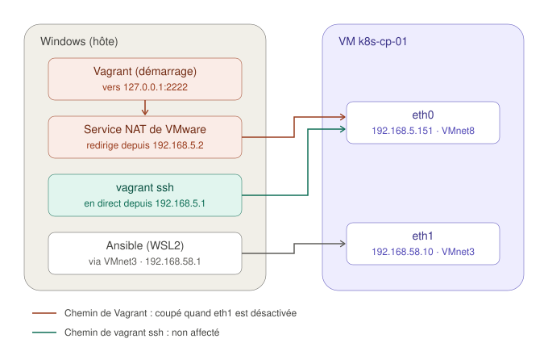

# Dépannage : le réseau privé disparaît après un `vagrant reload`

Ce guide raconte le diagnostic d'une panne rencontrée le 27/10/2026, juste après la phase 1 : après un `vagrant reload`, les nœuds du cluster perdaient leur adresse sur le réseau privé et devenaient injoignables pour Ansible. Il détaille la démarche autant que la solution, parce que la démarche est réutilisable sur d'autres pannes réseau.

Le journal de bord du [README](../README.md#journal-de-bord) n'en garde qu'un résumé.

## Sommaire

1. [Le symptôme](#1-le-symptôme)
2. [Les notions nécessaires](#2-les-notions-nécessaires)
3. [Le diagnostic, couche par couche](#3-le-diagnostic-couche-par-couche)
4. [La cause](#4-la-cause)
5. [La correction](#5-la-correction)
6. [La validation](#6-la-validation)
7. [Pourquoi `lab-cicd-pipeline` n'a jamais eu ce problème](#7-pourquoi-lab-cicd-pipeline-na-jamais-eu-ce-problème)
8. [Ce que je retiens](#8-ce-que-je-retiens)

---

## 1. Le symptôme

Le premier `vagrant up` fonctionne : les trois VMs sont joignables sur `192.168.58.0/24` et le playbook passe. Pour vérifier que la configuration de la phase 1 survit à un redémarrage, je lance un `vagrant reload`, qui échoue sur le premier nœud :

```
==> k8s-cp-01: Machine booted and ready!
==> k8s-cp-01: Setting hostname...
==> k8s-cp-01: Configuring network adapters within the VM...
The SSH connection was unexpectedly closed by the remote end.
```

Ensuite, `ping 192.168.58.10` échoue depuis Windows, alors que `vagrant ssh` fonctionne toujours. La panne touche les trois nœuds, pas seulement le control plane.

## 2. Les notions nécessaires

### Deux cartes réseau, plusieurs chemins

Chaque VM a deux interfaces, reliées à deux réseaux VMware différents :

| Interface | Réseau VMware | Adresse | Sert à |
|---|---|---|---|
| `eth0` | VMnet8 (NAT) | DHCP, ici `192.168.5.151` | Accès à Internet, connexions SSH de Vagrant |
| `eth1` | VMnet3 (hôte uniquement) | `192.168.58.10` | Ansible et communication entre les nœuds |

Point important, découvert pendant ce diagnostic : **Vagrant n'utilise pas le même chemin selon le moment.** Pendant le démarrage, il se connecte à `127.0.0.1:2222`, et c'est le service NAT de VMware sous Windows qui redirige ce port vers la VM. Avec `vagrant ssh`, la connexion part de Windows et va directement à l'adresse de `eth0`.



On le voit dans le journal de la VM, à l'adresse source des connexions : `from 192.168.5.2` pour Vagrant au démarrage (le service NAT de VMware), `from 192.168.5.1` pour `vagrant ssh` (Windows lui-même).

### Comment Debian active une interface

La box `generic/debian12` gère le réseau avec **ifupdown** :

- `/etc/network/interfaces` décrit les interfaces. Une ligne `auto eth1` demande d'activer `eth1` au démarrage, ce que fait le service `networking`.
- `ifup eth1` active l'interface : il attribue l'adresse (`ip addr add`), allume l'interface (`ip link set dev eth1 up`), puis exécute les scripts de `/etc/network/if-up.d/`.
- `ifdown eth1` fait l'inverse et exécute les scripts de `if-down.d/`.

Ces scripts sont des **hooks** : de petits programmes que d'autres paquets (chrony, postfix…) placent là pour être prévenus quand une interface change d'état.

### Ce que fait Vagrant à l'étape « Configuring network adapters »

D'après le [code de Vagrant pour Debian](https://github.com/hashicorp/vagrant/blob/main/plugins/guests/debian/cap/configure_networks.rb), cette étape envoie trois commandes par SSH :

1. `ifdown eth1` puis `ip addr flush dev eth1` : désactivation de l'interface et suppression de son adresse ;
2. réécriture du bloc `#VAGRANT-BEGIN` … `#VAGRANT-END` dans `/etc/network/interfaces` ;
3. `ifup eth1` : réactivation.

Cette étape est exécutée à **chaque** démarrage par Vagrant : premier `vagrant up`, `vagrant reload`, `vagrant up` après un `vagrant halt`.

## 3. Le diagnostic, couche par couche

### Étape 1 : quel chemin fonctionne encore ?

| Test | Résultat | Ce que ça indique |
|---|---|---|
| `ping 192.168.58.10` (PowerShell) | Échec | Le chemin `eth1` / VMnet3 est coupé |
| `vagrant ssh k8s-cp-01` | OK | Le chemin `eth0` / VMnet8 fonctionne : la VM a démarré et SSH tourne |

### Étape 2 : l'état de l'interface dans la VM

```
$ ip -br a
eth0             UP             192.168.5.151/24
eth1             DOWN
```

`ip -br a` (« brief ») donne une ligne par interface. `eth1` est éteinte et n'a aucune adresse.

```
$ cat /etc/network/interfaces
...
#VAGRANT-BEGIN
auto eth1
iface eth1 inet static
      address 192.168.58.10
      netmask 255.255.255.0
#VAGRANT-END
```

Le bloc écrit par Vagrant est correct : bonne interface, bonne adresse, activation automatique. **La configuration n'est pas en cause, c'est l'activation qui ne s'est pas faite.** Ça écarte aussi l'hypothèse d'une confusion de Vagrant entre les interfaces : dans ce cas, c'est `eth0` qui aurait perdu son adresse.

### Étape 3 : la carte virtuelle est-elle en cause ?

```
$ ip link show eth1
3: eth1: <BROADCAST,MULTICAST> mtu 1500 qdisc fq_codel state DOWN ...
```

Les mots entre chevrons sont les indicateurs de l'interface. `UP` est absent : l'interface a été **désactivée côté Linux**. Si la carte virtuelle avait été débranchée côté VMware, on aurait vu `UP` et `NO-CARRIER`.

(Lire `/sys/class/net/eth1/carrier` renvoyait `Invalid argument` : le noyau ne renseigne cette valeur que pour une interface activée. Ce test ne servait donc à rien ici.)

```
$ sudo ifup -v eth1
ifup: configuring interface eth1=eth1 (inet)
ip addr add 192.168.58.10/255.255.255.0 broadcast 192.168.58.255 dev eth1 label eth1
ip link set dev eth1   up
...
$ ip -br a
eth1             UP             192.168.58.10/24
```

L'activation à la main fonctionne, et le ping depuis Windows repasse. Côté Windows, l'adaptateur VMnet3 a toujours son adresse `192.168.58.1`. **La carte virtuelle, le réseau VMnet3 et l'adresse côté hôte fonctionnent tous.** Le problème est dans la séquence de Vagrant.

### Étape 4 : le journal du démarrage

`journalctl -b` affiche les journaux du démarrage en cours, sans filtre, ce qui évite de rater une ligne utile. Extrait, sur un `reload` qui reproduit la panne :

```
11:05:24  systemd: Finished networking.service - Raise network interfaces.
11:05:24  kernel: e1000e ... eth1: NIC Link is Up 1000 Mbps Full Duplex
11:05:26  sshd: Accepted publickey for vagrant from 192.168.5.2 port 64379
11:05:27  sudo: vagrant : COMMAND=/usr/bin/bash -l      (x4)
11:05:28  sudo: vagrant : COMMAND=/usr/bin/bash -l
11:05:28  sudo: vagrant : COMMAND=/usr/bin/bash -l
11:05:28  kernel: e1000e ... eth1: NIC Link is Down
          (plus aucune commande de Vagrant)
```

| Heure | Lecture |
|---|---|
| 11:05:24 | `eth1` s'active seule au démarrage, grâce à `auto eth1` |
| 11:05:26 | Vagrant se connecte, depuis `192.168.5.2` (le service NAT de VMware) |
| 11:05:27 à 11:05:28 | Chaque `sudo ... bash -l` est une commande envoyée par Vagrant |
| 11:05:28 | Pendant la sixième commande (`ifdown` + `flush` + réécriture), `eth1` tombe |
| après | Le `ifup` n'arrive jamais |

Ce qui **n'apparaît pas** compte autant :

- `sshd` ne redémarre pas (une seule ligne `Server listening`, au boot) ;
- `eth0` ne bouge pas (pas de nouvel échange DHCP) ;
- la VM ne ferme pas la session de Vagrant (aucune ligne `Disconnected` ou `session closed` pour l'utilisateur `vagrant`).

**La VM a exécuté ce qu'on lui demandait. La connexion a été coupée en dehors de la VM.**

### Étape 5 : pourquoi la reproduction à la main ne coupe rien

Avec `eth1` active, j'ai rejoué `sudo ifdown -v eth1` puis `sudo ifup -v eth1` dans une session `vagrant ssh` : la session ne s'est pas fermée. L'explication tient dans les adresses sources de l'étape 4 : `vagrant ssh` arrive de `192.168.5.1`, en direct, alors que Vagrant au démarrage passe par la redirection de port du service NAT de VMware (`192.168.5.2`). Ma reproduction n'empruntait pas le chemin qui casse.

## 4. La cause

Ce qui est établi :

- **Le déclencheur** est la désactivation d'une `eth1` active par Vagrant (`ifdown`). Elle n'a lieu qu'au démarrage d'une VM déjà configurée. Au premier `vagrant up`, `eth1` n'est pas encore configurée, le `ifdown` n'a aucun effet (Vagrant ignore son erreur avec `|| true`), et tout se passe bien.
- **La coupure** se produit sur le chemin de Vagrant (redirection de port du NAT de VMware), pas dans la VM.

Ce qui n'est pas prouvé : **pourquoi** le service NAT de VMware coupe cette connexion au moment où `eth1` tombe. Ça se passe dans un service Windows, invisible depuis la VM. Supprimer le déclencheur suffit à régler la panne, et c'est ce que fait la correction.

Conséquence pratique : sans correction, la panne ne se limite pas au `vagrant reload`. Un `vagrant up` après un `vagrant halt` passe par la même étape, donc chaque reprise du lab aurait laissé les nœuds sans réseau privé.

## 5. La correction

Deux changements dans le `Vagrantfile`.

**1. `auto_config: false` sur le réseau privé.** Vagrant crée toujours la carte virtuelle reliée à VMnet3, mais ne touche plus à sa configuration dans Debian. Dans le [code du plugin VMware](https://github.com/hashicorp/vagrant-vmware-desktop/blob/main/lib/vagrant-vmware-desktop/action/network.rb), seuls les réseaux où `auto_config` est vrai sont transmis à l'étape de configuration. Le message « Configuring network adapters within the VM… » s'affiche toujours, mais avec une liste vide : plus de `ifdown`.

```ruby
machine.vm.network "private_network", ip: node[:ip], auto_config: false
```

**2. Un provisioner shell qui écrit la configuration de `eth1`.** Il ne s'exécute qu'au premier `vagrant up` (un provisioner n'est pas relancé par `reload`). Ensuite, c'est Debian qui active `eth1` à chaque démarrage, ce que le journal de l'étape 4 montre qu'il sait déjà faire.

```bash
# Retire un éventuel bloc écrit par Vagrant (VM créée avec l'ancienne configuration)
sed -i '/^#VAGRANT-BEGIN/,/^#VAGRANT-END/d' /etc/network/interfaces

# /etc/network/interfaces contient "source /etc/network/interfaces.d/*"
cat > /etc/network/interfaces.d/eth1 <<EOF
auto eth1
iface eth1 inet static
    address ${IP}/24
EOF

ifup eth1
```

| Commande | Rôle |
|---|---|
| `sed -i '/A/,/B/d'` | Supprime, dans le fichier même (`-i`), toutes les lignes de celle qui contient `A` jusqu'à celle qui contient `B` |
| `cat > fichier <<EOF` | Écrit dans le fichier tout le texte jusqu'à la ligne `EOF` (un *here-document*) |
| `interfaces.d/eth1` | Un fichier par interface, inclus par la ligne `source` du fichier principal : plus lisible que d'éditer le fichier de la box |
| `ifup eth1` | Active l'interface tout de suite, pour que la suite du premier `vagrant up` et Ansible puissent l'utiliser |

### Pourquoi pas dans Ansible

Ansible est l'outil prévu pour la configuration système, mais il joint les nœuds **par cette adresse**. Il ne peut pas configurer le chemin qu'il emprunte. La frontière devient donc :

- **Vagrant** fournit le matériel virtuel et le réseau d'amorçage ;
- **Ansible** fait tout le reste.

Sur de vrais serveurs, ce rôle est tenu par l'installation de l'OS (fichier de préconfiguration) ou par l'outil d'initialisation du fournisseur cloud.

## 6. La validation

Après `vagrant destroy -f` puis `vagrant up` avec le nouveau `Vagrantfile` :

- `vagrant reload` va au bout sur les trois nœuds ;
- `eth1` est active après le redémarrage, le ping depuis Windows et Ansible fonctionnent ;
- le playbook rejoué deux fois donne `changed=0` partout au second passage.

Test de persistance de la phase 1 sur `k8s-worker-02`, après redémarrage :

```
$ free -h
Swap:             0B          0B          0B
$ lsmod | grep -E 'overlay|br_netfilter'
br_netfilter           32768  0
bridge                311296  1 br_netfilter
overlay               163840  0
$ sudo sysctl net.ipv4.ip_forward net.bridge.bridge-nf-call-iptables
net.ipv4.ip_forward = 1
net.bridge.bridge-nf-call-iptables = 1
$ ip -br a
eth0             UP             192.168.5.159/24
eth1             UP             192.168.58.12/24
```

## 7. Pourquoi `lab-cicd-pipeline` n'a jamais eu ce problème

Même box, même plugin VMware, même hyperviseur. La différence tient à la façon dont les VMs ont été redémarrées dans ce projet :

- le test de redémarrage de `deploy_target` utilisait le module Ansible `reboot`, qui redémarre la VM **de l'intérieur** : Vagrant n'intervient pas, il n'y a donc pas d'étape « Configuring network adapters » ;
- les tests de reproductibilité passaient par `vagrant destroy` puis `vagrant up`, c'est-à-dire toujours par un **premier** démarrage, où le `ifdown` n'a aucun effet.

Le déclencheur n'a donc jamais été rencontré. La panne y est probablement latente : un `vagrant reload runner` permettrait de le vérifier.

## 8. Ce que je retiens

- **Un outil qui « marche au premier coup » peut cacher un chemin de code jamais exercé.** Le premier démarrage et les suivants ne suivent pas la même séquence.
- **Ce qui manque dans un journal est une information** : l'absence de redémarrage de `sshd` et de déconnexion côté VM a localisé la coupure hors de la VM.
- **Une reproduction doit emprunter le même chemin que la panne.** Ma reproduction par `vagrant ssh` ne passait pas par la redirection de port, d'où un faux négatif.
- **Distinguer la cause du déclencheur** : sans connaître le mécanisme exact dans VMware, supprimer le déclencheur donne une correction fiable, à condition de documenter honnêtement ce qui reste non prouvé.
- **`sysctl` est dans `/usr/sbin`**, hors du `PATH` des utilisateurs non root sur Debian : il s'utilise avec `sudo`. À ne pas confondre avec `systemctl`, qui pilote les services.
