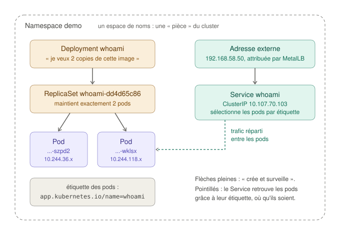
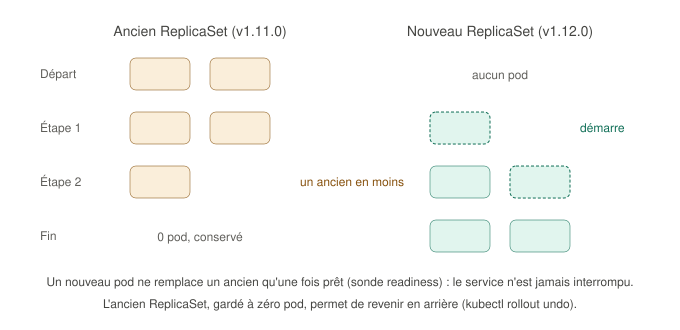

# Déployer une application sur Kubernetes, pas à pas

Ce guide montre, à la main et étape par étape, comment une application est déployée sur Kubernetes : namespace, pod, Deployment, Service. Chaque objet est d'abord créé par une commande, observé, puis manipulé, avant de passer aux fichiers de description que le projet utilise. À la fin, les fichiers de `apps/whoami/` n'auront plus de secret.

Toutes les commandes se lancent depuis **WSL2**, dans le dossier du projet (direnv sélectionne le kubeconfig du lab). Le guide utilise un namespace d'essai, `essai`, qu'on supprime à la fin : il ne touche pas à l'application de démonstration déjà installée dans `demo`.

## Sommaire

0. [Qui fait quoi dans ce projet](#0-qui-fait-quoi-dans-ce-projet)
1. [Le namespace : une pièce du cluster](#1-le-namespace--une-pièce-du-cluster)
2. [Un pod seul : ce qu'il ne faut pas faire](#2-un-pod-seul--ce-quil-ne-faut-pas-faire)
3. [Le Deployment : un pod qui se répare tout seul](#3-le-deployment--un-pod-qui-se-répare-tout-seul)
4. [Le Service : une adresse qui ne change pas](#4-le-service--une-adresse-qui-ne-change-pas)
5. [Des commandes aux fichiers](#5-des-commandes-aux-fichiers)
6. [Où ranger les fichiers d'une application ?](#6-où-ranger-les-fichiers-dune-application-)
7. [Diagnostiquer : la boîte à outils](#7-diagnostiquer--la-boîte-à-outils)
8. [Nettoyer](#8-nettoyer)
9. [Glossaire](#9-glossaire)

---

## 0. Qui fait quoi dans ce projet

Deux outils interviennent, sur deux étages différents :

| Étage | Contenu | Installé par |
|---|---|---|
| **Le socle** | Les VMs, leur système, containerd, Kubernetes, Calico, MetalLB, la Gateway | **Ansible** (`ansible-playbook site.yml`) |
| **Les applications** | whoami aujourd'hui, d'autres demain | **Argo CD**, depuis le dépôt Git (phase 6) ; kubectl auparavant |

Ansible n'a donc jamais déployé whoami. Jusqu'à la phase 5, c'est la commande `kubectl apply -f apps/whoami/` qui l'a fait ; depuis la phase 6, c'est Argo CD, qui lit le dossier `apps/` sur GitHub ([le GitOps avec Argo CD](gitops-argocd.md)). Ansible a seulement installé ce qui permet de l'exposer et de le déployer : MetalLB, la Gateway, Argo CD.

Une image pour s'en souvenir : Ansible construit l'immeuble et ses réseaux (eau, électricité, courrier) ; les applications sont les locataires qui emménagent ensuite.

### Ce qui se passe quand on lance une commande kubectl

kubectl n'exécute rien lui-même. Il envoie une demande à l'**API server**, qui l'enregistre dans **etcd**. Ce sont ensuite les composants du cluster (controllers, scheduler, kubelet) qui la réalisent, chacun à son tour (voir [le guide des notions, section 3](kubernetes-fondamentaux.md#3-ce-qui-se-passe-quand-on-déploie-une-application)). Quand une commande rend la main, l'objet est **enregistré**, mais il n'est pas forcément encore **en place** : il faut regarder.

## 1. Le namespace : une pièce du cluster

Un **namespace** (espace de noms) est une partition logique du cluster. C'est une pièce dans un immeuble : chaque pièce a son propre contenu, et deux objets peuvent porter le même nom s'ils sont dans deux pièces différentes.

Un namespace sert à :

- **ranger** : chaque application, ou chaque équipe, dans le sien ;
- **délimiter des règles** : droits d'accès (RBAC), quotas de ressources, niveau de sécurité des pods (Pod Security Admission), politiques réseau.

Attention à une idée reçue : un namespace **n'isole pas le réseau**. Par défaut, un pod d'un namespace peut joindre un pod d'un autre. Ce sont les NetworkPolicies qui posent des barrières.

Les namespaces existants :

```bash
kubectl get namespaces
```

| Namespace | Contenu |
|---|---|
| `default` | Ce qu'on crée sans préciser de namespace |
| `kube-system` | Les composants de Kubernetes : control plane, kube-proxy, CoreDNS |
| `kube-public`, `kube-node-lease` | Informations publiques du cluster, signaux de vie des nœuds |
| `tigera-operator`, `calico-system` | L'opérateur de Calico et les composants qu'il a créés |
| `metallb-system` | MetalLB |
| `demo` | L'application de démonstration |

Créer le namespace d'essai :

```bash
kubectl create namespace essai
kubectl get namespaces
```

Dans la suite, chaque commande précise `-n essai`. Sans cette option, kubectl travaille dans `default`.

## 2. Un pod seul : ce qu'il ne faut pas faire

On commence par le plus petit objet, un pod, pour comprendre pourquoi on ne s'en contente jamais.

```bash
kubectl -n essai run solo --image=traefik/whoami:v1.12.0
kubectl -n essai get pods -o wide
```

La colonne `IP` donne l'adresse du pod (en `10.244.x.x`), la colonne `NODE` le nœud choisi par le scheduler. Les messages du programme :

```bash
kubectl -n essai logs solo
```

Et toute l'histoire du pod :

```bash
kubectl -n essai describe pod solo
```

La section `Events`, en bas, retrace la chaîne vue dans les guides précédents :

| Événement | Qui | Ce qui s'est passé |
|---|---|---|
| `Scheduled` | Le scheduler | Il a choisi un nœud |
| `Pulling`, `Pulled` | Le kubelet, via containerd | L'image a été téléchargée |
| `Created`, `Started` | Le kubelet, via containerd | Le conteneur a été créé, puis lancé |

Maintenant, supprimons-le :

```bash
kubectl -n essai delete pod solo
kubectl -n essai get pods
```

Il a disparu, et **personne ne le recrée**. Un pod seul, c'est comme un `docker run` : s'il s'arrête, si son nœud tombe, s'il est supprimé par erreur, il ne revient pas. Dans un cluster, on ne crée donc presque jamais de pod directement : on décrit ce qu'on veut à un objet de plus haut niveau, qui s'occupe des pods.

## 3. Le Deployment : un pod qui se répare tout seul

Un **Deployment** décrit une application : quelle image, combien de copies, avec quels réglages. Il ne crée pas les pods lui-même : il crée un **ReplicaSet**, dont le seul rôle est de maintenir **exactement** le nombre de pods demandé.



### Lire un Deployment avant de le créer

L'option `--dry-run=client -o yaml` affiche l'objet que kubectl **enverrait**, sans rien créer. C'est le meilleur moyen de voir à quoi ressemble un objet :

```bash
kubectl -n essai create deployment whoami --image=traefik/whoami:v1.11.0 --replicas=2 --dry-run=client -o yaml
```

Le résultat, débarrassé de quelques champs vides :

```yaml
apiVersion: apps/v1          # le groupe et la version de l'API qui gère ce type d'objet
kind: Deployment             # le type d'objet
metadata:                    # l'identité de l'objet
  name: whoami
  namespace: essai
  labels:
    app: whoami
spec:                        # l'état voulu
  replicas: 2                # combien de copies
  selector:
    matchLabels:
      app: whoami            # « les pods qui m'appartiennent sont ceux qui portent cette étiquette »
  template:                  # le modèle de chaque pod
    metadata:
      labels:
        app: whoami          # l'étiquette posée sur chaque pod créé
    spec:
      containers:
        - name: whoami
          image: traefik/whoami:v1.11.0
```

Tous les objets Kubernetes ont cette forme : `apiVersion`, `kind`, `metadata`, `spec`. Kubernetes y ajoute ensuite un champ `status`, l'état observé, qu'on ne remplit jamais soi-même.

Le lien entre le Deployment et ses pods passe par une **étiquette** (*label*) : une paire clé-valeur, ici `app: whoami`. Le `template` la pose sur chaque pod, et le `selector` dit « mes pods sont ceux qui la portent ».

### Le créer, et voir les trois étages

La même commande, sans `--dry-run` :

```bash
kubectl -n essai create deployment whoami --image=traefik/whoami:v1.11.0 --replicas=2
kubectl -n essai get deployment,replicaset,pods
```

Exemple de sortie :

```
NAME                     READY   UP-TO-DATE   AVAILABLE   AGE
deployment.apps/whoami   2/2     2            2           20s

NAME                                DESIRED   CURRENT   READY   AGE
replicaset.apps/whoami-5d8f7c9b6c   2         2         2       20s

NAME                          READY   STATUS    RESTARTS   AGE
pod/whoami-5d8f7c9b6c-4xk2p   1/1     Running   0          20s
pod/whoami-5d8f7c9b6c-q9mzt   1/1     Running   0          20s
```

Les noms racontent la filiation : le ReplicaSet s'appelle `whoami-<empreinte du modèle>`, et chaque pod `whoami-<empreinte>-<suffixe aléatoire>`.

### Il se répare tout seul

Dans un second terminal, laisse tourner :

```bash
kubectl -n essai get pods -w
```

Et dans le premier, supprime un pod (remplace le nom par l'un des tiens) :

```bash
kubectl -n essai delete pod whoami-5d8f7c9b6c-4xk2p
```

Le second terminal montre le pod qui s'arrête, et **un nouveau pod, avec un autre nom, qui démarre aussitôt**. Le ReplicaSet a constaté qu'il n'y avait plus qu'un pod au lieu de deux, et il a corrigé l'écart : c'est la boucle de réconciliation, sous tes yeux. Si un nœud entier tombait, ses pods seraient recréés ailleurs de la même façon, au bout de quelques minutes.

### Changer le nombre de copies

```bash
kubectl -n essai scale deployment whoami --replicas=3
kubectl -n essai get pods -o wide
```

Un troisième pod apparaît. Retour à deux :

```bash
kubectl -n essai scale deployment whoami --replicas=2
```

L'un des trois est arrêté. On ne dit jamais « lance un pod » ou « arrête celui-là » : on change le nombre voulu, et le ReplicaSet s'adapte.

Pour voir les étiquettes, et filtrer par étiquette :

```bash
kubectl -n essai get pods --show-labels
kubectl -n essai get pods -l app=whoami
```

### Mettre à jour sans interruption

Passer de la version 1.11.0 à la version 1.12.0 de l'image :

```bash
kubectl -n essai set image deployment/whoami whoami=traefik/whoami:v1.12.0
kubectl -n essai rollout status deployment/whoami
kubectl -n essai get replicasets
```

Il y a maintenant **deux** ReplicaSets : l'ancien, à 0 pod, et un nouveau, à 2. Le Deployment a fait une **mise à jour progressive** (*rolling update*) :



Un nouveau pod ne prend la place d'un ancien qu'une fois prêt : à aucun moment l'application n'a cessé de répondre. L'ancien ReplicaSet est gardé à zéro pod, ce qui permet de revenir en arrière :

```bash
kubectl -n essai rollout history deployment/whoami
kubectl -n essai rollout undo deployment/whoami
kubectl -n essai get deployment whoami -o jsonpath='{.spec.template.spec.containers[0].image}{"\n"}'
```

La dernière commande affiche à nouveau `traefik/whoami:v1.11.0`.

## 4. Le Service : une adresse qui ne change pas

Note les adresses de tes pods (`kubectl -n essai get pods -o wide`), supprime-en un, et regarde l'adresse de son remplaçant : elle est différente. Impossible de donner l'adresse d'un pod à un client. Le **Service** résout ce problème.

### ClusterIP : une adresse stable, à l'intérieur du cluster

```bash
kubectl -n essai expose deployment whoami --port=80
kubectl -n essai get service whoami
```

Le Service a reçu une **ClusterIP**, dans la plage des Services (`10.96.0.0/12`). Il retrouve ses pods comme le Deployment : par leur **étiquette** (`app: whoami`), recopiée du Deployment. Pour voir les pods qu'il a trouvés :

```bash
kubectl -n essai get endpointslices -l kubernetes.io/service-name=whoami
```

La colonne `ENDPOINTS` liste les adresses des pods. Passe à trois copies (`kubectl -n essai scale deployment whoami --replicas=3`) et relance la commande : la troisième adresse apparaît, sans rien toucher au Service.

Un Service a aussi un **nom DNS**, de la forme `<service>.<namespace>.svc.cluster.local`. Pour le tester de l'intérieur, avec un pod temporaire (`--rm` le supprime à la fin) :

```bash
kubectl -n essai run client --rm -it --image=busybox:1.37 --restart=Never -- wget -qO- http://whoami.essai.svc.cluster.local
```

La réponse affiche `Hostname:`, le nom du pod qui a répondu. Depuis un pod du même namespace, le nom court `whoami` suffit en général : le résolveur du pod complète le nom avec `essai.svc.cluster.local`. Le nom complet, lui, fonctionne depuis n'importe quel namespace.

### NodePort : une porte sur chaque nœud

```bash
kubectl -n essai patch service whoami -p '{"spec":{"type":"NodePort"}}'
kubectl -n essai get service whoami
```

La colonne `PORT(S)` affiche maintenant `80:3xxxx/TCP` : le port `3xxxx` est ouvert **sur chaque nœud**. Depuis WSL2, avec ton numéro de port :

```bash
curl http://192.168.58.11:3xxxx
curl http://192.168.58.10:3xxxx     # même le control plane répond
```

### LoadBalancer : une adresse externe

```bash
kubectl -n essai patch service whoami -p '{"spec":{"type":"LoadBalancer"}}'
kubectl -n essai get service whoami
```

MetalLB attribue une adresse du pool : probablement `192.168.58.51`, la première libre, puisque `.50` est déjà prise par la Gateway. Puis :

```bash
curl http://192.168.58.51
```

Chaque type s'appuie sur le précédent : le Service `LoadBalancer` a **gardé** sa ClusterIP et son NodePort.

| Type | Joignable depuis | Utilisé pour |
|---|---|---|
| `ClusterIP` | L'intérieur du cluster | La communication entre applications (une API, une base de données) |
| `NodePort` | L'extérieur, via n'importe quel nœud | Des tests, ou derrière un load balancer externe |
| `LoadBalancer` | L'extérieur, sur une adresse dédiée | Exposer une application (dans le lab, grâce à MetalLB) |

Pour les applications **HTTP**, le lab ne donne plus une adresse à chacune : leur Service reste en `ClusterIP`, et une **HTTPRoute** les publie derrière la **Gateway**, le point d'entrée unique du cluster, à l'adresse `192.168.58.50`, sous un nom comme `whoami.lab.internal`. Voir [le guide de la Gateway API](gateway-api.md).

## 5. Des commandes aux fichiers

Tout ce qu'on vient de faire était **impératif** : des ordres successifs (« crée », « passe à 3 », « change l'image »). C'est très bien pour apprendre et pour dépanner, mais en exploitation, ça pose trois problèmes :

- **rien n'est tracé** : dans six mois, personne ne saura qui a passé l'application à 3 copies, ni pourquoi ;
- **rien n'est reproductible** : pour reconstruire l'application ailleurs, il faudrait se souvenir de toutes les commandes, dans l'ordre ;
- **l'état réel dérive** : chaque intervention manuelle éloigne le cluster de ce que tout le monde croit qu'il contient.

La méthode **déclarative** décrit l'état voulu dans des fichiers, et laisse Kubernetes calculer ce qu'il faut changer :

```bash
kubectl apply -f apps/whoami/
```

Les fichiers se versionnent dans Git, se relisent, et s'appliquent autant de fois qu'on veut avec le même résultat. C'est la base du GitOps : depuis la phase 6, c'est Argo CD qui applique `apps/`, à partir du dépôt.

### Lire les fichiers de `apps/whoami/`

Ce sont les mêmes objets qu'aux étapes précédentes, avec des réglages en plus, que voici :

**`01-namespace.yaml`** : le namespace `demo`, avec des étiquettes **Pod Security Admission** au niveau `restricted`. Kubernetes y refuse tout pod qui ne respecte pas les bonnes pratiques de sécurité. Pour le constater : `kubectl -n demo run test --image=busybox:1.37 -- sleep 60` est refusé, avec la liste des règles non respectées. L'étiquette `lab.internal/gateway-access: "true"` autorise le namespace à publier des routes sur la Gateway.

**`02-deployment.yaml`**, par rapport au Deployment de l'étape 3 :

| Ajout | Rôle |
|---|---|
| Étiquette `app.kubernetes.io/name` | Le nom d'étiquette recommandé par Kubernetes, au lieu du simple `app` |
| `topologySpreadConstraints` | Répartir les copies sur des nœuds différents : une panne de nœud n'emporte pas tout |
| `securityContext` (pod et conteneur) | Exécution sans root, aucune élévation de privilèges, capacités Linux retirées, système de fichiers en lecture seule, profil seccomp : ce qu'exige le niveau `restricted` |
| `WHOAMI_PORT_NUMBER: "8080"` | Les ports inférieurs à 1024 sont traditionnellement réservés à root : un programme qui tourne sans root écoute par convention sur un port plus haut. Le Service, lui, garde le port 80 |
| `resources.requests` | Ce que le pod réserve : le scheduler ne le place que sur un nœud qui a cette capacité libre |
| `resources.limits` | Ce que le pod ne peut pas dépasser, appliqué par les cgroups (phase 2). Au-delà de 32 Mio de mémoire, le conteneur est arrêté par le noyau (`OOMKilled`), puis redémarré |
| `readinessProbe` | Le pod ne reçoit du trafic que s'il répond sur `/health`. C'est aussi ce qui rend la mise à jour progressive sûre |
| `livenessProbe` | Le pod est redémarré s'il cesse de répondre |

**`03-service.yaml`** : un Service `ClusterIP`, joignable seulement depuis l'intérieur du cluster. Il vise le port **nommé** `http` du conteneur (`targetPort: http`) : si le port change dans le Deployment, le Service suit. (À l'étape 5a, c'était un Service `LoadBalancer` avec sa propre adresse externe ; la Gateway l'a remplacé.)

**`04-httproute.yaml`** : la route qui publie le Service sous le nom `whoami.lab.internal`, en se rattachant à la Gateway du cluster (`parentRefs`). Elle appartient à l'application, comme son Deployment ([explication](gateway-api.md#2-les-trois-objets-de-la-gateway-api)).

Les fichiers sont numérotés parce que `kubectl apply -f <dossier>` les traite par ordre alphabétique : le namespace doit exister avant les objets qu'il contient.

### Exercice : la boucle déclarative à la main

Depuis la phase 6, les fichiers de `apps/` sont appliqués par Argo CD : un `kubectl apply` fait à la main y serait annulé en quelques secondes. L'exercice se fait donc sur un fichier à part, dans le namespace `essai` :

1. Produis un fichier de Deployment : `kubectl -n essai create deployment boucle --image=traefik/whoami:v1.12.0 --replicas=2 --dry-run=client -o yaml > /tmp/boucle.yaml`, puis applique-le : `kubectl apply -f /tmp/boucle.yaml`. Le fichier va dans `/tmp`, hors du dépôt, pour ne pas risquer de le commiter.
2. Dans `/tmp/boucle.yaml`, passe `replicas: 2` à `replicas: 3`.
3. Demande à kubectl ce qui changerait, sans rien changer : `kubectl diff -f /tmp/boucle.yaml`. Seule la ligne `replicas` apparaît.
4. Applique : `kubectl apply -f /tmp/boucle.yaml`. Un troisième pod démarre.
5. Remets `replicas: 2`, applique de nouveau, puis supprime le fichier (le Deployment disparaîtra avec le namespace `essai`, section 8).

Comparer le fichier au cluster, puis appliquer la différence : c'est exactement ce que fait Argo CD, automatiquement et en continu, à partir du dépôt Git. La même modification sur whoami se fait par un commit : voir [travailler en GitOps](gitops-argocd.md#8-travailler-en-gitops).

## 6. Où ranger les fichiers d'une application ?

**Le cluster ne contient pas de dossier.** Quand tu lances `kubectl apply`, kubectl lit les fichiers sur ton poste et envoie leur contenu à l'API server, qui stocke les **objets** dans etcd. Les fichiers eux-mêmes ne quittent pas ton poste. On pourrait les appliquer depuis n'importe quel dossier, n'importe quelle machine qui a un kubeconfig, ou même depuis une adresse web.

Le choix de l'endroit est donc une question d'**organisation**, et il existe trois façons courantes de faire :

| Organisation | Principe | Quand |
|---|---|---|
| **Un seul dépôt** | Infrastructure et applications dans le même dépôt, dans des dossiers séparés | Un projet tenu par une seule personne ou une petite équipe. **C'est le choix de ce lab**, pour garder un projet démontrable d'un seul tenant |
| **Un dépôt par application** | Chaque application garde ses manifestes à côté de son code (souvent dans un dossier `deploy/` ou `k8s/`) | Chaque équipe gère son application de bout en bout |
| **Un dépôt de configuration dédié** | Un dépôt qui ne contient que l'état voulu du cluster, séparé du code des applications | Le GitOps en entreprise : droits et historique séparés, une seule source de vérité pour le cluster |

Dans le lab, le dossier `apps/` est séparé du reste (les rôles Ansible) précisément pour être confié à Argo CD : depuis la phase 6, il surveille `apps/` dans le dépôt GitHub, et seulement lui. Chaque sous-dossier y devient une application.

## 7. Diagnostiquer : la boîte à outils

| Commande | Pour |
|---|---|
| `kubectl -n <ns> get pods -o wide` | Voir l'état, l'adresse et le nœud de chaque pod |
| `kubectl -n <ns> describe pod <pod>` | Lire la configuration effective et les **événements** : c'est presque toujours là qu'est l'explication |
| `kubectl -n <ns> logs <pod>` | Les messages du programme (`-f` pour suivre, `--previous` pour la tentative précédente d'un conteneur qui redémarre) |
| `kubectl -n <ns> get events --sort-by=.lastTimestamp` | Tous les événements du namespace, dans l'ordre |
| `kubectl -n <ns> exec -it <pod> -- sh` | Ouvrir un shell dans un conteneur (s'il en contient un : ce n'est pas le cas de whoami) |
| `kubectl -n <ns> port-forward svc/<service> 8080:80` | Joindre un Service depuis WSL2 sur `localhost:8080`, sans l'exposer |

Les états qu'on rencontre le plus souvent :

| État | Signification | Où chercher |
|---|---|---|
| `Pending` | Aucun nœud ne peut accueillir le pod (ressources insuffisantes, taint) | `describe pod`, section `Events` |
| `ContainerCreating` | Le pod est placé, ses conteneurs se préparent (téléchargement de l'image, réseau) | Patienter, puis `describe pod` si ça dure |
| `ImagePullBackOff` | L'image est introuvable ou inaccessible (nom, version, registre) | `describe pod` |
| `CrashLoopBackOff` | Le conteneur démarre puis s'arrête en boucle | `logs --previous` |
| `Running` mais `0/1` dans `READY` | Le programme tourne, mais la sonde `readiness` échoue : pas de trafic | `describe pod` |

### Exercice : une mise à jour ratée, sans conséquence

```bash
kubectl -n essai set image deployment/whoami whoami=traefik/whoami:v9.9.9
kubectl -n essai get pods
```

Un nouveau pod passe en `ImagePullBackOff` : cette version n'existe pas. Mais les anciens pods **continuent de tourner** : la mise à jour progressive attend qu'un nouveau pod soit prêt avant d'en arrêter un ancien. L'application n'a jamais cessé de répondre. On répare :

```bash
kubectl -n essai describe pod <le pod en erreur> | sed -n '/^Events:/,$p'    # l'explication
kubectl -n essai rollout undo deployment/whoami
```

## 8. Nettoyer

Supprimer un namespace supprime **tout ce qu'il contient** :

```bash
kubectl delete namespace essai
```

Le Deployment, le ReplicaSet, les pods et le Service disparaissent, et MetalLB récupère l'adresse `192.168.58.51`. C'est aussi pour ça qu'on range chaque application dans son namespace : on peut la retirer d'un seul geste, sans risquer de toucher aux autres.

## 9. Glossaire

| Terme | Définition |
|---|---|
| Annotation | Information attachée à un objet, lue par des outils (ici MetalLB), sans servir à sélectionner |
| Déclaratif | Décrire l'état voulu dans des fichiers et laisser l'outil calculer les changements |
| Deployment | Objet qui décrit une application (image, nombre de copies, réglages) et gère ses mises à jour |
| EndpointSlice | Liste des adresses des pods derrière un Service, tenue à jour par Kubernetes |
| Étiquette (label) | Paire clé-valeur posée sur un objet, qui sert à le sélectionner |
| HTTPRoute | Règle de routage HTTP, d'un nom vers un Service, rattachée à la Gateway du cluster |
| Impératif | Donner des ordres successifs (« crée », « change », « supprime ») |
| Manifeste | Fichier YAML qui décrit un ou plusieurs objets Kubernetes |
| Namespace | Partition logique du cluster, qui délimite les noms et les règles |
| Pod Security Admission | Contrôle qui refuse les pods ne respectant pas un niveau de sécurité choisi par namespace |
| Probe (sonde) | Test régulier de l'état d'un conteneur (`readiness` : prêt à recevoir du trafic ; `liveness` : toujours vivant) |
| ReplicaSet | Objet qui maintient exactement le nombre de pods demandé |
| Requests, limits | Ressources réservées pour un pod, et plafond qu'il ne peut pas dépasser |
| Rolling update | Mise à jour progressive, pod par pod, sans interruption |
| Sélecteur (selector) | Condition sur les étiquettes, qui désigne un ensemble d'objets |
| Service | Adresse stable devant un groupe de pods (`ClusterIP`, `NodePort`, `LoadBalancer`) |

## Sources

- [Documentation Kubernetes : namespaces](https://kubernetes.io/docs/concepts/overview/working-with-objects/namespaces/)
- [Documentation Kubernetes : Deployments](https://kubernetes.io/docs/concepts/workloads/controllers/deployment/)
- [Documentation Kubernetes : Services](https://kubernetes.io/docs/concepts/services-networking/service/)
- [Documentation Kubernetes : étiquettes recommandées](https://kubernetes.io/docs/concepts/overview/working-with-objects/common-labels/)
- [Documentation Kubernetes : Pod Security Standards](https://kubernetes.io/docs/concepts/security/pod-security-standards/)
- [Documentation Kubernetes : gestion déclarative avec kubectl](https://kubernetes.io/docs/tasks/manage-kubernetes-objects/declarative-config/)
