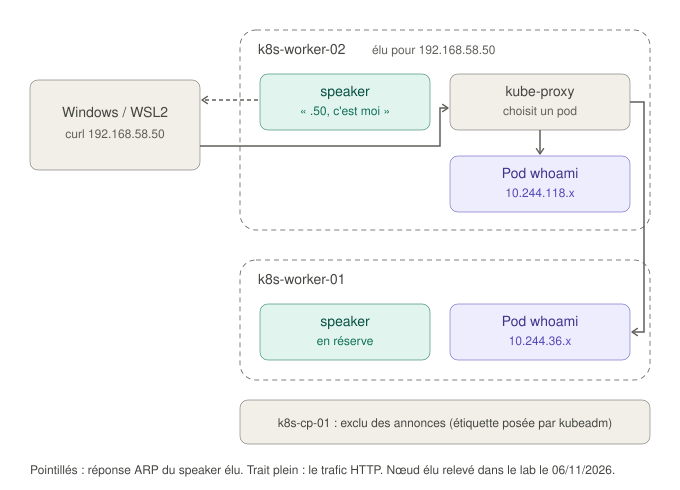

# Exposer les services : MetalLB

Ce guide explique comment une application du cluster devient joignable depuis Windows, à une adresse du réseau des nœuds (`192.168.58.50`). Il couvre l'étape 5a, MetalLB.

Depuis l'étape 5b, cette adresse n'est plus celle de whoami mais celle de la **Gateway**, le point d'entrée HTTP unique du cluster : voir [le guide de la Gateway API](gateway-api.md). Le mécanisme décrit ici reste le même ; les exemples datent de l'étape 5a, quand whoami avait sa propre adresse externe.

Pour les notions d'application, de Deployment et de Service, voir d'abord le guide [Déployer une application, pas à pas](deployer-une-application.md).

## Sommaire

1. [Le problème : un Service LoadBalancer sans fournisseur cloud](#1-le-problème--un-service-loadbalancer-sans-fournisseur-cloud)
2. [MetalLB : deux composants, deux objets de configuration](#2-metallb--deux-composants-deux-objets-de-configuration)
3. [Le mode L2 : répondre « cette adresse, c'est moi »](#3-le-mode-l2--répondre--cette-adresse-cest-moi-)
4. [Le chemin d'une requête, de Windows au pod](#4-le-chemin-dune-requête-de-windows-au-pod)
5. [Les choix du lab](#5-les-choix-du-lab)
6. [L'automatisation : installer une fois, configurer à chaque passage](#6-lautomatisation--installer-une-fois-configurer-à-chaque-passage)
7. [Vérifier, et lire les résultats](#7-vérifier-et-lire-les-résultats)
8. [Exercice : la bascule vers un autre nœud](#8-exercice--la-bascule-vers-un-autre-nœud)
9. [Les limites du mode L2](#9-les-limites-du-mode-l2)
10. [Glossaire](#10-glossaire)

---

## 1. Le problème : un Service LoadBalancer sans fournisseur cloud

Un Service de type `LoadBalancer` demande une **adresse externe**. Kubernetes ne sait pas en fournir une : il délègue cette tâche à un composant extérieur.

- **Chez un fournisseur cloud** (AWS, Azure, Google Cloud), ce composant crée un équilibreur de charge du fournisseur, avec son adresse, et le relie aux nœuds.
- **Dans des VMs ou sur des serveurs physiques**, personne ne joue ce rôle : le Service reste indéfiniment à `<pending>` dans la colonne `EXTERNAL-IP`.

**MetalLB** comble ce manque. On lui confie une plage d'adresses libres du réseau des nœuds ; il en attribue une à chaque Service `LoadBalancer`, puis fait en sorte que le réseau sache à quel nœud envoyer le trafic de cette adresse.

## 2. MetalLB : deux composants, deux objets de configuration

| Composant | Forme | Rôle |
|---|---|---|
| `controller` | Un Deployment, un seul pod | **Attribue** les adresses : il surveille les Services `LoadBalancer` et inscrit une adresse du pool dans leur `status`. Il sert aussi les webhooks qui valident la configuration de MetalLB |
| `speaker` | Un DaemonSet, un pod par nœud | **Annonce** les adresses sur le réseau, depuis le nœud choisi |

Le partage du travail ressemble à celui d'une mairie : un service attribue les numéros de rue (le controller), et sur place, quelqu'un répond quand on sonne au bon numéro (le speaker).

La configuration tient en deux objets, dans le namespace `metallb-system` (modèle Ansible : `roles/metallb/templates/metallb-config.yaml.j2`) :

| Objet | Contenu dans le lab |
|---|---|
| `IPAddressPool` `lab-pool` | Les adresses que MetalLB peut attribuer : `192.168.58.50-192.168.58.59` |
| `L2Advertisement` `lab-pool-l2` | La façon de les annoncer : en mode L2, sur l'interface `eth1` seulement |

Les deux sont séparés parce qu'on peut avoir plusieurs pools (une plage publique, une plage interne) annoncés différemment (sur des interfaces, des nœuds ou avec des protocoles différents).

## 3. Le mode L2 : répondre « cette adresse, c'est moi »

### ARP, la question posée à tout le réseau

Sur un réseau local, une machine ne peut pas envoyer un paquet à une **adresse IP** directement : la carte réseau a besoin d'une **adresse MAC**, l'identifiant matériel de la carte qui doit le recevoir. Pour la connaître, elle pose la question à tout le réseau, avec le protocole **ARP** (Address Resolution Protocol) :

> « Qui a l'adresse 192.168.58.50 ? Répondez à 192.168.58.1. »

La machine qui possède cette adresse répond avec sa MAC, et la réponse est gardée quelques minutes dans le **cache ARP** de la machine qui a demandé.

C'est comme appeler un nom dans une salle d'attente : celui qui le porte lève la main, et on sait vers qui se diriger.

### Le speaker lève la main à la place d'une machine qui n'existe pas

L'adresse `192.168.58.50` n'appartient à aucune carte réseau. En mode L2 (pour *Layer 2*, la couche liaison, celle des adresses MAC), le speaker d'**un** nœud répond aux questions ARP qui la concernent, avec la MAC **de son nœud**. Windows envoie donc le trafic de `.50` à ce nœud, qui le transmet aux pods.



### Qui répond ? Une élection sans vote

Il ne faut qu'un seul nœud pour une adresse donnée : si deux répondaient, le trafic partirait au hasard vers l'un ou l'autre. MetalLB choisit le nœud sans concertation :

1. Les speakers se surveillent entre eux (bibliothèque **memberlist**) : chacun sait quels nœuds sont en vie.
2. Pour chaque adresse, chaque speaker dresse la même liste des nœuds **éligibles** (en vie, et non exclus), et la classe selon une empreinte calculée à partir du nom du nœud et de l'adresse.
3. Le premier du classement annonce. Comme tous les speakers font le même calcul sur les mêmes données, ils arrivent au même résultat, sans échanger de message.

Le classement dépend de l'adresse : avec plusieurs Services, les adresses se répartissent entre les nœuds. Mais **une adresse donnée n'est servie que par un seul nœud à la fois**.

Si le nœud élu tombe, memberlist le détecte, le suivant dans le classement prend le relais et envoie une **annonce ARP spontanée** (*gratuitous ARP*) : « 192.168.58.50, c'est désormais moi ». Les machines du réseau mettent leur cache à jour, et la bascule prend en général quelques secondes.

## 4. Le chemin d'une requête, de Windows au pod

Commande : `curl http://192.168.58.50` depuis WSL2.

1. **ARP** : Windows demande qui a `192.168.58.50`. Le speaker de `k8s-worker-02`, élu, répond avec la MAC de `eth1` de son nœud.
2. **Arrivée sur le nœud** : le paquet arrive sur `k8s-worker-02`, port 80, adresse `192.168.58.50`.
3. **kube-proxy** : les règles iptables qu'il a écrites pour ce Service reconnaissent l'adresse et le port, et choisissent **au hasard** l'un des pods prêts. L'adresse de destination est réécrite (`192.168.58.50:80` devient `10.244.x.x:8080`).
4. **Calico** : si le pod est sur le même nœud, le paquet emprunte son câble virtuel ; s'il est sur l'autre worker, il part par `eth1`, grâce aux routes de Calico.
5. **La réponse** refait le chemin inverse, et les adresses d'origine sont restaurées.

MetalLB n'intervient donc qu'à l'étape 1 : il **attire** le trafic vers un nœud. Le reste, c'est le Service ordinaire (kube-proxy) et le réseau des pods (Calico). C'est pour ça que les réponses alternent entre les deux pods, alors que tout le trafic entre par `k8s-worker-02`.

## 5. Les choix du lab

### Le pool : `192.168.58.50` à `192.168.58.59`

Les adresses d'un pool doivent être **libres** sur le réseau, sinon deux machines répondraient à la même question ARP. Dans `192.168.58.0/24` :

| Adresses | Occupées par |
|---|---|
| `.1` | L'adaptateur VMnet3 de Windows |
| `.10` à `.12` | Les trois nœuds |
| `.50` à `.59` | **Le pool de MetalLB** |
| `.128` à `.254` | La plage DHCP de VMware (par défaut), au cas où elle serait activée |

Dix adresses suffisent largement : avec la Gateway API (étape 5b), une seule adresse servira toutes les applications HTTP. La plage est définie une seule fois, avec le reste du plan d'adressage : variable `k8s_lb_address_range` dans `inventory/group_vars/all/vars.yml`.

### Une adresse fixe

Sans précision, MetalLB donne la première adresse libre du pool. À l'étape 5a, le Service de whoami demandait `192.168.58.50` explicitement, par l'annotation `metallb.io/loadBalancerIPs`, pour que l'adresse reste la même après une reconstruction. Depuis l'étape 5b, c'est le Service des proxys de la Gateway qui la demande, avec la même annotation (posée par l'objet EnvoyProxy, variable `k8s_gateway_address`). L'ancien champ `spec.loadBalancerIP` est obsolète dans Kubernetes : l'annotation le remplace.

### Annoncer sur `eth1` seulement

Chaque nœud a deux interfaces : `eth0`, sur le réseau NAT de Vagrant, et `eth1`, sur le réseau privé. Sans restriction, le speaker répondrait aux questions ARP sur les deux. Or les adresses du pool appartiennent au réseau privé : les annoncer sur le réseau NAT n'a aucun sens, et pourrait perturber le NAT de VMware. Le champ `interfaces` de l'objet `L2Advertisement` limite l'annonce à `eth1`.

### Le control plane exclu des annonces

kubeadm pose sur le control plane l'étiquette `node.kubernetes.io/exclude-from-external-load-balancers`, une convention de Kubernetes qui signifie « ne pas recevoir le trafic des load balancers externes ». MetalLB la respecte : le control plane n'est jamais élu.

C'est pourquoi un `speaker` tourne bien sur chacun des trois nœuds (le DaemonSet tolère le taint du control plane), mais seuls les deux workers peuvent annoncer. Le control plane garde ses ressources pour l'API server et etcd.

### `externalTrafficPolicy: Cluster`, la valeur par défaut

Le nœud élu peut envoyer la requête à un pod situé sur l'autre worker (étape 4). Pour que la réponse revienne par le même chemin, kube-proxy remplace l'adresse source du client par une adresse du nœud (**SNAT**, traduction de l'adresse source). Conséquence : **le pod ne voit pas l'adresse réelle du client**.

L'autre valeur, `Local`, conserve l'adresse du client, mais le trafic n'est alors envoyé qu'aux pods du nœud qui le reçoit, et MetalLB n'élit que des nœuds qui ont un pod prêt. Pour whoami exposé directement, la valeur par défaut convenait. On le constatait dans la réponse : la ligne `RemoteAddr` n'affichait pas l'adresse de Windows (`192.168.58.1`).

Le Service des proxys de la Gateway, lui, est en `Local` (réglage par défaut d'Envoy Gateway) : les proxys voient l'adresse du client, et la transmettent aux applications dans l'en-tête `X-Forwarded-For`. C'est pour ça qu'il y a un proxy sur chaque worker : MetalLB peut annoncer l'adresse depuis l'un ou l'autre ([détail](gateway-api.md#deux-proxys-et-la-politique-local)).

## 6. L'automatisation : installer une fois, configurer à chaque passage

Le rôle `roles/metallb/` traite différemment le logiciel et sa configuration.

**Le logiciel** (`metallb-native.yaml`, la version « native », la plus légère, suffisante pour le mode L2) :

- téléchargé en version figée (`v0.16.2`), avec vérification de son empreinte SHA-256 ;
- appliqué **une seule fois**, si le Deployment `controller` n'existe pas encore. Le contrôleur modifie lui-même certains objets du manifeste (il y inscrit le certificat de ses webhooks) : les réappliquer à chaque passage, ce serait entrer en concurrence avec lui. C'est la même logique que pour l'opérateur de Calico. Une mise à jour de MetalLB suit une procédure, pas un passage du playbook.

**La configuration** (le pool et l'annonce), qui n'appartient qu'à nous, est **déclarative** : à chaque passage, le playbook compare le fichier au cluster, et n'applique que s'il y a une différence.

| Étape | Commande | Résultat |
|---|---|---|
| Comparer | `kubectl diff --server-side -f metallb-config.yaml` | Code de retour `0` : identique ; `1` : différences ; plus de `1` : erreur |
| Appliquer | `kubectl apply --server-side -f metallb-config.yaml` | Seulement si le code précédent vaut `1` |

Juste après l'installation, le webhook qui valide ces objets peut ne pas encore répondre : la comparaison échoue alors avec un code supérieur à 1. Le playbook réessaie (jusqu'à 12 fois, toutes les 10 secondes) avant de conclure à une erreur.

Résultat : modifier la plage dans `vars.yml` puis relancer le playbook suffit à mettre MetalLB à jour, et un passage sans modification ne change rien (`changed=0`).

`--server-side` confie le calcul de la fusion à l'API server, qui note quel outil gère quel champ : c'est la méthode moderne de `kubectl apply`, et celle qu'utilise Argo CD.

## 7. Vérifier, et lire les résultats

Résultats relevés dans le lab le 06/11/2026 (sorties abrégées), à l'étape 5a, quand whoami était un Service `LoadBalancer`. Depuis l'étape 5b, l'adresse appartient au Service des proxys de la Gateway : les mêmes vérifications se font sur lui, avec `kubectl -n envoy-gateway-system describe service -l gateway.envoyproxy.io/owning-gateway-name=lab-gateway`.

**Le Service a reçu son adresse :**

```
$ kubectl -n demo get service whoami
NAME     TYPE           CLUSTER-IP      EXTERNAL-IP     PORT(S)        AGE
whoami   LoadBalancer   10.107.70.103   192.168.58.50   80:30756/TCP   2m
```

`EXTERNAL-IP` n'est plus `<pending>`. Le Service a aussi une ClusterIP et un NodePort (`30756`) : chaque type s'appuie sur le précédent.

**Les composants de MetalLB :**

```
$ kubectl -n metallb-system get pods -o wide
```

Un `controller` (sur `k8s-worker-02` dans le lab) et un `speaker` par nœud, control plane compris.

**Qui annonce l'adresse :**

```
$ kubectl -n demo describe service whoami | sed -n '/^Events:/,$p'
  Normal  IPAllocated   ...  metallb-controller  Assigned IP ["192.168.58.50"]
  Normal  nodeAssigned  ...  metallb-speaker     announcing from node "k8s-worker-02" with protocol "layer2"
```

Les deux étapes apparaissent : l'attribution par le controller, puis l'annonce par le speaker du nœud élu.

**Côté Windows, la preuve ARP** (PowerShell) :

```
> arp -a
Interface : 192.168.58.1 --- 0x...
  192.168.58.12         00-0c-29-43-35-75     dynamique
  192.168.58.50         00-0c-29-43-35-75     dynamique
```

L'adresse `.50` a **la même MAC** que `.12`, l'adresse de `k8s-worker-02` : Windows envoie bien le trafic de `.50` à ce nœud. C'est exactement le mécanisme de la section 3.

**Le trafic est réparti entre les pods :**

```bash
for i in $(seq 1 6); do curl -s http://192.168.58.50 | grep Hostname; done
```

Les noms des deux pods alternent (`whoami-dd4d65c86-szpd2`, `whoami-dd4d65c86-wklsx`), y compris celui qui tourne sur `k8s-worker-01` : kube-proxy a fait suivre une partie du trafic au-delà du nœud élu.

**La configuration de MetalLB :**

```bash
kubectl -n metallb-system get ipaddresspools,l2advertisements
```

## 8. Exercice : la bascule vers un autre nœud

Pour voir l'élection en action, on suspend le nœud élu. Depuis l'étape 5b, l'adresse `192.168.58.50` est celle de la Gateway : le nœud élu est l'un des deux workers, qui hébergent chacun un proxy Envoy (ici `k8s-worker-02` ; vérifie d'abord le tien dans les événements du Service des proxys, avec `kubectl -n envoy-gateway-system describe service -l gateway.envoyproxy.io/owning-gateway-name=lab-gateway`).

Dans WSL2, une boucle qui interroge whoami chaque seconde, avec un délai maximal d'une seconde par requête :

```bash
while true; do printf '%s ' "$(date +%T)"; curl -s --max-time 1 --resolve whoami.lab.internal:80:192.168.58.50 http://whoami.lab.internal | grep Hostname || echo "pas de réponse"; sleep 1; done
```

Dans PowerShell, à la racine du projet :

```powershell
vagrant suspend k8s-worker-02
```

Ce qu'on observe, dans l'ordre :

1. **Quelques secondes sans réponse** : le nœud élu ne répond plus, memberlist le détecte, et le speaker de `k8s-worker-01`, seul autre nœud à héberger un proxy Envoy, prend le relais. Les événements du Service des proxys montrent une nouvelle annonce depuis `k8s-worker-01`, et `arp -a` sur Windows affiche désormais la MAC de `.11` pour `.50`.
2. **Ensuite, des réponses manquantes, de temps en temps** : le trafic arrive bien sur l'Envoy de `k8s-worker-01`, mais Envoy envoie encore une partie des requêtes aux pods whoami de `k8s-worker-02`, qui ne répondent plus. Kubernetes ne les retire du Service qu'une fois le nœud déclaré `NotReady`, au bout de quelques dizaines de secondes.
3. **Enfin, toutes les réponses viennent des pods de `k8s-worker-01`.**

Les deux délais ne viennent pas du même composant : le premier est celui de MetalLB (qui annonce l'adresse), le second celui de Kubernetes (qui décide qu'un nœud est perdu). Pour finir :

```powershell
vagrant resume k8s-worker-02
```

Le nœud revient `Ready`, ses pods reçoivent de nouveau du trafic, et l'annonce revient sur `k8s-worker-02` : il est toujours premier du classement pour cette adresse.

À noter : dans le lab, le `controller` de MetalLB et celui d'Envoy Gateway tournent eux aussi sur `k8s-worker-02`. Leur suspension n'empêche pas la bascule : elle ne dépend que des speakers de MetalLB et des proxys Envoy, qui gardent leur configuration. C'est la séparation entre **plan de contrôle** (ce qui décide) et **plan de données** (ce qui transporte le trafic) : seules les modifications (une nouvelle adresse, une nouvelle route) attendraient le retour des contrôleurs, ou leur redémarrage sur un autre nœud.

## 9. Les limites du mode L2

| Limite | Détail | En production |
|---|---|---|
| Un seul nœud par adresse | Tout le trafic d'une adresse entre par un seul nœud : son débit est le plafond. MetalLB attire le trafic, il ne le répartit pas entre les nœuds | Mode **BGP** : les nœuds annoncent l'adresse à des routeurs, qui répartissent le trafic entre eux |
| Bascule en quelques secondes | Le temps que memberlist détecte la panne et que les clients mettent leur cache ARP à jour. Un client qui ignore les annonces ARP spontanées reste bloqué jusqu'à l'expiration de son cache | BGP, ou un équilibreur de charge matériel |
| Un seul réseau local | ARP ne traverse pas les routeurs : les clients doivent être sur le même réseau que les nœuds (ici, Windows sur VMnet3) | BGP, ou l'équilibreur de charge du fournisseur cloud |
| Adresse du client masquée | Avec `externalTrafficPolicy: Cluster`, les pods voient une adresse du nœud. Réglé pour le trafic HTTP depuis l'étape 5b : le Service de la Gateway est en `Local`, et Envoy transmet l'adresse du client dans `X-Forwarded-For` | `Local` pour les Services qui ont besoin de l'adresse du client |

## 10. Glossaire

| Terme | Définition |
|---|---|
| Adresse MAC | Identifiant matériel d'une carte réseau, utilisé sur le réseau local |
| ARP | Protocole qui trouve l'adresse MAC correspondant à une adresse IP, en posant la question à tout le réseau local |
| BGP | Protocole d'échange de routes entre routeurs ; l'autre mode de MetalLB |
| Cache ARP | Table où une machine garde, quelques minutes, les réponses ARP reçues |
| Controller (MetalLB) | Composant qui attribue les adresses du pool aux Services `LoadBalancer` |
| externalTrafficPolicy | Réglage d'un Service : `Cluster` (tous les pods, adresse du client masquée) ou `Local` (pods du nœud qui reçoit, adresse du client conservée) |
| Gratuitous ARP | Annonce ARP envoyée sans question préalable, pour signaler qu'une adresse a changé de propriétaire |
| IPAddressPool | Objet de MetalLB : la plage d'adresses qu'il peut attribuer |
| L2 (couche 2) | La couche liaison du réseau, celle des adresses MAC et d'ARP |
| L2Advertisement | Objet de MetalLB : comment et où annoncer les adresses d'un pool en mode L2 |
| memberlist | Bibliothèque qui permet aux speakers de savoir quels nœuds sont en vie |
| SNAT | Remplacement de l'adresse source d'un paquet |
| Speaker (MetalLB) | Composant présent sur chaque nœud, qui annonce les adresses depuis le nœud élu |

## Sources

- [MetalLB : le mode L2](https://metallb.io/concepts/layer2/)
- [MetalLB : installation](https://metallb.io/installation/)
- [Documentation Kubernetes : Services de type LoadBalancer](https://kubernetes.io/docs/concepts/services-networking/service/#loadbalancer)
- [Documentation Kubernetes : étiquette `node.kubernetes.io/exclude-from-external-load-balancers`](https://kubernetes.io/docs/reference/labels-annotations-taints/#node-kubernetes-io-exclude-from-external-load-balancers)
- [Documentation Kubernetes : politique de trafic externe](https://kubernetes.io/docs/tasks/access-application-cluster/create-external-load-balancer/#preserving-the-client-source-ip)
