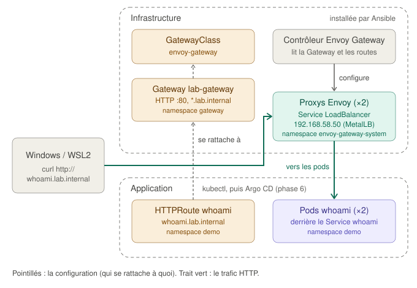
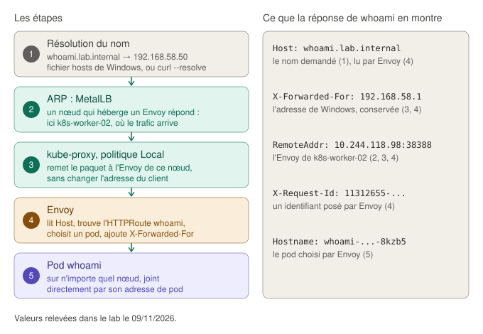

# Le point d'entrée HTTP : Gateway API et Envoy Gateway

Ce guide explique comment toutes les applications HTTP du cluster sont publiées derrière **une seule adresse** (`192.168.58.50`), et triées selon le **nom** demandé (`whoami.lab.internal`). Il couvre l'étape 5b. Il fait suite au guide [Exposer les services : MetalLB](exposition-des-services.md), qui explique comment cette adresse arrive jusqu'au cluster.

## Sommaire

1. [Pourquoi un point d'entrée unique](#1-pourquoi-un-point-dentrée-unique)
2. [Les trois objets de la Gateway API](#2-les-trois-objets-de-la-gateway-api)
3. [Envoy Gateway : un contrôleur et des proxys](#3-envoy-gateway--un-contrôleur-et-des-proxys)
4. [Le chemin d'une requête](#4-le-chemin-dune-requête)
5. [Les choix du lab](#5-les-choix-du-lab)
6. [L'automatisation : trois étages, trois méthodes](#6-lautomatisation--trois-étages-trois-méthodes)
7. [Vérifier, et lire les résultats](#7-vérifier-et-lire-les-résultats)
8. [Exercice : répartir le trafic entre deux versions, puis refuser une route](#8-exercice--répartir-le-trafic-entre-deux-versions-puis-refuser-une-route)
9. [Diagnostiquer](#9-diagnostiquer)
10. [Les limites](#10-les-limites)
11. [Glossaire](#11-glossaire)

---

## 1. Pourquoi un point d'entrée unique

Avec MetalLB seul (étape 5a), chaque application exposée est un Service `LoadBalancer` avec **sa propre adresse**. Ça fonctionne, mais :

- **une adresse par application** : dix applications, dix adresses à réserver, à retenir et à déclarer dans le DNS ;
- **aucun tri par nom ou par chemin** : un Service travaille au niveau TCP (une adresse, un port), il ne lit pas le contenu des requêtes HTTP ;
- **chaque application gère seule** ce qui devrait être commun : le chiffrement HTTPS, les journaux d'accès, les limites de débit.

La solution est un **reverse proxy** partagé : un programme qui reçoit toutes les requêtes HTTP, lit le nom demandé (l'en-tête `Host`) et le chemin, puis transmet chaque requête à la bonne application. C'est l'accueil d'un immeuble : une seule adresse dans la rue, et à l'accueil, on oriente chaque visiteur vers le bon bureau selon le nom qu'il donne. HAProxy jouait déjà ce rôle dans `lab-infra-as-code`.

Kubernetes a d'abord proposé l'objet **Ingress** pour décrire ces règles. Il est resté très limité (tout ce qui dépasse le routage simple passait par des annotations propres à chaque produit), et le contrôleur le plus utilisé, Ingress NGINX, n'est plus maintenu depuis mars 2026. Son successeur est la **Gateway API** : des objets plus riches, communs à toutes les implémentations, et une répartition claire des responsabilités.

## 2. Les trois objets de la Gateway API

La Gateway API n'est pas incluse dans Kubernetes : ses types d'objets sont ajoutés par des **CRD** (comme ceux de Calico et de MetalLB), publiées par le projet Kubernetes lui-même.

| Objet | Ce qu'il décrit | Analogie | Qui le gère | Dans le lab |
|---|---|---|---|---|
| **GatewayClass** | Le logiciel qui met en œuvre les Gateways de cette classe | La société d'accueil à qui l'on confie l'entrée | Le fournisseur de la plateforme | `envoy-gateway`, gérée par Ansible |
| **Gateway** | Un point d'entrée : ports, protocoles, noms acceptés, namespaces autorisés à s'y rattacher | La porte d'entrée et son guichet | L'équipe qui gère le cluster | `lab-gateway`, dans le namespace `gateway`, gérée par Ansible |
| **HTTPRoute** | Une règle de routage : « tel nom, tel chemin, vers tel Service » | La ligne de l'annuaire de l'accueil | L'équipe de l'application | `whoami`, dans le namespace `demo`, avec l'application (`apps/whoami/04-httproute.yaml`) |

Cette séparation est le grand apport de la Gateway API par rapport à Ingress. L'équipe de l'application décrit **ses** routes, dans **son** namespace, sans pouvoir modifier la porte d'entrée. L'équipe de la plateforme décide qui a le droit de s'y rattacher.



### Comment une route se rattache à la Gateway

L'HTTPRoute désigne la Gateway et son écouteur par `parentRefs` :

```yaml
parentRefs:
  - name: lab-gateway
    namespace: gateway
    sectionName: http        # l'écouteur « http » de la Gateway
hostnames:
  - whoami.lab.internal
rules:
  - backendRefs:
      - name: whoami         # le Service, dans le namespace de la route
        port: 80
```

La Gateway n'accepte la route que si **trois conditions** sont réunies :

1. le **namespace** de la route est autorisé par l'écouteur (`allowedRoutes`). Ici, il doit porter l'étiquette `lab.internal/gateway-access: "true"`, posée sur `demo` par `01-namespace.yaml` ;
2. le **nom** de la route correspond au nom de l'écouteur : `whoami.lab.internal` entre bien dans `*.lab.internal` ;
3. le **type** de route est accepté par l'écouteur (`kinds: HTTPRoute`).

Le résultat est inscrit par le contrôleur dans le `status` de la route : condition `Accepted`. Une seconde condition, `ResolvedRefs`, indique que le Service visé existe.

Une route peut viser un Service d'un **autre** namespace, mais seulement si ce namespace l'autorise par un objet **ReferenceGrant**. Sans cette autorisation, n'importe quelle route pourrait capter le trafic d'une application qui ne lui appartient pas.

## 3. Envoy Gateway : un contrôleur et des proxys

La Gateway API ne fait que **décrire**. Il faut un logiciel qui la met en œuvre : le lab utilise **Envoy Gateway**. Il comporte deux parties, qu'on retrouve dans tous les logiciels réseau de Kubernetes :

| Partie | Rôle | Dans le lab |
|---|---|---|
| **Plan de contrôle** : le contrôleur `envoy-gateway` | Il surveille les GatewayClass, Gateway et HTTPRoute, en déduit une configuration, et l'envoie aux proxys | 1 pod, dans `envoy-gateway-system` |
| **Plan de données** : les proxys **Envoy** | Ils reçoivent les requêtes et les transmettent aux pods. Ils ne lisent pas les objets Kubernetes : ils appliquent la configuration reçue du contrôleur | 2 pods, un par worker, dans `envoy-gateway-system` |

Le contrôleur envoie la configuration aux proxys par **xDS**, le protocole de configuration d'Envoy, sur une connexion chiffrée. Le Job `certgen` du manifeste d'installation crée les certificats de cette connexion.

Point important : si le contrôleur s'arrête, **le trafic continue**. Les proxys gardent leur dernière configuration ; seules les modifications de routes attendent son retour.

Pour chaque Gateway, le contrôleur crée :

- un **Deployment** de proxys, nommé `envoy-<namespace>-<nom>-<empreinte>`. Dans le lab : `envoy-gateway-lab-gateway-00ec3056`, où `00ec3056` est le début de l'empreinte SHA-256 de `gateway/lab-gateway` ;
- un **Service `LoadBalancer`** du même nom, devant ces proxys. C'est lui qui reçoit l'adresse `192.168.58.50` de MetalLB.

Chaque pod de proxy contient **deux conteneurs** (d'où le `2/2` dans `kubectl get pods`) : `envoy`, le proxy, et `shutdown-manager`, qui laisse les connexions en cours se terminer avant l'arrêt du pod.

Envoy tourne sans root, et les ports inférieurs à 1024 sont traditionnellement réservés à root : Envoy Gateway les évite en les décalant de 10 000. L'écouteur du port 80 est servi sur le port **10080** du conteneur, et le Service fait la traduction (port 80 vers 10080).

Les réglages propres à Envoy Gateway, que la Gateway API commune ne prévoit pas (nombre de copies, ressources, annotations du Service), sont décrits dans un objet **EnvoyProxy**, que la Gateway désigne par `infrastructure.parametersRef`.

## 4. Le chemin d'une requête

Commande : `curl --resolve whoami.lab.internal:80:192.168.58.50 http://whoami.lab.internal`, depuis WSL2.



1. **Résolution du nom.** Le nom `whoami.lab.internal` doit être traduit en adresse. Le lab n'a pas de serveur DNS : l'option `--resolve` de curl donne l'adresse directement, et pour le navigateur, une ligne dans le fichier hosts de Windows fait la même chose.
2. **ARP, MetalLB.** Windows demande qui a `192.168.58.50`. Le Service des proxys est en `externalTrafficPolicy: Local` : MetalLB ne fait donc répondre qu'un nœud **qui héberge un proxy Envoy prêt**. Ici, c'est `k8s-worker-02`.
3. **kube-proxy, politique Local.** Sur ce nœud, kube-proxy remet le paquet à l'Envoy **du même nœud**, sans traduction de l'adresse source : Envoy voit l'adresse réelle du client, `192.168.58.1`.
4. **Envoy.** Il lit l'en-tête `Host` (`whoami.lab.internal`), trouve la règle de l'HTTPRoute `whoami`, et choisit l'un des pods du Service `whoami`. Il ajoute l'en-tête `X-Forwarded-For` avec l'adresse du client, pour que l'application la connaisse.
5. **Le pod whoami.** Envoy le joint **directement par son adresse de pod**, sur n'importe quel nœud, grâce au réseau de Calico. Il ne passe pas par la ClusterIP du Service : il lit lui-même la liste des pods (les EndpointSlices), transmise par le contrôleur.

Par rapport à l'étape 5a, deux différences :

| | Étape 5a : Service `LoadBalancer` direct | Étape 5b : Gateway |
|---|---|---|
| Qui choisit le pod | kube-proxy, au niveau TCP | Envoy, au niveau HTTP, d'après le nom et le chemin |
| Adresse du client vue par le pod | Une adresse du nœud (SNAT) | Le proxy Envoy (`RemoteAddr`), et l'adresse réelle du client dans `X-Forwarded-For` |

## 5. Les choix du lab

### Envoy Gateway, version 1.10.0

Plusieurs logiciels mettent en œuvre la Gateway API : Envoy Gateway, NGINX Gateway Fabric, Traefik, Istio, Cilium, Kong. Envoy Gateway, parce que :

- c'est la seule version d'Envoy Gateway **testée sur Kubernetes 1.37** (v1.10.0, publiée le 05/11/2026) ;
- **Envoy**, le proxy, est un projet diplômé de la CNCF, très répandu (Istio et de nombreuses solutions l'utilisent), et Envoy Gateway en est le sous-projet officiel ;
- il se concentre sur la Gateway API, sans objets propres qu'il faudrait apprendre en plus pour le routage courant.

Calico propose aussi un point d'entrée fondé sur Envoy Gateway, installé par son opérateur. Je ne l'ai pas retenu : comme pour le reste du lab, je voulais installer et voir chaque brique.

### Les CRD du canal standard, gérées à part

La Gateway API est publiée en deux **canaux** :

| Canal | Contenu | Pour qui |
|---|---|---|
| **Standard** | Les types et champs stables, garantis compatibles d'une version à l'autre | La production |
| **Expérimental** | Le canal standard, plus les fonctionnalités en cours de mise au point, qui peuvent changer | Les essais |

Le manifeste officiel d'Envoy Gateway (`install.yaml`) contient les CRD du canal **expérimental**, en plus du contrôleur. Le lab applique donc :

1. les CRD **standard**, depuis le projet Gateway API (`standard-install.yaml`, v1.6.1, la version testée avec Envoy Gateway 1.10) ;
2. les CRD propres à Envoy Gateway (`envoy-gateway-crds.yaml`, pour l'objet EnvoyProxy notamment) ;
3. **seulement le contrôleur** du manifeste complet, avec l'option `--selector` de kubectl : `kubectl apply -f install.yaml --selector app.kubernetes.io/instance=eg`. Les objets du contrôleur portent cette étiquette ; les CRD, non. Le fichier officiel n'est pas modifié, et son empreinte reste vérifiable.

Les CRD standard installent aussi une règle d'admission, `safe-upgrades` : l'API server **refuse** de remplacer une CRD standard par une CRD expérimentale, ou par une version plus ancienne. Je l'ai vérifié avant le premier lancement : le manifeste complet, appliqué sans sélecteur, est rejeté avec le message « Installing experimental CRDs on top of standard channel CRDs is prohibited ».

### Un domaine : `lab.internal`

Les applications sont publiées sous `*.lab.internal`. L'ICANN, qui gère les noms de domaine de premier niveau, a réservé `.internal` aux réseaux privés en 2024 : ce domaine ne sera jamais attribué sur Internet, il ne peut donc pas entrer en conflit avec un vrai site. La variable `k8s_apps_domain` le définit, avec le reste du plan d'adressage.

### Une étiquette d'accès pour les namespaces

L'écouteur n'accepte que les routes des namespaces qui portent `lab.internal/gateway-access: "true"`. Une application doit donc **demander** à être publiée, en posant l'étiquette sur son namespace. La valeur `from: All` aurait accepté n'importe quel namespace : plus simple, mais tout pod de test pourrait alors publier un nom sur l'adresse d'entrée du cluster.

### Deux proxys, et la politique `Local`

Par défaut, Envoy Gateway crée **un** proxy, et règle son Service en `externalTrafficPolicy: Local`, pour conserver l'adresse du client. Mais avec la politique `Local`, MetalLB n'annonce l'adresse **que depuis un nœud qui héberge un proxy prêt** (étape 2 du chemin). Avec un seul proxy, la perte de son nœud rendrait l'adresse injoignable jusqu'à ce que le proxy soit recréé ailleurs, plusieurs minutes plus tard.

L'objet EnvoyProxy demande donc **deux copies**, réparties sur des nœuds différents (`topologySpreadConstraints`, comme pour whoami). Chaque worker héberge un proxy, et MetalLB peut basculer de l'un à l'autre en quelques secondes.

L'EnvoyProxy réduit aussi la mémoire réservée par proxy (128 Mio au lieu de 512 Mio par défaut, une taille de production), avec un plafond à 512 Mio.

### L'adresse `192.168.58.50` pour la Gateway, whoami en ClusterIP

La Gateway reprend l'adresse qu'avait whoami à l'étape 5a, demandée à MetalLB par l'annotation `metallb.io/loadBalancerIPs`, posée sur le Service des proxys par l'objet EnvoyProxy. Le Service de whoami redevient un simple `ClusterIP`, joignable seulement depuis l'intérieur du cluster : l'accès de l'extérieur passe par la Gateway.

### Le niveau de sécurité `restricted`

Les deux namespaces de la Gateway (`envoy-gateway-system` et `gateway`) sont au niveau Pod Security `restricted`, comme `demo`. J'ai vérifié dans le code d'Envoy Gateway que ses pods le respectent (exécution sans root, aucune élévation de privilèges, capacités retirées, profil seccomp), puis testé l'admission des pods du contrôleur et d'un proxy sur un API server.

## 6. L'automatisation : trois étages, trois méthodes

Le rôle `roles/envoy_gateway/` applique chaque étage avec la méthode qui lui convient :

| Étage | Contenu | Méthode | Pourquoi |
|---|---|---|---|
| 1. Socle | CRD de la Gateway API et d'Envoy Gateway, deux namespaces | Comparé au cluster (`kubectl diff`), appliqué s'il diffère | Les CRD n'appartiennent qu'à nous : une montée de version (numéro et empreinte dans `defaults/main.yml`) suffit à les mettre à jour |
| 2. Contrôleur | Les objets du manifeste officiel qui portent l'étiquette du contrôleur | Appliqué une seule fois | Le manifeste contient un Job, qu'on ne peut pas modifier une fois créé : le réappliquer échouerait à chaque montée de version |
| 3. Configuration | GatewayClass, EnvoyProxy, Gateway | Comparée, appliquée si elle diffère | Comme la configuration de MetalLB : tout changement du modèle est répercuté |

Les namespaces sont créés dès l'étage 1, et pas avec la configuration : `kubectl diff` simule la création des objets, et cette simulation échoue pour un objet placé dans un namespace qui n'existe pas encore. Le test du rôle sur un API server a révélé ce piège avant le premier lancement (voir le [journal du 09/11/2026](../README.md#09112026--phase-5b--point-dentrée-http-avec-la-gateway-api)).

Le rôle vérifie ensuite son résultat, du plus simple au plus complet :

| Vérification | Ce qu'elle prouve |
|---|---|
| CRD `Established` | L'API server sert les nouveaux types |
| Contrôleur prêt (`rollout status`) | Le pod `envoy-gateway` tourne |
| GatewayClass `Accepted` | Le contrôleur reconnaît la classe comme la sienne |
| Gateway `Programmed` | Les proxys tournent **et** MetalLB a donné une adresse à leur Service. En cas d'échec, le rôle affiche le message du contrôleur et la cause la plus probable : l'adresse déjà prise par un autre Service |
| Adresse de la Gateway = `k8s_gateway_address` | MetalLB a respecté l'annotation |
| Requête HTTP depuis WSL2, réponse `404` attendue | Le chemin complet fonctionne, depuis le poste de contrôle : ARP, kube-proxy, Envoy. Le nom demandé (`controle.lab.internal`) n'a pas de route : Envoy doit répondre « 404, aucune route » |

## 7. Vérifier, et lire les résultats

Résultats relevés dans le lab le 09/11/2026.

### La classe est acceptée

```
$ kubectl get gatewayclass
NAME            CONTROLLER                                      ACCEPTED   AGE
envoy-gateway   gateway.envoyproxy.io/gatewayclass-controller   True       93s
```

**Intention** : vérifier qu'un contrôleur a reconnu la classe. **Lecture** : la colonne `CONTROLLER` reprend le `controllerName` de la classe, et `ACCEPTED True` signifie que le contrôleur qui porte ce nom l'a prise en charge. Avec une faute de frappe dans `controllerName`, la classe resterait à `Unknown` : aucun contrôleur ne s'y reconnaîtrait.

### La Gateway est opérationnelle

```
$ kubectl -n gateway get gateway
NAME          CLASS           ADDRESS         PROGRAMMED   AGE
lab-gateway   envoy-gateway   192.168.58.50   True         106s
```

**Intention** : vérifier que l'entrée existe vraiment. **Lecture** : `ADDRESS` est l'adresse que MetalLB a donnée au Service des proxys, recopiée par le contrôleur. `PROGRAMMED True` signifie que les proxys tournent et ont reçu leur configuration.

### La route est acceptée

```
$ kubectl -n demo get httproute
NAME     HOSTNAMES                 AGE
whoami   ["whoami.lab.internal"]   89s
$ kubectl -n demo describe httproute whoami | sed -n '/^Status:/,$p'
Status:
  Parents:
    Conditions:
      Message:               Route is accepted
      Reason:                Accepted
      Status:                True
      Type:                  Accepted
      Message:               Resolved all the Object references for the Route
      Reason:                ResolvedRefs
      Status:                True
      Type:                  ResolvedRefs
    Controller Name:         gateway.envoyproxy.io/gatewayclass-controller
    Parent Ref:
      Name:          lab-gateway
      Namespace:     gateway
      Section Name:  http
```

**Intention** : `get` ne montre pas si la route est en service ; seul son `status` le dit. `sed -n '/^Status:/,$p'` affiche la sortie de `describe` à partir de la ligne `Status:`. **Lecture** : le statut est donné **par Gateway parente** (une route peut se rattacher à plusieurs Gateways). `Accepted` : la Gateway accepte la route (namespace autorisé, nom compatible). `ResolvedRefs` : le Service `whoami` existe, sur le port demandé.

### Les pods d'Envoy Gateway

```
$ kubectl -n envoy-gateway-system get pods -o wide
NAME                                                  READY   STATUS    IP              NODE
envoy-gateway-7b99796d48-wf5sb                        1/1     Running   10.244.118.97   k8s-worker-02
envoy-gateway-lab-gateway-00ec3056-7d979f8b65-8t9vw   2/2     Running   10.244.118.98   k8s-worker-02
envoy-gateway-lab-gateway-00ec3056-7d979f8b65-r8dg8   2/2     Running   10.244.36.234   k8s-worker-01
```

**Intention** : voir les deux plans et leur répartition. **Lecture** : `envoy-gateway-...` est le contrôleur (un conteneur). Les deux `envoy-gateway-lab-gateway-00ec3056-...` sont les proxys de la Gateway (`2/2` : Envoy et le shutdown-manager), **un sur chaque worker**, comme demandé.

### Le Service des proxys

```
$ kubectl -n envoy-gateway-system get service -l gateway.envoyproxy.io/owning-gateway-name=lab-gateway
NAME                                 TYPE           CLUSTER-IP       EXTERNAL-IP     PORT(S)
envoy-gateway-lab-gateway-00ec3056   LoadBalancer   10.100.228.180   192.168.58.50   80:31416/TCP
```

**Intention** : retrouver le Service créé par le contrôleur grâce à l'étiquette qu'il y pose (`-l`), sans connaître son nom. **Lecture** : c'est ce Service qui porte l'adresse externe. Le port 80 du Service mène au port 10080 des proxys (`kubectl -n envoy-gateway-system get service envoy-gateway-lab-gateway-00ec3056 -o jsonpath='{.spec.ports[0].targetPort}'`).

### Une requête complète

```
$ curl -s --resolve whoami.lab.internal:80:192.168.58.50 http://whoami.lab.internal
Hostname: whoami-dd4d65c86-8kzb5
IP: 127.0.0.1
IP: 10.244.118.92
RemoteAddr: 10.244.118.98:38388
GET / HTTP/1.1
Host: whoami.lab.internal
User-Agent: curl/8.18.0
Accept: */*
X-Envoy-External-Address: 192.168.58.1
X-Forwarded-For: 192.168.58.1
X-Forwarded-Proto: http
X-Request-Id: 11312655-f98b-4a6d-8c86-9743765c5b15
```

**Intention** : `--resolve nom:port:adresse` dit à curl « pour ce nom et ce port, utilise cette adresse », sans DNS ni fichier hosts. curl envoie quand même le **nom** dans l'en-tête `Host`, comme le ferait un navigateur.

| Ligne | Ce qu'elle montre |
|---|---|
| `Hostname`, `IP` | Le pod whoami qui a répondu, et ses adresses (`127.0.0.1` est l'interface locale du pod, `10.244.118.92` son adresse de pod) |
| `RemoteAddr: 10.244.118.98` | Qui a ouvert la connexion vers whoami : le **proxy Envoy de `k8s-worker-02`**. C'est donc par ce nœud que le trafic est entré, celui que MetalLB a élu |
| `Host: whoami.lab.internal` | Le nom demandé, celui qu'Envoy a lu pour choisir la route |
| `X-Forwarded-For: 192.168.58.1` | L'adresse réelle du client (Windows, par lequel passe le trafic de WSL2), ajoutée par Envoy. À l'étape 5a, elle était perdue |
| `X-Envoy-External-Address` | La même adresse, ajoutée par Envoy parce qu'il considère ce client comme extérieur |
| `X-Forwarded-Proto: http` | Le protocole utilisé par le client : HTTP, sans chiffrement |
| `X-Request-Id` | Un identifiant unique, créé par Envoy pour chaque requête : il permet de suivre une requête dans les journaux de plusieurs services |

Dans le navigateur, après l'ajout de la ligne `192.168.58.50 whoami.lab.internal` au fichier hosts de Windows, la réponse est la même, avec les en-têtes du navigateur en plus. Dans le relevé du lab, la requête du navigateur est entrée par le même proxy (`RemoteAddr: 10.244.118.98`, sur `k8s-worker-02`), mais elle a été servie par un pod de `k8s-worker-01` (`IP: 10.244.36.233`) : Envoy choisit le pod sur tout le cluster, pas seulement sur son nœud. Le navigateur affiche « Non sécurisé » : la connexion n'est pas chiffrée (pas de HTTPS, voir les limites).

Le fichier hosts de Windows, dans un PowerShell **administrateur** :

```powershell
Add-Content -Path "$env:windir\System32\drivers\etc\hosts" -Value "192.168.58.50 whoami.lab.internal"
```

### La répartition entre les pods

```bash
for i in $(seq 1 6); do curl -s --resolve whoami.lab.internal:80:192.168.58.50 http://whoami.lab.internal | grep Hostname; done
```

**Lecture** : les requêtes sont réparties entre les pods whoami, mais **pas en alternance stricte**. Par défaut, Envoy Gateway configure Envoy en mode « moins de requêtes en cours » (*least request*) : Envoy tire deux pods au hasard et choisit celui qui a le moins de requêtes en cours. Avec des requêtes envoyées une par une, les deux sont toujours à égalité : le choix est aléatoire.

### Un nom sans route

```
$ curl -s -o /dev/null -w '%{http_code}\n' -H 'Host: inconnu.lab.internal' http://192.168.58.50
404
```

**Intention** : `-H 'Host: ...'` impose le nom demandé ; `-o /dev/null` jette la réponse, et `-w '%{http_code}\n'` n'affiche que le code HTTP. **Lecture** : `404` vient d'**Envoy** (le nom entre dans `*.lab.internal`, mais aucune route ne le déclare), pas d'une application. C'est la même vérification que la dernière tâche du rôle.

### L'idempotence

Au second passage du playbook :

```
k8s-cp-01      : ok=81   changed=0    unreachable=0    failed=0    skipped=12
k8s-worker-01  : ok=36   changed=0    unreachable=0    failed=0    skipped=9
k8s-worker-02  : ok=36   changed=0    unreachable=0    failed=0    skipped=8
```

Sur le control plane, `skipped=12` : les neuf tâches ignorées de l'étape 5a, plus les trois applications d'Envoy Gateway (les CRD et la configuration n'avaient pas de différence, le contrôleur était déjà installé).

## 8. Exercice : répartir le trafic entre deux versions, puis refuser une route

La Gateway API sait répartir le trafic entre plusieurs Services selon des **poids**. C'est la base du **déploiement canari** : envoyer d'abord une petite part du trafic à une nouvelle version, et l'augmenter si tout va bien.

Préparer deux versions de whoami, dans un namespace d'essai autorisé à publier des routes. Ce namespace n'est pas au niveau `restricted` : les images whoami s'y lancent telles quelles, sur le port 80.

```bash
kubectl create namespace canari
kubectl label namespace canari lab.internal/gateway-access=true
kubectl -n canari create deployment v1 --image=traefik/whoami:v1.11.0
kubectl -n canari create deployment v2 --image=traefik/whoami:v1.12.0
kubectl -n canari expose deployment v1 --port=80
kubectl -n canari expose deployment v2 --port=80
```

Une route qui envoie 90 % du trafic à `v1` et 10 % à `v2` :

```bash
kubectl apply -f - <<'EOF'
apiVersion: gateway.networking.k8s.io/v1
kind: HTTPRoute
metadata:
  name: canari
  namespace: canari
spec:
  parentRefs:
    - name: lab-gateway
      namespace: gateway
      sectionName: http
  hostnames:
    - canari.lab.internal
  rules:
    - backendRefs:
        - name: v1
          port: 80
          weight: 90
        - name: v2
          port: 80
          weight: 10
EOF
```

Cinquante requêtes, comptées par version (les noms de pods commencent par `v1-` ou `v2-`) :

```bash
for i in $(seq 1 50); do curl -s --resolve canari.lab.internal:80:192.168.58.50 http://canari.lab.internal | grep Hostname; done | cut -d- -f1 | sort | uniq -c
```

Le résultat doit approcher 45 pour `v1` et 5 pour `v2` : le tirage est aléatoire, les proportions ne sont respectées qu'en moyenne. Passer les poids à 50 et 50, réappliquer, recompter : la répartition change en quelques secondes, sans redémarrer aucun pod.

**Refuser une route.** Retirer l'étiquette d'accès du namespace (le `-` final supprime l'étiquette) :

```bash
kubectl label namespace canari lab.internal/gateway-access-
kubectl -n canari describe httproute canari | sed -n '/^Status:/,$p'
curl -s -o /dev/null -w '%{http_code}\n' --resolve canari.lab.internal:80:192.168.58.50 http://canari.lab.internal
```

La condition `Accepted` passe à `False`, raison `NotAllowedByListeners` (« aucun écouteur n'autorise cette route »), et la requête reçoit `404` : la route n'est plus en service. Remettre l'étiquette la rétablit.

Variante : remplacer `canari.lab.internal` par `canari.example.com` dans la route. Elle est refusée avec la raison `NoMatchingListenerHostname` : ce nom n'entre pas dans `*.lab.internal`.

Pour finir :

```bash
kubectl delete namespace canari
```

## 9. Diagnostiquer

Une requête qui échoue se diagnostique **de l'objet vers le trafic**, dans cet ordre :

| Question | Commande | Ce qu'on cherche |
|---|---|---|
| La route est-elle acceptée ? | `kubectl -n <ns> describe httproute <route>` | `Accepted` et `ResolvedRefs` à `True`. Sinon, la raison : `NotAllowedByListeners` (étiquette du namespace), `NoMatchingListenerHostname` (nom hors du domaine), `BackendNotFound` (Service absent), `RefNotPermitted` (Service d'un autre namespace sans ReferenceGrant) |
| La Gateway voit-elle la route ? | `kubectl -n gateway get gateway lab-gateway -o jsonpath='{.status.listeners[*].attachedRoutes}'` | Le nombre de routes rattachées à l'écouteur |
| La Gateway est-elle opérationnelle ? | `kubectl -n gateway describe gateway lab-gateway` | `Programmed` à `True`, et une adresse |
| Les proxys tournent-ils ? | `kubectl -n envoy-gateway-system get pods -o wide` | Deux proxys `2/2 Running` |
| Que dit le contrôleur ? | `kubectl -n envoy-gateway-system logs deployment/envoy-gateway` | Les erreurs de traduction de la configuration |
| Que voit Envoy ? | `kubectl -n envoy-gateway-system logs <pod de proxy> -c envoy` | Le journal d'accès : une ligne par requête, avec le code de réponse et l'identifiant `X-Request-Id` |
| L'adresse est-elle annoncée ? | `kubectl -n envoy-gateway-system describe service -l gateway.envoyproxy.io/owning-gateway-name=lab-gateway` | L'événement `announcing from node ...` de MetalLB ([guide de MetalLB](exposition-des-services.md#7-vérifier-et-lire-les-résultats)) |

Les codes de réponse les plus parlants, quand ils viennent d'Envoy :

| Code | Signification |
|---|---|
| `404` | Aucune route pour ce nom ou ce chemin |
| `503` | Une route existe, mais aucun pod prêt derrière le Service |
| Connexion refusée ou délai dépassé | Le problème est avant Envoy : adresse, ARP, Service des proxys |

## 10. Les limites

| Limite | Détail | En production |
|---|---|---|
| Pas de HTTPS | Le trafic circule en clair. Le navigateur affiche « Non sécurisé » | Un écouteur HTTPS sur la Gateway, avec des certificats délivrés et renouvelés automatiquement par cert-manager, et une redirection de HTTP vers HTTPS |
| Résolution des noms à la main | `--resolve` ou le fichier hosts de Windows, une ligne par application | Un serveur DNS interne, alimenté automatiquement à partir des routes (external-dns), ou une entrée générique `*.lab.internal` |
| Une seule Gateway | Toutes les applications partagent la même entrée | Plusieurs Gateways : publique et interne, ou une par environnement |
| Fonctionnalités expérimentales indisponibles | Le canal standard exclut les types en cours de mise au point | Le canal expérimental seulement si une fonctionnalité précise l'exige, en connaissant le risque |
| Contrôleur installé une seule fois | Une nouvelle version d'Envoy Gateway demande une procédure (CRD d'abord, puis contrôleur) | Mises à jour planifiées, éventuellement gérées par un outil GitOps |
| Envoy Gateway 1.10.0 est très récent | Publié quatre jours avant son installation dans le lab, faute de version plus ancienne testée sur Kubernetes 1.37 | Attendre les premiers correctifs (1.10.1 et suivants) avant une mise en production |

## 11. Glossaire

| Terme | Définition |
|---|---|
| Canal (standard, expérimental) | Les deux éditions des CRD de la Gateway API : stable, ou avec les fonctionnalités en cours de mise au point |
| Déploiement canari | Envoyer une petite part du trafic à une nouvelle version avant de la généraliser |
| Écouteur (listener) | Partie d'une Gateway : un port, un protocole, des noms acceptés, des namespaces autorisés |
| Envoy | Proxy réseau de la CNCF, qui reçoit et transmet le trafic |
| Envoy Gateway | Mise en œuvre de la Gateway API fondée sur Envoy : un contrôleur, et des proxys Envoy pour chaque Gateway |
| EnvoyProxy | Objet d'Envoy Gateway qui règle les proxys d'une Gateway (copies, ressources, Service) |
| Gateway | Objet de la Gateway API : un point d'entrée, avec ses écouteurs |
| GatewayClass | Objet de la Gateway API qui désigne le logiciel mettant en œuvre les Gateways |
| HTTPRoute | Objet de la Gateway API : une règle de routage HTTP, d'un nom et d'un chemin vers des Services |
| Ingress | Ancien objet de Kubernetes pour le routage HTTP, remplacé par la Gateway API |
| Least request | Répartition qui choisit, parmi deux serveurs tirés au hasard, celui qui a le moins de requêtes en cours |
| Plan de contrôle, plan de données | Ce qui décide de la configuration (le contrôleur), et ce qui transporte le trafic (les proxys) |
| ReferenceGrant | Objet de la Gateway API par lequel un namespace autorise des routes d'un autre namespace à viser ses Services |
| Reverse proxy | Programme qui reçoit les requêtes à la place des applications et les leur transmet |
| X-Forwarded-For | En-tête HTTP dans lequel un proxy indique l'adresse du client d'origine |
| xDS | Protocole par lequel un plan de contrôle envoie sa configuration à Envoy |

## Sources

- [Gateway API : présentation et rôles](https://gateway-api.sigs.k8s.io/)
- [Gateway API v1.6](https://kubernetes.io/blog/2026/08/03/gateway-api-v1-6-release/)
- [Envoy Gateway : matrice de compatibilité](https://gateway.envoyproxy.io/news/releases/matrix/)
- [Envoy Gateway : installation, et gestion séparée des CRD](https://gateway.envoyproxy.io/latest/install/install-helm/)
- [Envoy Gateway : installation par manifeste](https://gateway.envoyproxy.io/latest/install/install-yaml/)
