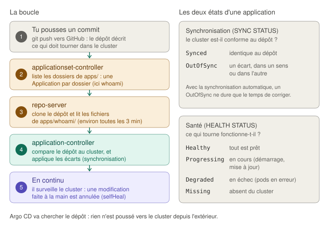
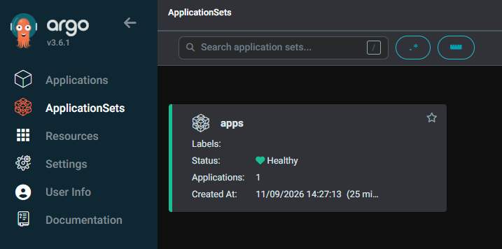
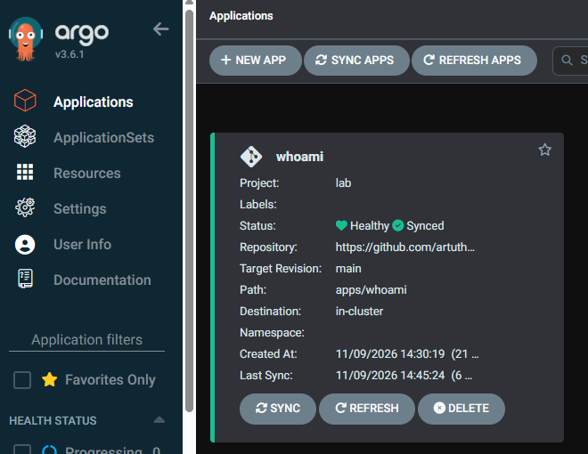
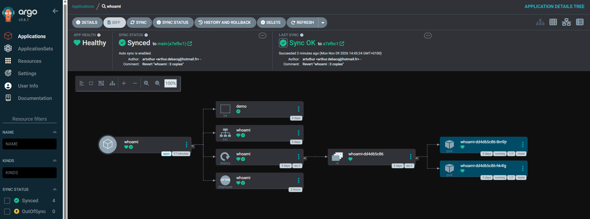
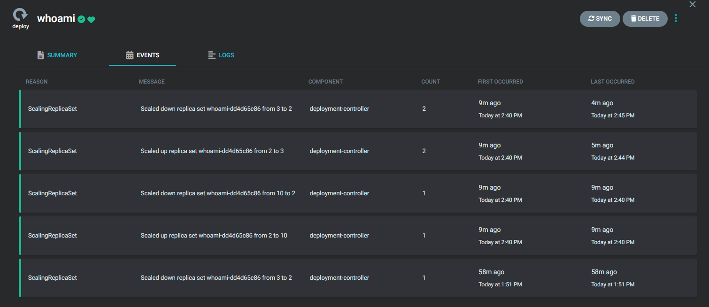

# Le GitOps avec Argo CD

Ce guide explique comment le cluster applique, seul et en permanence, ce que décrit le dépôt Git : Argo CD lit le dossier `apps/` sur GitHub, et ramène le cluster à cet état à chaque écart. Il couvre la phase 6.

Pour les objets qu'Argo CD déploie (namespace, Deployment, Service, HTTPRoute), voir d'abord les guides [Déployer une application, pas à pas](deployer-une-application.md) et [Le point d'entrée HTTP](gateway-api.md).

## Sommaire

1. [Le principe : le dépôt fait foi](#1-le-principe--le-dépôt-fait-foi)
2. [Argo CD : sept composants](#2-argo-cd--sept-composants)
3. [Les trois objets d'Argo CD](#3-les-trois-objets-dargo-cd)
4. [Synchroniser : les états, et les deux boucles](#4-synchroniser--les-états-et-les-deux-boucles)
5. [Les choix du lab](#5-les-choix-du-lab)
6. [L'automatisation : le rôle argocd](#6-lautomatisation--le-rôle-argocd)
7. [Vérifier, et lire les résultats](#7-vérifier-et-lire-les-résultats)
8. [Travailler en GitOps](#8-travailler-en-gitops)
9. [Exercice : ajouter puis retirer une application](#9-exercice--ajouter-puis-retirer-une-application)
10. [Diagnostiquer](#10-diagnostiquer)
11. [Les limites](#11-les-limites)
12. [Glossaire](#12-glossaire)

---

## 1. Le principe : le dépôt fait foi

Jusqu'à la phase 5, une application se déployait par `kubectl apply -f apps/whoami/`, lancé depuis WSL2. C'est un modèle **poussé et ponctuel** : un outil extérieur envoie l'état voulu une fois, et plus personne ne vérifie ensuite. Si quelqu'un modifie le cluster à la main, l'écart reste, et personne ne le voit.

Le **GitOps** inverse les rôles. Le projet OpenGitOps, de la CNCF, le résume en quatre principes :

| Principe | Dans le lab |
|---|---|
| **Déclaratif** : on décrit l'état voulu, pas les étapes pour l'atteindre | Les fichiers YAML de `apps/` |
| **Versionné et immuable** : cet état est conservé dans un système qui garde tout l'historique | Le dépôt Git sur GitHub : chaque changement est un commit, avec son auteur, sa date et son message |
| **Tiré automatiquement** : un agent va chercher l'état voulu, personne ne le pousse | Argo CD, qui tourne **dans** le cluster, lit le dépôt |
| **Réconcilié en continu** : l'agent compare sans cesse l'état réel à l'état voulu, et corrige | Argo CD ramène le cluster au contenu du dépôt à chaque écart |

Une image : le dépôt est le plan de l'architecte, et Argo CD le chef de chantier qui repasse régulièrement sur le chantier et remet tout conforme au plan. Pour modifier le bâtiment, on modifie le plan.

Le modèle « tiré » a une conséquence de sécurité. Dans `lab-cicd-pipeline`, la chaîne d'intégration **poussait** le déploiement par SSH, avec une clé stockée dans une variable de GitLab : quiconque obtenait cette variable pouvait agir sur le serveur. Ici, **aucun outil extérieur n'a d'accès au cluster**. Argo CD ne fait que lire un dépôt public.

## 2. Argo CD : sept composants

Le manifeste officiel installe sept composants dans le namespace `argocd` :



| Composant | Forme | Rôle |
|---|---|---|
| `argocd-applicationset-controller` | Deployment | Remplit les modèles d'applications (ApplicationSets) : ici, une application par dossier de `apps/` |
| `argocd-repo-server` | Deployment | Clone le dépôt et produit les manifestes à appliquer (YAML tels quels, ou rendus par Kustomize et Helm) |
| `argocd-application-controller` | StatefulSet | Le cœur : compare le dépôt au cluster, applique les écarts, surveille les objets |
| `argocd-server` | Deployment | L'interface web et l'API, publiées sur la Gateway sous `argocd.lab.internal` |
| `argocd-redis` | Deployment | Le cache des manifestes et de l'état des applications |
| `argocd-dex-server` | Deployment | La connexion par un annuaire d'entreprise (SSO). Non utilisé dans le lab |
| `argocd-notifications-controller` | Deployment | Les alertes (messagerie, courriel) sur les synchronisations. Non utilisé dans le lab |

Le manifeste installe aussi trois CRD (Application, ApplicationSet, AppProject) et **sept NetworkPolicies**, les premières du cluster. Calico les applique : par exemple, seuls `argocd-server`, `argocd-repo-server` et `argocd-application-controller` peuvent joindre `argocd-redis`. `argocd-server`, lui, accepte les connexions de partout, et donc celles des proxys Envoy de la Gateway.

## 3. Les trois objets d'Argo CD

| Objet | Ce qu'il décrit | Analogie | Dans le lab |
|---|---|---|---|
| **Application** | « Ce dossier de ce dépôt, appliqué à ce cluster », avec ses règles de synchronisation | Un chantier et son plan | `whoami`, créée automatiquement |
| **ApplicationSet** | Un modèle d'Application, et un **générateur** qui le remplit | Le gabarit de chantier, rempli pour chaque nouveau plan | `apps` : un sous-dossier de `apps/` donne une Application |
| **AppProject** | Les règles d'un groupe d'applications : sources, destinations, types d'objets permis | Le règlement du lotissement | `lab` |

Les trois objets du lab sont décrits dans `roles/argocd/templates/gitops.yaml.j2`.

### L'ApplicationSet et son générateur

```yaml
generators:
  - git:
      repoURL: https://github.com/artuthur/lab-k8s-gitops.git
      revision: main
      directories:
        - path: apps/*             # chaque sous-dossier de apps/
template:
  metadata:
    name: '{{ .path.basename }}'   # le nom du dossier : whoami
  spec:
    project: lab
    source:
      path: '{{ .path.path }}'     # le chemin du dossier : apps/whoami
```

Le générateur liste les sous-dossiers de `apps/` dans le dépôt. Pour chacun, il remplit le modèle (`{{ .path.basename }}`, `{{ .path.path }}`) et crée l'Application. **Ajouter une application revient à créer un dossier et à pousser** ; la retirer, à supprimer le dossier.

Les `{{ }}` du modèle sont destinés à Argo CD, pas à Ansible, qui utilise la même syntaxe. Le modèle Ansible les protège par `...` : Ansible les recopie sans les interpréter.

Le modèle ne fixe pas de namespace de destination : chaque fichier de l'application nomme le sien (`namespace: demo`). Dans l'interface, la ligne `Namespace` de l'application reste donc vide.

### L'AppProject : les garde-fous

```yaml
sourceRepos:
  - https://github.com/artuthur/lab-k8s-gitops.git   # une seule source
destinations:
  - namespace: "!kube-*"                             # « ! » : interdit
  - namespace: "!calico-*"
  # ... tigera-operator, metallb-system, envoy-gateway-system, gateway, argocd
  - namespace: "*"                                   # tout le reste : permis
clusterResourceWhitelist:
  - group: ""
    kind: Namespace                                  # seul objet sans namespace permis
```

Une application du dépôt peut donc créer ses namespaces et y déployer ce qu'elle veut. En revanche, elle ne peut ni toucher au socle (Kubernetes, Calico, MetalLB, la Gateway, Argo CD lui-même), ni créer d'objets valables pour tout le cluster : pas de ClusterRole qui donnerait des droits partout, pas de CRD. Le dépôt est public, mais seul son propriétaire peut y pousser. Ces règles limitent pourtant les dégâts d'une erreur, ou d'un compte GitHub compromis.

## 4. Synchroniser : les états, et les deux boucles

### Les deux états d'une application

| État | Question | Valeurs |
|---|---|---|
| **Synchronisation** (`SYNC STATUS`) | Le cluster est-il conforme au dépôt ? | `Synced` : identique. `OutOfSync` : un écart, que le dépôt ait changé ou le cluster |
| **Santé** (`HEALTH STATUS`) | Ce qui tourne fonctionne-t-il ? | `Healthy` : prêt. `Progressing` : en cours. `Degraded` : en échec. `Missing` : absent du cluster |

Les deux sont indépendants. Une application peut être `Synced` et `Degraded` : le dépôt est bien appliqué, mais il demande une image qui n'existe pas. Elle peut aussi être `OutOfSync` et `Healthy` : quelqu'un a ajouté une copie à la main, et tout fonctionne, mais ce n'est plus ce que dit le dépôt.

### Quand Argo CD regarde-t-il ?

- **Le dépôt** est relu environ toutes les **trois minutes** : toutes les 120 secondes, plus un délai aléatoire d'au plus 60 secondes, pour ne pas solliciter GitHub par à-coups. Le générateur de l'ApplicationSet relit lui aussi le dépôt toutes les trois minutes. Le bouton **Refresh** de l'interface, ou une annotation, force une relecture immédiate (section 8).
- **Le cluster** est surveillé **en continu** : Argo CD est abonné aux changements des objets qu'il gère, et voit une modification en quelques secondes.

### La synchronisation automatique du lab

```yaml
syncPolicy:
  automated:
    prune: true       # un objet retiré du dépôt est retiré du cluster
    selfHeal: true    # une modification faite à la main est annulée
  retry:
    limit: 5          # une synchronisation ratée est retentée, 5 fois au plus,
    backoff:          # après 10 s, 20 s, 40 s... (3 min au plus)
      duration: 10s
      factor: 2
      maxDuration: 3m
```

Sans `automated`, Argo CD se contenterait de **signaler** l'écart (`OutOfSync`) et attendrait un clic sur **Sync**. C'est un réglage courant en production pour les applications sensibles.

### Deux boucles imbriquées

Argo CD ne crée pas les pods. Il écrit **l'état voulu** (le Deployment avec `replicas: 2`), et ce sont les contrôleurs de Kubernetes qui font le reste, comme depuis le début du lab. Il y a donc deux boucles de réconciliation, l'une dans l'autre :

| Boucle | Elle compare | Elle corrige |
|---|---|---|
| **Argo CD** | Le dépôt Git et les objets du cluster | Les objets (le Deployment, le Service...) |
| **Les contrôleurs de Kubernetes** | Les objets et ce qui tourne réellement | Les ReplicaSets et les pods |

C'est pour ça que les événements du Deployment, dans l'interface d'Argo CD, viennent du `deployment-controller` de Kubernetes, et pas d'Argo CD (section 7).

## 5. Les choix du lab

### Argo CD v3.6.1, manifeste non haute disponibilité

La version 3.6 est testée sur Kubernetes 1.34 à 1.37. Le manifeste `install.yaml` lance une copie de chaque composant, comme le recommande la documentation pour les essais. Le manifeste « haute disponibilité » (`ha/install.yaml`) en lance plusieurs, avec un Redis répliqué, et demande au moins trois nœuds.

### Une installation entièrement déclarative

C'est le quatrième composant installé par manifeste, et le premier appliqué de façon entièrement déclarative :

| Composant | Méthode d'installation | Pourquoi |
|---|---|---|
| Calico | Une seule fois | L'opérateur réécrit lui-même l'objet `Installation` |
| MetalLB | Une seule fois, configuration déclarative | Le contrôleur inscrit ses certificats dans les objets du manifeste |
| Envoy Gateway | CRD déclaratives, contrôleur une seule fois, configuration déclarative | Le manifeste contient un Job, qu'on ne peut pas modifier |
| **Argo CD** | **Déclarative, à chaque passage** | Aucun objet du manifeste n'est réécrit par un contrôleur, et la procédure officielle de mise à jour est justement de réappliquer le manifeste |

Mettre à jour Argo CD se résume donc à changer `argocd_version` et l'empreinte dans `roles/argocd/defaults/main.yml`, puis à relancer le playbook.

### Les gestionnaires de champs : qui a écrit quoi

Nos réglages se trouvent dans deux ConfigMaps (`argocd-cmd-params-cm` et `argocd-cm`) qui existent **aussi** dans le manifeste officiel, vides ou avec d'autres clés. Si les deux étaient appliqués de la même façon, chaque réapplication du manifeste effacerait nos réglages.

Avec l'application « côté serveur » (`kubectl apply --server-side`), l'API server note, **champ par champ**, quel gestionnaire l'a écrit (`metadata.managedFields`). Une réapplication ne retire que les champs qui appartiennent à son propre gestionnaire. C'est comme un document partagé dont chaque paragraphe est signé par son auteur : chacun ne réécrit que ses paragraphes.

Le lab utilise donc deux gestionnaires :

| Gestionnaire | Ce qu'il applique |
|---|---|
| `kubectl` (par défaut) | Le manifeste officiel |
| `lab-k8s-gitops` | Nos objets : namespace, réglages, route, projet, ApplicationSet |

Résultat vérifié : `argocd-cm` contient à la fois les clés du manifeste (`resource.exclusions`, `resource.customizations...`) et la nôtre (`url`). Quand on retire une clé de notre modèle, elle disparaît du cluster, sans toucher à celles du manifeste.

### HTTP simple derrière la Gateway

Par défaut, `argocd-server` sert son interface en HTTPS, avec un certificat qu'il génère lui-même, et redirige toute requête HTTP vers HTTPS. Derrière la Gateway, qui reçoit les clients en HTTP, il faut le passer en HTTP simple : `server.insecure: "true"` dans `argocd-cmd-params-cm`. C'est la méthode décrite par la documentation d'Argo CD pour un point d'entrée Gateway API.

Ce réglage est lu **au démarrage** d'`argocd-server`. Le rôle l'applique donc **avant** le manifeste : au premier démarrage, le serveur le trouve déjà. Si le réglage change plus tard, le rôle redémarre `argocd-server` (`kubectl rollout restart`).

La route `argocd.lab.internal` (une HTTPRoute dans le namespace `argocd`, autorisé sur la Gateway par son étiquette) mène au port 80 du Service `argocd-server`.

### Un dépôt public, lu sans identifiants

Le dépôt `artuthur/lab-k8s-gitops` est public : Argo CD le lit en HTTPS, sans clé ni jeton. Les pods joignent GitHub grâce à la traduction d'adresses de Calico (`natOutgoing: Enabled` sur le pool d'adresses des pods). En entreprise, le dépôt serait privé, et Argo CD aurait une clé de déploiement en lecture seule, ou une application GitHub.

### Pas de suppression en cascade

Si un dossier disparaît de `apps/`, l'ApplicationSet supprime l'Application correspondante. Mais les objets qu'elle avait créés **restent**, parce que le modèle ne pose pas le *finalizer* `resources-finalizer.argocd.argoproj.io`, qui commanderait une suppression en cascade. C'est un garde-fou : une erreur dans le dépôt, comme un dossier renommé, ne supprime pas une application en service. La suppression des objets reste un geste délibéré (section 9).

### Le niveau de sécurité `restricted`

Le namespace `argocd` est au niveau Pod Security `restricted`, comme ceux de la Gateway. J'ai vérifié les contextes de sécurité du manifeste, puis l'admission des sept composants sur un API server, avant le premier lancement.

## 6. L'automatisation : le rôle argocd

Le rôle `roles/argocd/` applique quatre étages, tous déclaratifs (comparés au cluster par `kubectl diff`, appliqués s'ils diffèrent) :

| Étage | Contenu | Particularité |
|---|---|---|
| 1. Namespace | `argocd`, ses étiquettes de sécurité et d'accès à la Gateway | À part : `kubectl diff` ne peut pas simuler des objets dans un namespace qui n'existe pas encore |
| 2. Réglages | `argocd-cmd-params-cm`, `argocd-cm` | Avant le manifeste, gestionnaire `lab-k8s-gitops` |
| 3. Manifeste officiel | Les CRD, les sept composants, les NetworkPolicies | `--server-side --force-conflicts`, la méthode officielle |
| 4. GitOps | HTTPRoute, AppProject, ApplicationSet | Après les CRD d'Argo CD, gestionnaire `lab-k8s-gitops` |

Puis il vérifie son résultat :

| Vérification | Ce qu'elle prouve |
|---|---|
| Les sept composants prêts (`rollout status`) | Argo CD tourne |
| `GET /healthz` par la Gateway, depuis WSL2 : `200` attendu | La route fonctionne, `argocd-server` répond, et en HTTP simple (sinon, la réponse serait une redirection) |
| L'ApplicationSet à `ResourcesUpToDate` | Le générateur a lu le dépôt **et** créé les applications. En cas d'échec, le rôle affiche l'erreur d'Argo CD et la piste la plus probable : dépôt privé, ou branche pas encore poussée |
| Au moins une application | Le dossier `apps/` du dépôt n'est pas vide |

L'attente de l'ApplicationSet dure jusqu'à 240 secondes. Quand une lecture du dépôt échoue ou ne donne rien, l'ApplicationSet réessaie **trois minutes plus tard** (constante `ReconcileRequeueOnValidationError` du code d'Argo CD). L'attente laisse sa chance à ce second essai, ce qui s'est justement produit lors de l'installation (section 7).

Avant le premier lancement, le rôle a été testé sur un API server Kubernetes 1.37 réel, avec un script jouant le rôle des contrôleurs d'Argo CD. Le test a vérifié l'idempotence, l'admission des pods, la coexistence des gestionnaires de champs, l'absence de différence après les écritures d'Argo CD lui-même (ses secrets, un redémarrage), le redémarrage d'`argocd-server` après un changement de réglage, et le message d'erreur d'un dépôt illisible.

## 7. Vérifier, et lire les résultats

Résultats relevés dans le lab le 09/11/2026.

### Les composants

```
$ kubectl -n argocd get pods -o wide
NAME                                                READY   STATUS    IP               NODE
argocd-application-controller-0                     1/1     Running   10.244.36.236    k8s-worker-01
argocd-applicationset-controller-794bb95c9d-d67xr   1/1     Running   10.244.36.235    k8s-worker-01
argocd-dex-server-66cf64bfcf-pgvsp                  1/1     Running   10.244.118.99    k8s-worker-02
argocd-notifications-controller-5878c8d644-rstq9    1/1     Running   10.244.118.101   k8s-worker-02
argocd-redis-5869b7547-vms5h                        1/1     Running   10.244.118.100   k8s-worker-02
argocd-repo-server-7d55cc466b-75cmj                 1/1     Running   10.244.36.237    k8s-worker-01
argocd-server-85b849c688-fnjqg                      1/1     Running   10.244.118.102   k8s-worker-02
```

**Intention** : vérifier que tout tourne. **Lecture** : les sept composants, répartis par le scheduler sur les deux workers. Le contrôleur d'applications a un nom stable (`-0`) : c'est un StatefulSet, qui garde son identité d'un redémarrage à l'autre.

### L'application, et la preuve qu'elle suit le dépôt

```
$ kubectl -n argocd get applications
NAME     SYNC STATUS   HEALTH STATUS
whoami   Synced        Healthy
$ kubectl -n argocd get application whoami -o jsonpath='{.status.sync.revision}{"\n"}'; git rev-parse HEAD
45a26cfe55fb73083c44d82458ef5a0c58f22703
45a26cfe55fb73083c44d82458ef5a0c58f22703
```

**Intention** : la première commande donne l'état ; la seconde compare le commit appliqué par Argo CD à ton dernier commit local. **Lecture** : `Synced` et `Healthy`, et **la même empreinte de commit** : le cluster applique exactement ce qui est sur GitHub.

### L'adoption des objets existants

```
$ kubectl -n demo get deployment whoami -o jsonpath='{.metadata.annotations.argocd\.argoproj\.io/tracking-id}{"\n"}'
whoami:apps/Deployment:demo/whoami
```

**Intention** : savoir si Argo CD considère le Deployment comme le sien. **Lecture** : l'annotation de suivi, de la forme `<application>:<groupe>/<type>:<namespace>/<nom>`. Les objets de whoami, créés à la main avec kubectl aux phases 5a et 5b, ont été **adoptés** sans être recréés. Dans l'interface, le namespace, le Service et le Deployment ont « 3 days », et les deux pods n'ont pas redémarré.

### Les NetworkPolicies et l'interface

```
$ kubectl -n argocd get networkpolicies
NAME                                              POD-SELECTOR
argocd-application-controller-network-policy      app.kubernetes.io/name=argocd-application-controller
argocd-redis-network-policy                       app.kubernetes.io/name=argocd-redis
...                                               (sept au total)
$ curl -s -o /dev/null -w '%{http_code}\n' --resolve argocd.lab.internal:80:192.168.58.50 http://argocd.lab.internal/healthz
200
```

Les sept politiques réseau du manifeste sont en place, et l'interface répond par la Gateway, en HTTP simple.

### L'interface web

Après l'ajout de `192.168.58.50 argocd.lab.internal` au fichier hosts de Windows, l'interface s'ouvre à `http://argocd.lab.internal`. On s'y connecte avec l'utilisateur `admin`, et le mot de passe initial que lit cette commande :

```bash
kubectl -n argocd get secret argocd-initial-admin-secret -o jsonpath='{.data.password}' | base64 -d; echo
```

Ce qu'on y voit :

| Écran | Lecture |
|---|---|
| **ApplicationSets** | `apps`, `Healthy`, `Applications: 1` |
| **Applications** | `whoami`, projet `lab`, `Healthy` et `Synced`, dépôt, branche `main`, chemin `apps/whoami`, destination `in-cluster`, namespace vide (chaque fichier nomme le sien) |
| **Arbre de l'application** | L'application et ses quatre objets (namespace `demo`, Service, Deployment, HTTPRoute), puis le ReplicaSet `whoami-dd4d65c86` et ses deux pods. Chaque objet porte deux pastilles : santé (cœur) et synchronisation (coche) |
| **En-tête** | `Synced to main (a7efbc1)`, « Auto sync is enabled », et la dernière synchronisation : `Sync OK`, avec le message du commit appliqué |







L'ApplicationSet a été créé à 14:27:13, et l'application `whoami` à 14:30:19, trois minutes plus tard. La première lecture du dépôt par le générateur a échoué, alors que le dépôt était public et poussé ; la suivante a eu lieu à l'issue du délai de trois minutes prévu par Argo CD. Entre-temps, l'attente du rôle, alors limitée à 180 secondes, s'était terminée quatre secondes trop tôt : le premier passage du playbook s'est arrêté sur le message « Argo CD n'arrive pas à lire le dépôt », et le second, lancé quelques secondes plus tard, est passé. C'est ce qui a conduit à allonger l'attente du rôle (section 6).

### L'autocorrection et le commit, vus par les événements

Les événements du Deployment `whoami`, dans l'interface :



| Heure | Événement | Ce qui s'est passé |
|---|---|---|
| 13:51 | 3 vers 2 | Avant Argo CD : retour à 2 copies, à la main, après l'exercice du guide de déploiement |
| 14:40 | 2 vers 10, puis 10 vers 2 | `kubectl scale --replicas=10` : Argo CD a rétabli les 2 copies du dépôt dans la même minute (`selfHeal`) |
| 14:40 | 2 vers 3, puis 3 vers 2 | Le même essai avec 3 copies |
| 14:44 | 2 vers 3 | Le commit « whoami : 3 copies », poussé sur GitHub, appliqué par Argo CD |
| 14:45 | 3 vers 2 | Le commit « Revert "whoami : 3 copies" » : retour à 2 copies, **par Git** |

Les événements viennent du `deployment-controller` de Kubernetes : Argo CD a changé le nombre de copies voulu du Deployment, et Kubernetes a fait le reste. Ce sont les deux boucles de la section 4.

### L'idempotence

```
k8s-cp-01      : ok=96   changed=0    unreachable=0    failed=0    skipped=17
k8s-worker-01  : ok=36   changed=0    unreachable=0    failed=0    skipped=9
k8s-worker-02  : ok=36   changed=0    unreachable=0    failed=0    skipped=8
```

Sur le control plane, `skipped=17` : les douze tâches ignorées de l'étape 5b, plus les cinq du rôle `argocd` qui n'avaient rien à faire. Il s'agit des quatre applications (namespace, réglages, manifeste, GitOps), qui n'ont trouvé aucune différence, et du redémarrage d'`argocd-server`.

## 8. Travailler en GitOps

À partir de la phase 6, **on ne lance plus `kubectl apply` sur `apps/`**. On modifie le dépôt :

```bash
# 1. modifier un fichier de apps/, par exemple le nombre de copies
git commit -am "whoami : 3 copies"
git push

# 2. attendre la prochaine relecture (trois minutes au plus), ou la forcer
kubectl -n argocd annotate application whoami argocd.argoproj.io/refresh=normal
```

L'annotation `argocd.argoproj.io/refresh` demande à Argo CD de relire le dépôt tout de suite ; il la retire une fois la relecture faite. Le bouton **Refresh** de l'interface fait la même chose.

Ce qui change dans la façon de travailler :

| Avant (kubectl) | Maintenant (GitOps) |
|---|---|
| L'état voulu est dans la tête de celui qui tape les commandes | L'état voulu est dans le dépôt, lisible par tous |
| Une modification à la main reste | Une modification à la main est annulée en quelques secondes (`selfHeal`) |
| Revenir en arrière : se souvenir de l'état précédent | Revenir en arrière : `git revert`, puis `git push`. Le retour est lui-même tracé |
| Qui a changé quoi ? Personne ne le sait | `git log` : auteur, date, message, contenu exact |

Le bouton **History and rollback** de l'interface liste les synchronisations passées. Il ne permet pas de revenir en arrière tant que la synchronisation automatique est active : Argo CD réappliquerait aussitôt le dépôt. En GitOps, c'est le **dépôt** qu'on ramène en arrière.

**Un commit défectueux ne coupe pas le service.** Avec une image inexistante dans `02-deployment.yaml`, l'application passe `Synced` (le dépôt est appliqué) mais `Degraded` ou `Progressing` (le nouveau pod ne démarre pas), et les anciens pods continuent de répondre : c'est la mise à jour progressive du Deployment. Un `git revert` répare.

## 9. Exercice : ajouter puis retirer une application

**Ajouter.** Une copie de whoami, sous un autre nom, dans un autre namespace :

```bash
cp -r apps/whoami apps/whoami-bis
sed -i 's/namespace: demo$/namespace: demo-bis/; s/name: demo$/name: demo-bis/; s/whoami\.lab\.internal/whoami-bis.lab.internal/' apps/whoami-bis/*.yaml
grep -n 'demo\|lab.internal' apps/whoami-bis/*.yaml      # contrôle des remplacements
git add apps/whoami-bis
git commit -m "Application whoami-bis"
git push
```

Puis forcer la relecture de l'ApplicationSet (sinon, trois minutes au plus), et regarder l'application apparaître :

```bash
kubectl -n argocd annotate applicationset apps argocd.argoproj.io/application-set-refresh=true
kubectl -n argocd get applications -w                    # Ctrl+C quand whoami-bis est Synced et Healthy
curl -s --resolve whoami-bis.lab.internal:80:192.168.58.50 http://whoami-bis.lab.internal | grep Hostname
```

Aucun réglage d'Argo CD n'a été touché : le dossier a suffi. La route a été acceptée par la Gateway, parce que le namespace `demo-bis` a hérité de l'étiquette d'accès copiée avec `01-namespace.yaml`.

**Retirer.**

```bash
git rm -r apps/whoami-bis
git commit -m "Retrait de whoami-bis"
git push
kubectl -n argocd annotate applicationset apps argocd.argoproj.io/application-set-refresh=true
kubectl -n argocd get applications                       # whoami-bis a disparu
kubectl get namespace demo-bis                           # ... mais ses objets sont toujours là
```

L'Application a disparu, mais pas ses objets : c'est l'absence de suppression en cascade (section 5). Leur suppression est un geste délibéré :

```bash
kubectl delete namespace demo-bis
```

## 10. Diagnostiquer

| Question | Commande | Ce qu'on cherche |
|---|---|---|
| Quel est l'état des applications ? | `kubectl -n argocd get applications` | `SYNC STATUS` et `HEALTH STATUS` |
| Pourquoi une application est-elle en échec ? | `kubectl -n argocd describe application <app>` | `Conditions` (erreurs de comparaison ou de synchronisation), `Operation State` (résultat de la dernière synchronisation), `Events` |
| Qu'est-ce qui diffère du dépôt ? | Bouton **Diff** de l'interface | Le détail, objet par objet |
| L'ApplicationSet lit-il le dépôt ? | `kubectl -n argocd get applicationset apps -o jsonpath='{range .status.conditions[*]}{.type}={.status} {.message}{"\n"}{end}'` | `ErrorOccurred=True` et son message : dépôt inaccessible, branche absente |
| Que dit Argo CD ? | `kubectl -n argocd logs statefulset/argocd-application-controller` ; `kubectl -n argocd logs deployment/argocd-repo-server` | Les erreurs de synchronisation ; les erreurs de lecture du dépôt |

Les erreurs les plus probables dans le lab :

| Symptôme | Cause probable |
|---|---|
| L'application reste `OutOfSync` après un `git push` | Le dépôt n'a pas encore été relu : bouton **Refresh**, ou annotation `refresh` |
| Synchronisation refusée : namespace ou type d'objet « not permitted » | Les règles du projet `lab` : un namespace du socle, ou un objet sans namespace autre qu'un Namespace |
| `ComparisonError` | Un fichier YAML invalide dans le dossier de l'application |
| `Synced` mais `Degraded` | Le dépôt est appliqué, mais ce qu'il décrit ne fonctionne pas : voir les pods (`kubectl -n <ns> describe pod`) |
| Une modification à la main disparaît | Ce n'est pas une panne : c'est `selfHeal` |

## 11. Les limites

| Limite | Détail | En production |
|---|---|---|
| Interface d'administration en HTTP simple | Le mot de passe circule en clair entre le navigateur et la Gateway | HTTPS sur la Gateway, certificats délivrés par cert-manager |
| Compte `admin` local | Un seul compte, tous les droits, et un mot de passe initial lisible dans un secret | Connexion par l'annuaire de l'entreprise (SSO, avec Dex ou OIDC), droits par équipe (`argocd-rbac-cm`), compte `admin` désactivé |
| Dépôt public, lu sans identifiants | Tout le monde peut lire la configuration du cluster | Dépôt privé, clé de déploiement en lecture seule ou application GitHub |
| Détection des commits par relecture | Jusqu'à trois minutes entre un `git push` et son application | Un webhook de GitHub vers Argo CD : impossible ici, GitHub ne peut pas joindre le réseau privé du lab |
| Pas de haute disponibilité | Une copie de chaque composant. Si un nœud tombe, Argo CD s'interrompt le temps d'être recréé ailleurs. Les applications, elles, continuent de tourner | Manifeste `ha/install.yaml`, trois nœuds au moins |
| Argo CD installé par Ansible | Argo CD ne se gère pas lui-même | Argo CD peut se gérer lui-même, depuis le dépôt (modèle « app of apps ») ; Ansible ne sert alors qu'à l'amorçage |
| Pas de secrets dans le dépôt | Les applications actuelles n'en ont pas besoin ; un mot de passe ne doit jamais être commité en clair | Sealed Secrets ou External Secrets, qui chiffrent les secrets ou les lisent dans un coffre-fort |

## 12. Glossaire

| Terme | Définition |
|---|---|
| Adoption | Prise en charge par Argo CD d'un objet créé avant lui, sans le recréer |
| Application | Objet d'Argo CD : un dossier d'un dépôt, appliqué à un cluster, avec ses règles de synchronisation |
| ApplicationSet | Objet d'Argo CD : un modèle d'Application, rempli par un générateur |
| AppProject | Objet d'Argo CD : les règles d'un groupe d'applications (sources, destinations, types d'objets permis) |
| Finalizer | Marque qui retarde la suppression d'un objet tant qu'une action n'a pas été faite (ici : supprimer les objets de l'application) |
| Générateur | Partie d'un ApplicationSet qui produit les valeurs du modèle (ici : la liste des dossiers de `apps/`) |
| Gestionnaire de champs (field manager) | Nom de l'outil qui a écrit un champ d'un objet, noté par l'API server lors d'une application côté serveur |
| GitOps | Méthode où l'état voulu est versionné dans Git, et appliqué en continu par un agent qui le tire |
| OutOfSync, Synced | L'état de synchronisation : le cluster diffère du dépôt, ou lui est conforme |
| Prune | Suppression des objets retirés du dépôt |
| Refresh | Relecture du dépôt par Argo CD, sans attendre son intervalle |
| Self-heal | Annulation des modifications faites dans le cluster sans passer par le dépôt |
| Source de vérité | L'endroit qui fait foi : ici, la branche `main` du dépôt |
| Synchronisation (sync) | Application au cluster de ce que décrit le dépôt |

## Sources

- [OpenGitOps : les principes](https://opengitops.dev/)
- [Argo CD : installation](https://argo-cd.readthedocs.io/en/stable/operator-manual/installation/)
- [Argo CD : versions de Kubernetes testées](https://argo-cd.readthedocs.io/en/latest/operator-manual/tested-kubernetes-versions/)
- [Argo CD : exposition par la Gateway API](https://argo-cd.readthedocs.io/en/stable/operator-manual/ingress/)
- [Argo CD : générateur Git de l'ApplicationSet](https://argo-cd.readthedocs.io/en/stable/operator-manual/applicationset/Generators-Git/)
- [Argo CD : synchronisation automatique](https://argo-cd.readthedocs.io/en/stable/user-guide/auto_sync/)
- [Argo CD : projets](https://argo-cd.readthedocs.io/en/stable/user-guide/projects/)
- [Kubernetes : application côté serveur et gestionnaires de champs](https://kubernetes.io/docs/reference/using-api/server-side-apply/)
