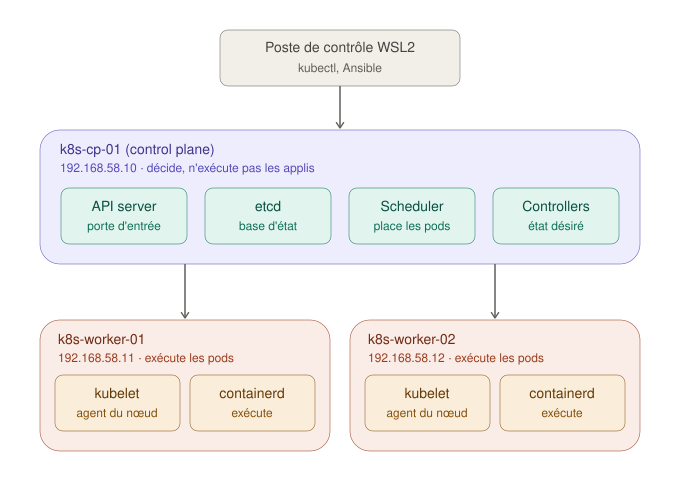

# Kubernetes : les notions avant les commandes

Ce guide pose le modèle mental nécessaire pour comprendre ce que fait chaque étape du projet. Il ne contient aucune commande d'installation : celles-ci sont dans le README, et chaque phase y renvoie aux notions expliquées ici.

## Sommaire

1. [Le principe : décrire un état, pas donner des ordres](#1-le-principe--décrire-un-état-pas-donner-des-ordres)
2. [Les composants d'un cluster](#2-les-composants-dun-cluster)
3. [Ce qui se passe quand on déploie une application](#3-ce-qui-se-passe-quand-on-déploie-une-application)
4. [Les trois réseaux d'un cluster](#4-les-trois-réseaux-dun-cluster)
5. [Exposer une application : du pod au navigateur](#5-exposer-une-application--du-pod-au-navigateur)
6. [Glossaire](#6-glossaire)

---

## 1. Le principe : décrire un état, pas donner des ordres

Dans `lab-cicd-pipeline`, le déploiement était **impératif** : le job CI se connectait en SSH et disait « arrête ce conteneur, lance celui-ci ». Si le conteneur s'arrêtait ensuite, personne ne le relançait (en dehors de la politique `--restart` de Docker sur cette seule machine).

Kubernetes est **déclaratif** : on décrit l'**état désiré** (« je veux 3 copies de cette application, chacune avec 128 Mo de RAM ») et le cluster compare en permanence cet état à l'**état observé**. Dès qu'un écart apparaît (un conteneur plante, une machine s'éteint), il agit pour le corriger. Cette boucle « observer, comparer, corriger » s'appelle la **réconciliation**.

C'est ce principe qui rend le **GitOps** possible : si l'état désiré est un fichier texte, il peut vivre dans un dépôt Git, avec son historique, ses relectures et ses retours arrière.

## 2. Les composants d'un cluster

Un cluster est un ensemble de machines appelées **nœuds**, réparties en deux rôles : le **control plane** décide, les **workers** exécutent.

### Sur le control plane

| Composant | Rôle |
|---|---|
| **API server** (`kube-apiserver`) | La seule porte d'entrée du cluster. `kubectl`, les autres composants et les nœuds passent tous par lui. Il vérifie l'identité de l'appelant (authentification), ses droits (autorisation), puis enregistre la demande. |
| **etcd** | La base de données clé-valeur où vit tout l'état du cluster. C'est la pièce la plus précieuse : perdre etcd, c'est perdre le cluster. Seul l'API server lui parle. |
| **Scheduler** (`kube-scheduler`) | Choisit sur quel nœud placer chaque nouveau pod, selon les ressources disponibles et les contraintes déclarées. Il ne lance rien lui-même : il inscrit sa décision. |
| **Controllers** (`kube-controller-manager`) | Un ensemble de boucles de réconciliation. Exemple : le controller des Deployments constate qu'il manque un pod et en demande un nouveau. |

### Sur chaque nœud (y compris le control plane)

| Composant | Rôle |
|---|---|
| **kubelet** | L'agent du nœud. Il demande à l'API server quels pods lui sont attribués, les fait exécuter, puis remonte leur état. Avec containerd, c'est le seul composant installé comme service système (`systemd`) : avec kubeadm, l'API server, etcd, le scheduler et les controllers tournent eux-mêmes dans des conteneurs, lancés par le kubelet. |
| **containerd** | Le **container runtime** : le logiciel qui télécharge les images et lance réellement les conteneurs. Le kubelet lui parle via le **CRI** (Container Runtime Interface), une interface standard qui permet de changer de runtime sans modifier Kubernetes. |
| **kube-proxy** | Traduit les Services (voir section 5) en règles réseau sur chaque nœud. Installé automatiquement par kubeadm. |

Kubeadm installe aussi **CoreDNS**, le serveur DNS interne qui permet à un pod de joindre un Service par son nom.

### Pourquoi le control plane n'exécute pas les applications

Par défaut, kubeadm pose une **taint** (une « marque de répulsion ») sur le control plane : le scheduler n'y place aucun pod applicatif. Une application qui consommerait toute la RAM ne doit pas pouvoir faire tomber l'API server ou etcd.

## 3. Ce qui se passe quand on déploie une application

Commande : `kubectl apply -f deployment.yaml`, où le fichier demande 3 copies d'une application.

1. `kubectl` envoie le fichier à l'**API server**, qui vérifie les droits puis enregistre l'objet Deployment dans **etcd**.
2. Un **controller** constate qu'un Deployment réclame 3 pods alors qu'il en existe 0 : il crée 3 objets pod, encore sans nœud.
3. Le **scheduler** repère ces pods sans nœud et attribue un worker à chacun.
4. Le **kubelet** de chaque worker concerné voit qu'un pod lui est attribué et demande à **containerd** de télécharger l'image et de lancer le conteneur.
5. Le **CNI** (voir section 4) donne une adresse IP au pod.
6. Le kubelet remonte l'état « en cours d'exécution » à l'API server, qui l'enregistre dans etcd.

À noter : aucun composant n'en appelle un autre directement. Chacun **surveille** l'API server et réagit aux changements qui le concernent. Si un worker s'éteint, l'étape 2 recommence d'elle-même : le controller constate l'écart et recrée les pods manquants ailleurs.

## 4. Les trois réseaux d'un cluster

| Réseau | Ce qu'il adresse | Qui l'attribue | Plage du lab |
|---|---|---|---|
| Réseau des nœuds | Les VMs | Vagrant (réseau privé VMware) | `192.168.58.0/24` |
| Réseau des pods | Chaque pod | Le CNI (Calico) | `10.244.0.0/16` |
| Réseau des services | Les Services, adresses stables devant un groupe de pods | Kubernetes | `10.96.0.0/12` (valeur par défaut de kubeadm) |

Le **CNI** (Container Network Interface) est le plugin qui donne une IP à chaque pod et qui fait en sorte qu'un pod du worker 1 joigne un pod du worker 2 sans traduction d'adresse. Kubernetes n'en fournit aucun : tant qu'il n'est pas installé, les nœuds restent à l'état `NotReady`.

Les trois plages **ne doivent jamais se chevaucher**, sinon un paquet destiné à un pod peut partir vers une VM, ou l'inverse. Piège concret : Calico propose par défaut `192.168.0.0/16` pour les pods, qui englobe le réseau des nœuds `192.168.58.0/24`. La plage des pods est donc fixée explicitement à `10.244.0.0/16`.

## 5. Exposer une application : du pod au navigateur

**Exposer** une application, c'est rendre joignable, depuis l'extérieur du cluster, l'application que les pods font tourner. Ce n'est pas l'application elle-même : c'est le chemin réseau qui mène jusqu'à elle.

Le problème de départ : un pod a une IP, mais elle n'est joignable que depuis l'intérieur du cluster, et elle change à chaque fois que le pod est recréé. On ne peut donc ni la donner à un utilisateur, ni la noter dans une configuration.

Kubernetes empile plusieurs couches pour résoudre ce problème, chacune construite sur la précédente :

| Couche | Ce qu'elle apporte | Joignable depuis |
|---|---|---|
| **IP de pod** | Une adresse par pod, éphémère | L'intérieur du cluster |
| **Service `ClusterIP`** | Une IP virtuelle et un nom DNS **stables**, qui répartissent le trafic entre les pods sélectionnés par leurs **labels** (étiquettes clé-valeur posées sur les pods) | L'intérieur du cluster |
| **Service `NodePort`** | Ouvre le même port (entre 30000 et 32767) sur **tous** les nœuds et le redirige vers le Service | L'extérieur, via `IP_d_un_nœud:port` |
| **Service `LoadBalancer`** | Une IP externe unique, sur des ports normaux | L'extérieur, via une IP dédiée |
| **Gateway** (Gateway API) | Un point d'entrée HTTP unique qui route selon le nom de domaine ou le chemin de l'URL et termine le TLS | L'extérieur, via un nom de domaine |

### Le cas du `LoadBalancer` hors du cloud

Chez un fournisseur cloud, créer un Service `LoadBalancer` provoque la création d'un équilibreur de charge du fournisseur avec une IP publique. Dans des VMs, personne ne joue ce rôle : le Service reste indéfiniment en attente d'IP (`<pending>`). **MetalLB** comble ce manque : on lui confie une plage d'adresses du réseau des nœuds, et en mode « couche 2 » un des nœuds répond aux requêtes ARP pour l'IP attribuée (« cette adresse, c'est moi »), comme le ferait une machine physique.

### Le parallèle avec `lab-infra-as-code`

| `lab-infra-as-code` | Kubernetes |
|---|---|
| HAProxy devant les serveurs web | Gateway (ou Service `LoadBalancer`) |
| Liste des backends écrite dans `haproxy.cfg` à partir du groupe `webservers` | Service qui sélectionne automatiquement les pods par leurs labels |
| Backends à IP fixes | Pods à IP changeantes, masquées par le Service |

## 6. Glossaire

| Terme | Définition |
|---|---|
| CNI | Container Network Interface. Plugin réseau qui donne une IP aux pods et les relie entre eux. |
| CRI | Container Runtime Interface. Interface standard entre le kubelet et le container runtime. |
| cgroups | Mécanisme du noyau Linux qui limite et mesure la RAM et le CPU d'un groupe de processus. |
| Deployment | Objet qui décrit une application sans état et le nombre de copies voulues. |
| kubeconfig | Fichier qui contient l'adresse de l'API server et les identifiants (certificat) pour s'y connecter. |
| Label | Étiquette clé-valeur posée sur un objet, utilisée par les Services et les Deployments pour sélectionner des pods. |
| Pod | Plus petite unité gérée par Kubernetes : un ou plusieurs conteneurs qui partagent une IP. |
| Réconciliation | Boucle permanente qui ramène l'état observé vers l'état désiré. |
| Service | Adresse stable devant un groupe de pods. |
| Taint | Marque posée sur un nœud pour en écarter les pods qui ne la tolèrent pas. |

## Sources

- [Documentation Kubernetes : composants d'un cluster](https://kubernetes.io/docs/concepts/overview/components/)
- [Documentation Kubernetes : Services](https://kubernetes.io/docs/concepts/services-networking/service/)
- [Documentation Kubernetes : installer kubeadm](https://kubernetes.io/docs/setup/production-environment/tools/kubeadm/install-kubeadm/)
- [Annonce de la retraite d'Ingress NGINX](https://kubernetes.io/blog/2025/11/11/ingress-Nginx-retirement/)
- [Documentation MetalLB](https://metallb.io/)
