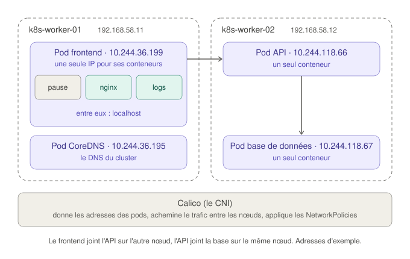
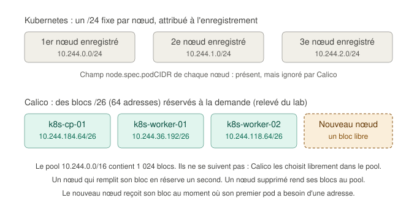
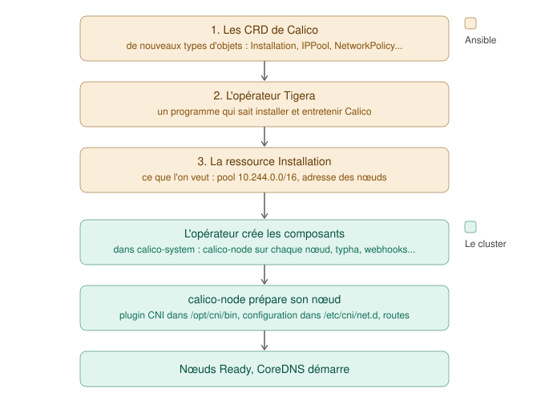
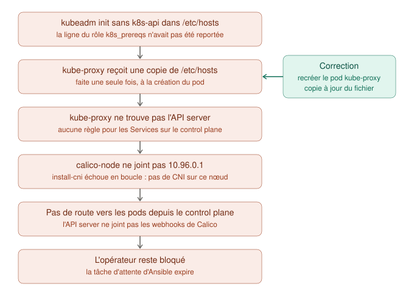

# Le réseau des pods avec Calico

Ce guide accompagne la phase 4 du projet : l'installation de **Calico**, le plugin réseau (CNI) du cluster. Il part des notions de base (qu'est-ce qu'un pod, pourquoi les pods doivent communiquer), explique ce que fait Calico et comment il est installé, puis montre comment lire et tester le réseau sur un nœud. Il se termine par le récit d'une panne instructive survenue pendant l'installation.

Il fait suite aux guides [Kubernetes : les notions avant les commandes](kubernetes-fondamentaux.md), [Le runtime de conteneurs et les paquets Kubernetes](runtime-et-paquets.md) et [Créer le cluster : kubeadm init et kubeadm join](cluster-kubeadm.md).

## Sommaire

1. [Pod ou conteneur ?](#1-pod-ou-conteneur-)
2. [Pourquoi les pods doivent communiquer](#2-pourquoi-les-pods-doivent-communiquer)
3. [Ce que fait Calico](#3-ce-que-fait-calico)
4. [Le découpage des adresses : blocs à la demande](#4-le-découpage-des-adresses--blocs-à-la-demande)
5. [Installer Calico : CRD, opérateur et Installation](#5-installer-calico--crd-opérateur-et-installation)
6. [Les réglages du lab](#6-les-réglages-du-lab)
7. [Lire le réseau d'un nœud](#7-lire-le-réseau-dun-nœud)
8. [Tester le réseau](#8-tester-le-réseau)
9. [La panne : une copie périmée de /etc/hosts](#9-la-panne--une-copie-périmée-de-etchosts)
10. [Glossaire](#10-glossaire)

---

## 1. Pod ou conteneur ?

Pour le réseau, une image d'immeuble fonctionne bien :

- un **nœud** est un immeuble ;
- un **pod** est un appartement, avec **une adresse** : son adresse IP ;
- les **conteneurs** sont les colocataires de cet appartement.

Chaque colocataire a sa chambre : chaque conteneur a son image, ses fichiers et ses processus. Mais tous partagent la même adresse et la même boîte aux lettres : **les conteneurs d'un même pod ont la même IP** et se parlent par `localhost`, comme deux programmes sur une même machine. Ils peuvent aussi partager des dossiers (des volumes).

| | Conteneur | Pod |
|---|---|---|
| C'est | Un processus isolé, lancé à partir d'une image | Un groupe d'un ou plusieurs conteneurs, géré comme un tout |
| Adresse IP | Pas la sienne : il prend celle de son pod | Une par pod |
| Ce que Kubernetes manipule | Jamais directement | L'unité de base : placée sur un nœud, démarrée, arrêtée et répliquée en bloc |

Dans la plupart des cas, un pod ne contient **qu'un seul conteneur**. On en met plusieurs seulement quand ils sont inséparables. Exemple classique : un serveur web et un **sidecar** (un conteneur « d'appoint ») qui lit ses fichiers de logs dans un dossier partagé pour les envoyer vers un outil central.

### Le conteneur `pause`, qui tient l'adresse

L'image `pause` (`registry.k8s.io/pause:3.10.2`), rencontrée en phase 2, sert précisément à faire tenir un pod. Quand Kubernetes crée un pod, containerd lance d'abord ce minuscule conteneur, qui ne fait rien d'autre qu'**exister** et garder l'adresse réseau du pod. Les conteneurs de l'application rejoignent ensuite son réseau. Si l'un d'eux redémarre, l'IP du pod ne change pas : c'est `pause` qui la détient. Dans l'immeuble, c'est le bail de l'appartement : les colocataires peuvent changer, l'adresse reste.

Pour voir la différence entre pods et conteneurs, sur un nœud :

```bash
sudo crictl pods    # les pods (« sandboxes »), chacun tenu par son conteneur pause
sudo crictl ps      # les conteneurs, avec la colonne POD qui indique leur pod
```

Les conteneurs `pause` n'apparaissent pas dans `crictl ps` : crictl les présente comme les pods eux-mêmes.

## 2. Pourquoi les pods doivent communiquer

Une application réelle n'est presque jamais un seul programme. Dans `lab-infra-as-code`, HAProxy envoyait les requêtes à deux serveurs web, qui interrogeaient PostgreSQL. Dans Kubernetes, chacun serait un pod, et le scheduler les répartirait sur plusieurs nœuds, pour qu'une panne de nœud n'emporte pas tout.

Même une application d'un seul pod parle à d'autres pods :

- **CoreDNS** est un pod. Chaque fois qu'une application cherche un nom de Service, elle l'interroge, peut-être sur un autre nœud ;
- un **Service** n'est qu'une adresse stable devant des pods. kube-proxy redirige chaque connexion vers l'**IP de l'un d'eux**, éventuellement sur un autre nœud.



### Le modèle réseau de Kubernetes

Kubernetes fixe trois règles pour le réseau des pods :

1. chaque pod a sa propre adresse IP ;
2. chaque pod peut joindre **n'importe quel autre pod, sur n'importe quel nœud, directement par son IP**, sans traduction d'adresse (sans NAT) ;
3. les agents d'un nœud (le kubelet) peuvent joindre les pods de ce nœud.

Kubernetes **définit** ces règles mais ne les **met pas en œuvre**. C'est le travail du **CNI** (Container Network Interface). Tant qu'aucun CNI n'est installé, les nœuds restent `NotReady`, comme à la fin de la phase 3.

## 3. Ce que fait Calico

Dans l'immeuble, Calico est le service postal de la résidence. Il a trois missions :

| Mission | Dans la résidence | Concrètement |
|---|---|---|
| **Attribuer les adresses** | Numéroter chaque appartement | Il découpe le pool `10.244.0.0/16` en blocs, en rattache à chaque nœud, et donne une IP à chaque nouveau pod |
| **Brancher et acheminer** | Livrer le courrier, y compris d'un immeuble à l'autre | Il relie chaque pod à son nœud par un câble virtuel (une paire *veth*, côté nœud l'interface `cali...`), et indique à chaque nœud où se trouvent les blocs des autres |
| **Appliquer les règles** | Le règlement : qui a le droit d'écrire à qui | Les **NetworkPolicies**, des règles de pare-feu entre pods. Sans règle, tout pod peut joindre tout autre pod |

La troisième mission compte pour ce projet : c'est par les NetworkPolicies qu'on pourra compenser l'absence d'UFW sur les nœuds, la limite documentée en phase 1.

## 4. Le découpage des adresses : blocs à la demande

Le cluster contient en réalité **deux** découpages de la plage des pods :



**Celui de Kubernetes, fixe.** Comme on a donné `podSubnet: 10.244.0.0/16` à kubeadm, le controller-manager attribue à chaque nœud un `/24` (256 adresses) au moment de son enregistrement, et le garde jusqu'à sa suppression :

```bash
kubectl get nodes -o custom-columns=NOEUD:.metadata.name,PODCIDR:.spec.podCIDR
```

Certains CNI, comme Flannel, s'appuient sur ce découpage. **Calico, dans sa configuration par défaut, l'ignore** : il gère ses adresses lui-même.

**Celui de Calico, à la demande.** Calico raisonne avec un **pool** (la plage globale, `10.244.0.0/16`, soit 65 536 adresses) et des **blocs** (par défaut des `/26`, soit 64 adresses ; le pool en contient 1 024). Quand un nœud doit donner une IP à un pod :

1. il cherche une adresse libre dans **ses** blocs ;
2. s'il n'en a pas (premier pod, ou blocs pleins), il **réserve un bloc libre** du pool, qui lui est désormais rattaché ;
3. il annonce aux autres nœuds que les adresses de ce bloc sont chez lui.

Un kubelet accepte au plus 110 pods par défaut : un nœud plein utilise environ deux blocs. Si le pool venait à manquer de blocs libres, un nœud pourrait emprunter des adresses isolées dans le bloc d'un autre, un mode dégradé qui n'arrivera pas dans un lab de quelques nœuds.

Dans le lab :

```
$ kubectl get blockaffinities.projectcalico.org
NAME                             CIDR               NODE            TYPE
k8s-cp-01-10-244-184-64-26       10.244.184.64/26   k8s-cp-01       host
k8s-worker-01-10-244-36-192-26   10.244.36.192/26   k8s-worker-01   host
k8s-worker-02-10-244-118-64-26   10.244.118.64/26   k8s-worker-02   host
```

Les blocs ne se suivent pas : Calico les choisit librement dans le pool. Ils n'ont rien à voir avec les `/24` de Kubernetes.

### Quand un nœud rejoint le cluster

Avec un quatrième nœud, il n'y aurait rien à faire côté réseau :

1. le nœud rejoint le cluster avec `kubeadm join` ;
2. Calico s'installe dessus tout seul : son agent, `calico-node`, est un **DaemonSet**, un objet qui demande « un exemplaire de ce pod sur chaque nœud ». Dès que le nœud apparaît, Kubernetes y lance l'agent ;
3. l'agent prépare le réseau du nœud et apprend où sont les blocs des autres ;
4. au premier pod placé sur ce nœud, Calico réserve un bloc libre et l'annonce.

Quand un nœud est supprimé du cluster, un composant de Calico (`calico-kube-controllers`) libère ses blocs.

## 5. Installer Calico : CRD, opérateur et Installation



### Deux notions nouvelles

**Une CRD** (*Custom Resource Definition*) ajoute un **nouveau type d'objet** à Kubernetes. De base, Kubernetes connaît les Pods, les Services, les Deployments. Les CRD de Calico lui apprennent des types comme `Installation`, `IPPool` ou les `NetworkPolicy` de Calico. On peut ensuite créer ces objets comme n'importe quel objet Kubernetes, avec kubectl.

**Un opérateur** est un programme qui tourne dans le cluster et qui sait **installer et entretenir un logiciel**. Il surveille un objet (ici `Installation`), et chaque fois que cet objet change, il crée ou corrige tout ce qu'il faut pour que le logiciel corresponde à la description. C'est la boucle de réconciliation de Kubernetes, appliquée à l'installation d'un logiciel. Comme un technicien qui connaîtrait Calico par cœur : on lui remet une fiche (« ce pool d'adresses, avec ces réglages »), il s'occupe du reste, y compris de réparer ce qui casse.

L'opérateur doit tourner **avant** qu'il existe un réseau des pods, puisque c'est lui qui va l'installer. Il utilise donc directement le réseau du nœud (`hostNetwork`), comme kube-proxy et les composants du control plane.

### Les trois fichiers

La méthode officielle de Calico 3.33 applique trois fichiers, dans cet ordre :

| Fichier | Contenu | Témoin utilisé par Ansible |
|---|---|---|
| `v3_projectcalico_org.yaml` | 31 CRD (types `operator.tigera.io` et `projectcalico.org`), au format recommandé pour Kubernetes 1.36 et plus | La CRD `installations.operator.tigera.io` |
| `tigera-operator.yaml` | L'opérateur : son namespace, ses droits, son Deployment | Le Deployment `tigera-operator` |
| `custom-resources.yaml` | Ce que l'on veut : les objets `Installation` et `APIServer`, écrits par Ansible à partir d'un modèle | L'objet `Installation` nommé `default` |

Les deux premiers sont téléchargés en version figée (`v3.33.0`) depuis le dépôt de Calico, et leur **empreinte SHA-256** est vérifiée : un fichier modifié en route, ou différent de celui attendu, fait échouer le téléchargement.

`kubectl apply --server-side` confie à l'API server le calcul des modifications. C'est nécessaire ici : les CRD de Calico sont trop volumineuses pour un `apply` classique, qui stocke une copie de chaque objet dans une annotation de taille limitée.

### Pourquoi chaque fichier n'est appliqué qu'une fois

En lisant le code de l'opérateur, j'ai vu qu'il **réécrit** l'objet `Installation` pour y ajouter ses valeurs par défaut. Il complète, par exemple, chaque pool d'adresses avec des champs qu'on n'a pas écrits. Si Ansible réappliquait ce fichier à chaque passage, il effacerait ces ajouts, et l'opérateur les remettrait aussitôt. Ce serait deux personnes qui corrigent le même document chacune à sa façon, sans jamais converger.

Ansible teste donc la présence d'un objet témoin, et n'applique un fichier que s'il est absent. C'est la même logique que `creates:` pour `kubeadm init`. Conséquences :

- modifier le modèle `custom-resources.yaml.j2` après l'installation ne change pas le cluster ;
- une mise à jour de Calico suit sa procédure officielle, pas un nouveau passage du playbook.

Un outil GitOps comme Argo CD rencontrerait la même question : il doit savoir qu'un champ est complété par un opérateur, pour ne pas le signaler comme une différence. Dans le lab, la question ne se pose pas : Argo CD (phase 6) ne gère que les applications du dossier `apps/`, et Calico reste installé par Ansible.

### Ce que l'opérateur crée

Une fois l'objet `Installation` créé, l'opérateur déploie dans le namespace `calico-system` :

| Composant | Rôle |
|---|---|
| `calico-node` (DaemonSet, un par nœud) | L'agent de chaque nœud : installe le plugin CNI, écrit les routes et les règles de filtrage |
| `calico-typha` | Un relais entre l'API server et les agents, pour éviter que chaque agent interroge l'API server directement |
| `calico-kube-controllers` | Le nettoyage : libère les blocs et les adresses des nœuds et des pods supprimés |
| `calico-webhooks` | La validation des ressources de Calico (notamment les politiques réseau) avant leur enregistrement |
| `csi-node-driver` | Un pilote de volumes, utilisé par certaines fonctions de Calico |

L'opérateur publie l'état de chaque composant dans des objets **TigeraStatus** :

```bash
kubectl get tigerastatus
```

C'est cet état qu'attend le playbook : les composants `calico` et `apiserver` doivent être `Available`.

## 6. Les réglages du lab

La configuration reprend le fichier officiel `custom-resources.yaml`, avec quatre adaptations :

```yaml
apiVersion: operator.tigera.io/v1
kind: Installation
metadata:
  name: default
spec:
  calicoNetwork:
    linuxDataplane: Iptables
    nodeAddressAutodetectionV4:
      kubernetes: NodeInternalIP
    ipPools:
      - name: default-ipv4-ippool
        cidr: 10.244.0.0/16
        blockSize: 26
        encapsulation: VXLANCrossSubnet
        natOutgoing: Enabled
        nodeSelector: all()
```

| Réglage | Valeur | Pourquoi |
|---|---|---|
| `nodeAddressAutodetectionV4` | `kubernetes: NodeInternalIP` | Par défaut, Calico prend **la première interface trouvée**, donc `eth0`, celle du NAT de Vagrant. On lui fait reprendre l'adresse que le kubelet annonce (`node-ip`, réseau privé). La décision de la phase 3 sert une deuxième fois |
| `cidr` | `10.244.0.0/16` | Le même pool que le `podSubnet` de kubeadm. Le fichier officiel propose `192.168.0.0/16`, qui **engloberait le réseau des nœuds** (`192.168.58.0/24`) |
| `encapsulation` | `VXLANCrossSubnet` | Voir ci-dessous |
| `linuxDataplane` | `Iptables` | Calico écrit ses règles avec iptables, comme kube-proxy. Il existe aussi un mode eBPF, plus performant, qui remplace kube-proxy : un sujet à part entière |

### L'encapsulation : une lettre dans une enveloppe

**Encapsuler**, c'est glisser le paquet d'un pod (de `10.244.36.199` vers `10.244.118.66`) dans un second paquet, adressé de nœud à nœud (de `192.168.58.11` vers `192.168.58.12`). Le nœud destinataire ouvre l'enveloppe et remet le paquet d'origine au pod. On en a besoin quand le réseau entre les nœuds refuse les adresses qu'il ne connaît pas, ce qui est souvent le cas dans le cloud : il ne voit alors que des adresses de nœuds.

Avec `VXLANCrossSubnet`, Calico n'encapsule (en VXLAN) qu'entre nœuds de **sous-réseaux différents**. Nos trois nœuds partagent `192.168.58.0/24` : leur trafic est simplement **routé**, sans enveloppe, ce qui est plus simple et plus rapide. L'interface `vxlan.calico` existe sur chaque nœud, prête à servir, mais n'est pas utilisée.

### Ce qui n'est pas installé

Le fichier officiel installe aussi **Goldmane** et **Whisker**, une interface qui affiche en direct les flux réseau autorisés et refusés. Je les ai laissés de côté pour garder cette phase lisible. Ils seront utiles le jour où l'on écrira des NetworkPolicies.

## 7. Lire le réseau d'un nœud

### La table de routage

Sur `k8s-worker-01` :

```
$ ip route | grep 10.244
blackhole 10.244.36.192/26 proto 80
10.244.36.193 dev calic7761382390 scope link metric 1024
10.244.36.194 dev calia76955b4a90 scope link metric 1024
...
10.244.118.64/26 via 192.168.58.12 dev eth1 proto 80 onlink
10.244.184.64/26 via 192.168.58.10 dev eth1 proto 80 onlink
```

| Route | Signification |
|---|---|
| `blackhole 10.244.36.192/26` | Le bloc de **ce** nœud. Une adresse du bloc qui n'est attribuée à aucun pod est jetée (*blackhole*) au lieu de partir sur le réseau |
| `10.244.36.193 dev cali...` | Un pod de ce nœud, joint par son câble virtuel. Il y a une route par pod |
| `10.244.118.64/26 via 192.168.58.12 dev eth1` | Le bloc de `k8s-worker-02`, joint par le réseau privé, **sans encapsulation** |
| `10.244.184.64/26 via 192.168.58.10 dev eth1` | Le bloc du control plane, de la même façon |
| `proto 80` | Une route posée par **Felix**, le composant de `calico-node` qui programme le nœud |

Le mot `eth1` sur les deux dernières lignes valide le réglage `NodeInternalIP` : sans lui, ces routes passeraient par `eth0`, le réseau NAT.

### Les câbles virtuels

```
$ ip -br link | grep cali
calic7761382390@if2  UP  ee:ee:ee:ee:ee:ee  <BROADCAST,MULTICAST,UP,LOWER_UP>
...
vxlan.calico         UNKNOWN  66:bb:bb:d8:11:bf  <BROADCAST,MULTICAST,UP,LOWER_UP>
```

Chaque interface `cali...` est l'extrémité, côté nœud, d'une paire *veth* : un câble virtuel dont l'autre extrémité est l'interface `eth0` **à l'intérieur du pod**. `@if2` indique le numéro de cette autre extrémité dans le réseau du pod.

## 8. Tester le réseau

### D'un pod à l'autre, d'un nœud à l'autre

Depuis WSL2, un pod sur chaque worker (`nodeName` impose le nœud, sans passer par le scheduler) :

```bash
kubectl run test-a --image=busybox:1.37 --restart=Never --overrides='{"spec":{"nodeName":"k8s-worker-01"}}' -- sleep 3600
kubectl run test-b --image=busybox:1.37 --restart=Never --overrides='{"spec":{"nodeName":"k8s-worker-02"}}' -- sleep 3600
kubectl get pods -o wide
```

```
NAME     READY   STATUS    RESTARTS   AGE   IP              NODE
test-a   1/1     Running   0          17s   10.244.36.199   k8s-worker-01
test-b   1/1     Running   0          9s    10.244.118.66   k8s-worker-02
```

Chaque pod a reçu une adresse dans le bloc de son nœud. Puis :

```
$ kubectl exec test-a -- ping -c 3 10.244.118.66
64 bytes from 10.244.118.66: seq=0 ttl=62 time=0.481 ms
64 bytes from 10.244.118.66: seq=1 ttl=62 time=0.281 ms
64 bytes from 10.244.118.66: seq=2 ttl=62 time=0.321 ms
```

Un pod joint un pod d'un autre nœud directement par son IP : c'est la deuxième règle du modèle réseau. Le `ttl=62` (64 moins 2) montre que le paquet a été routé deux fois, par chacun des deux nœuds, comme par deux routeurs.

### Le DNS du cluster

```bash
kubectl exec test-a -- nslookup kubernetes.default.svc.cluster.local    # attendu : 10.96.0.1
```

Il faut écrire le **nom complet**. Normalement, `kubernetes.default` suffit, grâce à la **liste de recherche** du DNS (les suffixes `default.svc.cluster.local`, `svc.cluster.local`... ajoutés automatiquement). Mais la commande `nslookup` de busybox gère mal cette liste depuis sa version 1.29. Elle cherche alors `kubernetes.default` tel quel, et obtient `NXDOMAIN`, alors que le DNS fonctionne. La ligne `Server: 10.96.0.10` (l'adresse du Service de CoreDNS) prouve d'ailleurs qu'il a bien répondu.

Pour finir :

```bash
kubectl delete pod test-a test-b
```

## 9. La panne : une copie périmée de /etc/hosts

Le premier lancement du rôle `calico` a échoué : la tâche `Attendre que Calico soit opérationnel` a expiré au bout de 60 tentatives. Les workers étaient `Ready`, le control plane non. Le diagnostic a remonté une réaction en chaîne, partie d'une erreur de la phase 3.



### Les symptômes

```
$ kubectl get tigerastatus
NAME        AVAILABLE   PROGRESSING   DEGRADED   MESSAGE
apiserver   False       False         True       ... failed calling webhook "tiered-rbac.api.projectcalico.org": ... context deadline exceeded
calico                  True                     ... (même message)
```

Et, dans `kubectl -n calico-system get pods -o wide`, le `calico-node` du control plane en `Init:CrashLoopBackOff`.

### Le diagnostic, maillon par maillon

**1. Quel conteneur d'initialisation échoue ?** Un pod peut avoir des **conteneurs d'initialisation**, qui doivent se terminer avec succès, dans l'ordre, avant que le conteneur principal démarre :

```
$ kubectl -n calico-system get pod calico-node-5wpxn -o jsonpath='{range .status.initContainerStatuses[*]}...'
flexvol-driver  prêt=true   redémarrages=0
ebpf-bootstrap  prêt=true   redémarrages=0
cni-plugins     prêt=true   redémarrages=0
install-cni     prêt=false  redémarrages=10  code=1  raison=Error
```

**2. Pourquoi ?** Ses messages, à la tentative précédente (`--previous`) :

```
$ kubectl -n calico-system logs calico-node-5wpxn -c install-cni --previous
...
[FATAL] Unable to create token for CNI kubeconfig error=Post "https://10.96.0.1:443/api/v1/namespaces/calico-system/serviceaccounts/calico-cni-plugin/token": dial tcp 10.96.0.1:443: connect: connection refused
```

La création d'un jeton échoue, mais le jeton n'y est pour rien : la requête n'atteint pas l'API server. `10.96.0.1` est l'adresse du Service `kubernetes`. Comme toute adresse de Service, elle est **virtuelle** et n'existe que grâce aux règles que **kube-proxy** écrit sur chaque nœud. Sur le control plane, cette traduction ne se faisait pas.

**3. Pourquoi kube-proxy ne fait-il pas son travail, et seulement sur le control plane ?**

```
$ kubectl -n kube-system logs kube-proxy-g85h6 --tail=1
E1104 15:15:57.763334  1 reflector.go:227] "Failed to watch" err="failed to list *v1.Node: Get \"https://k8s-api:6443/api/v1/nodes?...\": dial tcp: lookup k8s-api on 4.2.2.1:53: no such host"
```

kube-proxy ne trouve pas le nom `k8s-api`. Or `/etc/hosts` le contient bien :

```
vagrant@k8s-cp-01:~$ grep k8s-api /etc/hosts
192.168.58.10 k8s-api
vagrant@k8s-cp-01:~$ sudo grep k8s-api /var/lib/kubelet/pods/<id du pod>/etc-hosts || echo "absent de la copie du pod"
absent de la copie du pod
```

**4. L'explication**, vérifiée dans le code de Kubernetes :

- kube-proxy joint l'API server par `controlPlaneEndpoint`, donc par le nom `k8s-api`. kubeadm écrit son kubeconfig ainsi, alors que les composants du control plane utilisent l'adresse locale ;
- un pod qui utilise le réseau du nœud reçoit une **copie** de `/etc/hosts`, faite par le kubelet à la création du pod (fonction `ensureHostsFile`). Si le fichier du nœud change ensuite, le pod ne le voit pas.

Or le kube-proxy du control plane avait été créé par `kubeadm init`, **avant** la correction de `/etc/hosts` (le problème du nom `k8s-api` de la phase 3). Sa copie était périmée. Ceux des workers, créés après la correction, fonctionnaient. Les âges des pods le confirmaient : 166 minutes sur le control plane, comme le cluster, 151 minutes sur les workers.

**5. La suite de la chaîne.** Sans `calico-node` sur le control plane, celui-ci n'a aucune route vers les pods. Or l'API server y tourne, et il doit consulter un **webhook** de Calico, un service de validation appelé avant chaque écriture d'une politique réseau Calico. Ce webhook est servi par les pods `calico-webhooks`, sur `k8s-worker-01`. Dans le code de l'opérateur, ce webhook a un délai de 5 secondes, et en cas d'échec, l'écriture est refusée (`failurePolicy: Fail`). L'opérateur, qui crée justement les politiques qui protègent les composants de Calico, restait donc bloqué.

### La correction

Recréer le pod kube-proxy du control plane. Il est géré par un DaemonSet, qui le relance aussitôt, avec une copie à jour de `/etc/hosts` :

```bash
kubectl -n kube-system delete pod kube-proxy-g85h6
kubectl -n calico-system delete pod calico-node-5wpxn    # relance immédiate, sans attendre le prochain essai
```

En quelques secondes, `calico-node` démarre sur le control plane, l'opérateur se débloque, les trois nœuds passent `Ready`. Le playbook, relancé, ignore les étapes d'installation (déjà faites) et valide le résultat.

### Les leçons

- **Corriger un fichier de configuration ne suffit pas** : les programmes qui l'ont lu, ou copié, avant la correction gardent l'ancienne version. Ici, la copie est faite une seule fois, à la création du pod.
- **Le message d'erreur décrit la couche qui échoue, pas la cause.** `Unable to create token` désignait l'étape en échec ; la cause était trois maillons plus haut.
- **Une attente qui expire est une bonne nouvelle** : la tâche a refusé de déclarer l'installation réussie alors qu'elle ne l'était pas.

Pour une reconstruction depuis zéro, le problème ne peut pas se reproduire : `/etc/hosts` est écrit en phase 1, avant `kubeadm init`, et la résolution du nom `k8s-api` est vérifiée.

## 10. Glossaire

| Terme | Définition |
|---|---|
| Bloc (Calico) | Morceau du pool d'adresses (par défaut 64 adresses), réservé à la demande par un nœud |
| CNI | Container Network Interface : le plugin qui donne une adresse à chaque pod et relie les pods entre eux |
| Conteneur d'initialisation | Conteneur qui doit se terminer avec succès avant le démarrage des conteneurs principaux du pod |
| CRD | Custom Resource Definition : déclaration d'un nouveau type d'objet dans Kubernetes |
| DaemonSet | Objet qui fait tourner un exemplaire d'un pod sur chaque nœud |
| Encapsulation | Transport du paquet d'un pod à l'intérieur d'un paquet adressé de nœud à nœud (VXLAN, IP-in-IP) |
| Felix | Composant de `calico-node` qui programme les routes et les règles de filtrage du nœud |
| `hostNetwork` | Pod qui utilise directement le réseau du nœud, sans adresse de pod |
| NetworkPolicy | Règle de pare-feu entre pods |
| Opérateur | Programme qui installe et entretient un logiciel dans le cluster, à partir d'un objet qui le décrit |
| `pause` | Conteneur minuscule qui détient l'adresse réseau d'un pod |
| Pool (Calico) | La plage d'adresses dans laquelle Calico prend les adresses des pods |
| Sidecar | Conteneur d'appoint placé dans le même pod qu'une application |
| TigeraStatus | Objet dans lequel l'opérateur de Calico publie l'état de chaque composant |
| veth | Paire d'interfaces virtuelles reliées, comme un câble : une extrémité dans le pod, l'autre sur le nœud |
| Webhook (admission) | Service appelé par l'API server pour valider ou modifier un objet avant son enregistrement |

## Sources

- [Documentation Kubernetes : le modèle réseau](https://kubernetes.io/docs/concepts/services-networking/#the-kubernetes-network-model)
- [Documentation Kubernetes : pods](https://kubernetes.io/docs/concepts/workloads/pods/)
- [Documentation Calico 3.33 : installation sur site](https://docs.tigera.io/calico/latest/getting-started/kubernetes/self-managed-onprem/onpremises)
- [Notes de version de Calico 3.33.0](https://github.com/projectcalico/calico/releases/tag/v3.33.0)
- [Documentation de Calico (dépôt GitHub)](https://github.com/tigera/docs) : versions de Kubernetes testées, référence de l'API `Installation`
- Code source de [l'opérateur Tigera v1.44.0](https://github.com/tigera/operator/tree/v1.44.0) (réécriture de l'objet `Installation`, configuration des webhooks), de [Calico v3.33.0](https://github.com/projectcalico/calico/tree/v3.33.0) et de [Kubernetes v1.37.2](https://github.com/kubernetes/kubernetes/tree/v1.37.2) (copie de `/etc/hosts` par le kubelet, kubeconfig de kube-proxy)
