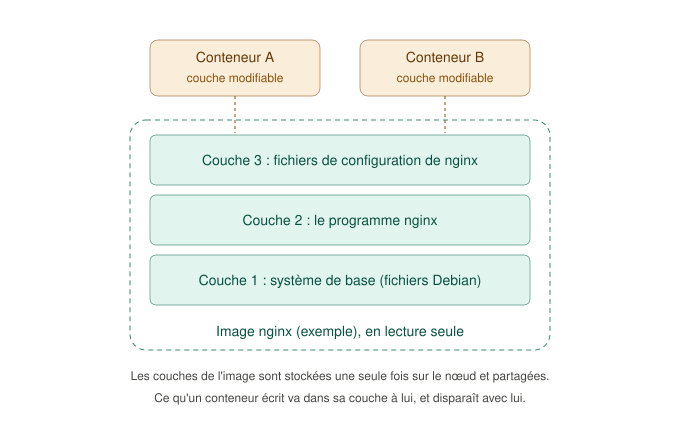
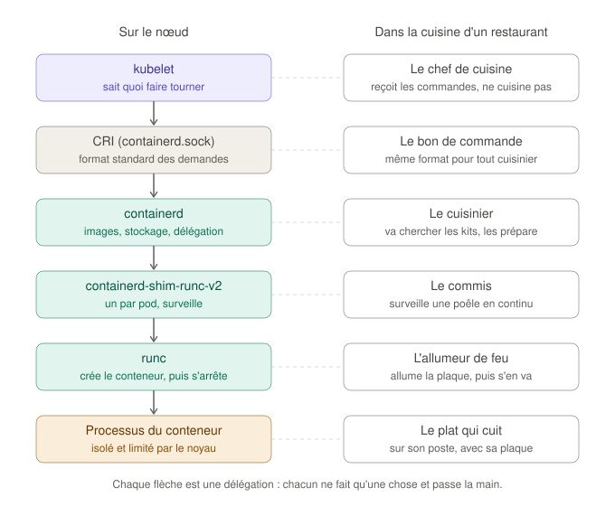

# Le runtime de conteneurs et les paquets Kubernetes

Ce guide accompagne la phase 2 du projet : l'installation de **containerd** (le logiciel qui fait tourner les conteneurs) et des paquets **kubeadm**, **kubelet** et **kubectl**. Il explique ce que fait chaque pièce, pourquoi elle est là, et comment le vérifier soi-même sur un nœud.

Il complète le guide [Kubernetes : les notions avant les commandes](kubernetes-fondamentaux.md), qui présente le cluster dans son ensemble. Ici, on descend à l'intérieur d'**un seul nœud**.

## Sommaire

1. [Une analogie pour tout le guide : la cuisine d'un restaurant](#1-une-analogie-pour-tout-le-guide--la-cuisine-dun-restaurant)
2. [Image et conteneur : la recette et le plat](#2-image-et-conteneur--la-recette-et-le-plat)
3. [La chaîne qui lance un conteneur](#3-la-chaîne-qui-lance-un-conteneur)
4. [Exercice : voir la chaîne de ses propres yeux](#4-exercice--voir-la-chaîne-de-ses-propres-yeux)
5. [Isoler et limiter : namespaces et cgroups](#5-isoler-et-limiter--namespaces-et-cgroups)
6. [Le CRI, crictl et ctr](#6-le-cri-crictl-et-ctr)
7. [Installer depuis un dépôt APT tiers](#7-installer-depuis-un-dépôt-apt-tiers)
8. [Les versions : choisir, aligner, bloquer](#8-les-versions--choisir-aligner-bloquer)
9. [Le kubelet avant kubeadm : activé, mais à l'arrêt](#9-le-kubelet-avant-kubeadm--activé-mais-à-larrêt)
10. [Les pièges rencontrés](#10-les-pièges-rencontrés)
11. [Glossaire](#11-glossaire)

---

## 1. Une analogie pour tout le guide : la cuisine d'un restaurant

Un cluster Kubernetes ressemble à un restaurant qui possède plusieurs cuisines :

| Dans le restaurant | Dans le cluster |
|---|---|
| La direction, qui prend les commandes des clients et les répartit | Le **control plane** |
| Le comptoir où arrivent toutes les commandes | L'**API server** |
| Le responsable qui décide dans quelle cuisine préparer chaque plat | Le **scheduler** |
| Une cuisine | Un **nœud** (une VM du lab) |
| Le chef de cuisine, qui reçoit les commandes pour sa cuisine | Le **kubelet** |
| Le bon de commande, au format identique pour tout le restaurant | Le **CRI** |
| Le cuisinier | **containerd** |
| Un kit repas sous vide (recette et ingrédients) | Une **image** |
| Le plat préparé à partir du kit | Un **conteneur** |

La phase 2 équipe chaque cuisine : on embauche le cuisinier (containerd), on installe le chef (kubelet) et son outillage (kubeadm). La phase 3 rattachera chaque cuisine à la direction.

## 2. Image et conteneur : la recette et le plat

Ces deux mots sont souvent confondus, alors qu'ils désignent deux choses bien distinctes.

- Une **image** est un modèle figé, en **lecture seule** : tous les fichiers nécessaires à un programme (le programme lui-même, ses bibliothèques, sa configuration). C'est le kit repas sous vide : on ne le modifie pas, on s'en sert.
- Un **conteneur** est une image **en train de tourner** : un processus lancé à partir de ces fichiers. C'est le plat qu'on prépare à partir du kit. Avec un seul kit en stock, on peut préparer autant de plats qu'on veut.

Une image est construite en **couches** empilées. Chaque couche ajoute ou modifie des fichiers par rapport à celle du dessous :



Concrètement :

- les couches de l'image sont téléchargées **une seule fois** par nœud, même si dix conteneurs utilisent cette image ;
- chaque conteneur ajoute **sa propre couche modifiable**, très fine, où vont les fichiers qu'il crée ou modifie ;
- quand le conteneur est supprimé, sa couche modifiable disparaît avec lui. C'est pour ça qu'on dit qu'un conteneur est **éphémère**, et que les données à conserver vont dans des **volumes** (abordés plus tard).

Le module noyau `overlay`, chargé en phase 1, est justement ce qui permet de superposer ces couches pour qu'un conteneur voie un seul système de fichiers.

Les images sont stockées dans des **registres**, des serveurs dont c'est le rôle : Docker Hub (`docker.io`), le registre de Kubernetes (`registry.k8s.io`), ou le registre de GitLab de `lab-cicd-pipeline`. Le nom d'une image indique où la trouver :

```
registry.k8s.io/pause:3.10
└──── registre ──┘└nom┘└tag (version)
```

## 3. La chaîne qui lance un conteneur

Quand Kubernetes doit lancer un conteneur sur un nœud, plusieurs programmes se passent le relais. Chacun ne fait qu'une chose :



| Maillon | Son rôle | Dans la cuisine | Que se passe-t-il s'il manque ? |
|---|---|---|---|
| **kubelet** | Sait *quels* conteneurs doivent tourner sur le nœud, et vérifie qu'ils tournent. Ne sait pas les lancer lui-même. | Le chef lit les commandes et vérifie que les plats partent, mais ne cuisine pas | Le nœud n'exécute plus rien de nouveau |
| **CRI** | Le format standard des demandes du kubelet au runtime (« télécharge cette image », « crée ce conteneur »). Il passe par un fichier spécial, le socket `/run/containerd/containerd.sock` | Le bon de commande : n'importe quel cuisinier qui sait le lire peut travailler | Le kubelet ne peut pas parler au runtime (c'était le cas avec `disabled_plugins = ["cri"]`, voir la section 10) |
| **containerd** | Télécharge les images, stocke leurs couches, prépare le système de fichiers de chaque conteneur, puis délègue l'exécution | Le cuisinier va chercher les kits à l'entrepôt et prépare chaque poste | Aucun conteneur ne peut être lancé |
| **containerd-shim-runc-v2** | Un petit processus par pod, qui reste à côté du conteneur pour le surveiller, récupérer son code de sortie et relayer ses journaux | Un commis reste devant chaque poêle | Redémarrer containerd tuerait tous les conteneurs du nœud |
| **runc** | Demande au noyau Linux de créer le conteneur (isolation et limites, voir la section 5), puis se termine | L'allumeur de feu allume la plaque et s'en va | Rien ne peut être démarré |
| **Processus du conteneur** | Le programme lui-même (nginx, une application...) | Le plat qui cuit | — |

Deux points méritent d'être retenus :

- **Le shim est ce qui rend containerd remplaçable à chaud.** Le conteneur est rattaché au shim, pas à containerd. On peut donc arrêter ou mettre à jour containerd : les shims et leurs conteneurs continuent de tourner, et containerd les retrouve à son redémarrage. C'est comme un cuisinier qui part en pause : les commis surveillent les poêles en attendant.
- **runc ne reste pas en mémoire.** Il intervient quelques millisecondes pour créer le conteneur, puis disparaît. On ne le verra donc jamais dans la liste des processus.

runc suit une norme, **OCI** (Open Container Initiative), qui définit ce qu'est une image et comment lancer un conteneur. C'est grâce à elle qu'une image construite avec Docker dans `lab-cicd-pipeline` peut tourner avec containerd ici.

## 4. Exercice : voir la chaîne de ses propres yeux

containerd est livré avec `ctr`, un client très basique qui lui parle directement, sans Kubernetes. On l'utilise ici uniquement pour observer. Sur un nœud (`vagrant ssh k8s-worker-01`) :

```bash
# 1. Télécharger une image minuscule (busybox : quelques outils Unix de base)
sudo ctr images pull docker.io/library/busybox:latest

# 2. Lancer un conteneur nommé "demo", en arrière-plan (-d), qui dort 5 minutes
sudo ctr run -d docker.io/library/busybox:latest demo sleep 300

# 3. Regarder l'arbre des processus du nœud
ps -ef --forest | grep -B1 "[s]leep 300"   # [s] évite que grep se trouve lui-même
```

Exemple de sortie (les numéros changeront chez toi) :

```
root   2101     1  0 15:02 ?   00:00:00 /usr/bin/containerd-shim-runc-v2 -namespace default -id demo -address /run/containerd/containerd.sock
root   2122  2101  0 15:02 ?   00:00:00  \_ sleep 300
```

Comment lire ces deux lignes :

| Colonne | Valeur | Ce qu'elle montre |
|---|---|---|
| 2e (PID) | `2122` pour `sleep 300` | Le numéro du processus du conteneur, **vu depuis le nœud** |
| 3e (PPID, le parent) | `2101` | Le parent de `sleep` est le **shim**, pas containerd |
| 3e colonne du shim | `1` | Le parent du shim est **systemd** (PID 1), pas containerd : c'est ce qui permet de redémarrer containerd sans tuer le conteneur |
| — | aucun `runc` | runc a créé le conteneur puis s'est terminé |

Ensuite, on regarde le **même processus depuis l'intérieur** du conteneur :

```bash
# Exécuter la commande "ps" dans le conteneur demo
sudo ctr task exec --exec-id essai demo ps
```

Exemple de sortie :

```
PID   USER     TIME  COMMAND
    1 root      0:00 sleep 300
    7 root      0:00 ps
```

Le même processus s'appelle `2122` sur le nœud et `1` dans le conteneur, qui ne voit que lui-même et la commande `ps`. C'est l'**isolation**, expliquée dans la section suivante.

Pour finir, on nettoie :

```bash
sudo ctr task kill -s SIGKILL demo     # arrêter le processus
sudo ctr task delete demo              # supprimer la tâche (le conteneur en cours)
sudo ctr container delete demo         # supprimer le conteneur
sudo ctr images rm docker.io/library/busybox:latest
```

Remarque : `sudo crictl ps -a` ne montre **pas** ce conteneur. containerd range ses conteneurs dans des espaces séparés (ses propres « namespaces », sans rapport avec ceux du noyau) : `ctr` utilise `default`, Kubernetes utilise `k8s.io`, et crictl ne regarde que ce dernier.

## 5. Isoler et limiter : namespaces et cgroups

Un conteneur n'est pas une machine virtuelle. C'est un **processus ordinaire du nœud**, auquel le noyau Linux applique deux mécanismes :

### Les namespaces : des cloisons

Les **namespaces** (espaces de noms) limitent **ce qu'un processus voit**. Dans la cuisine, ce sont les cloisons entre les postes de travail : chaque plat a l'impression d'être seul dans sa cuisine.

| Namespace | Ce qu'il isole | Ce qu'on a vu dans l'exercice |
|---|---|---|
| `pid` | Les numéros de processus | `sleep` est le PID 1 dans le conteneur, le PID 2122 sur le nœud |
| `net` | Les interfaces réseau et les adresses IP | Chaque pod aura sa propre adresse IP (phase 4) |
| `mnt` | Les systèmes de fichiers montés | Le conteneur voit les fichiers de son image, pas ceux du nœud |
| `uts` | Le nom d'hôte | Chaque conteneur peut avoir son propre nom |
| `ipc`, `user` | Communication entre processus, identifiants d'utilisateurs | — |

### Les cgroups : des compteurs et des limites

Les **cgroups** (control groups) limitent **ce qu'un processus consomme** : RAM, CPU, nombre de processus. Dans la cuisine, c'est la taille de la plaque et le quota de gaz attribués à chaque poste. Quand un pod déclare « 256 Mo de RAM maximum », c'est un cgroup qui l'applique. S'il dépasse, le noyau tue le processus (c'est le fameux `OOMKilled`, pour *out of memory*).

Les cgroups sont rangés en arbre dans `/sys/fs/cgroup/`. La commande `stat -fc %T /sys/fs/cgroup` affiche `cgroup2fs` sur nos nœuds : ils utilisent **cgroups v2**, la version actuelle, avec un arbre unique pour toutes les ressources.

### Le driver cgroup : un seul gestionnaire du tableau électrique

Il faut que quelqu'un crée et organise ces cgroups. Sur Debian, **systemd** (le premier processus lancé au démarrage, PID 1) les gère déjà pour tous les services du système. On peut voir son arbre :

```bash
systemd-cgls --no-pager | head -30
```

On y trouve par exemple `system.slice`, qui contient `containerd.service`, `ssh.service`, etc.

La règle est qu'**un seul gestionnaire doit écrire dans l'arbre des cgroups**. Imaginons un immeuble où deux électriciens modifient le tableau électrique chacun de leur côté, sans se parler : chacun croit savoir quel disjoncteur alimente quoi, et tôt ou tard, l'un coupe le circuit de l'autre. C'est pour ça que containerd et le kubelet doivent tous les deux **passer par systemd** au lieu d'écrire eux-mêmes dans l'arbre (l'autre méthode, appelée `cgroupfs`).

D'où le réglage `SystemdCgroup = true` dans la configuration de containerd. Côté kubelet, kubeadm choisit déjà `systemd` par défaut. Si les deux ne sont pas d'accord, les nœuds deviennent instables, avec des symptômes difficiles à relier à leur cause.

En phase 3, `systemd-cgls` montrera une nouvelle branche, `kubepods.slice`, qui contiendra les cgroups des pods.

## 6. Le CRI, crictl et ctr

### Pourquoi une interface standard

Au début de Kubernetes, le kubelet parlait directement à Docker, au moyen d'un composant appelé `dockershim`. Chaque runtime aurait dû être câblé de la même façon, dans le code même de Kubernetes. Le projet a donc défini une interface standard, le **CRI** (Container Runtime Interface), et retiré `dockershim` en version 1.24.

C'est le même principe qu'une prise électrique normalisée : n'importe quel appareil conforme peut s'y brancher. containerd et CRI-O, deux runtimes différents, savent tous les deux répondre au CRI, et le kubelet n'a pas besoin de savoir lequel est installé.

Point important : le CRI n'est **pas** Docker. Kubernetes n'a pas besoin de Docker. Il exécute pourtant sans problème les images construites avec Docker, puisque tous suivent la norme OCI.

### crictl et ctr : deux outils qui ne font pas la même chose

`crictl` et `ctr` parlent tous les deux à containerd, ce qui donne l'impression qu'ils font double emploi. En réalité, ils ne parlent pas la même langue et ne voient pas le même monde.

**crictl parle le CRI, la langue du kubelet.** Il voit donc le nœud exactement comme le kubelet le voit : des **pods**, les conteneurs qui appartiennent à chaque pod, avec leurs noms Kubernetes, et les images utilisées par Kubernetes. C'est l'outil qui permet de répondre à la question « qu'est-ce que le kubelet a demandé, et qu'a répondu le runtime ? ».

**ctr parle l'interface propre à containerd.** Il voit tout ce que containerd gère, y compris ce que Kubernetes ignore : les objets internes (couches stockées, systèmes de fichiers préparés), et tous les espaces de containerd (`k8s.io` pour Kubernetes, `default` pour ctr, d'autres pour d'autres outils). En revanche, il ne connaît pas les pods, qui sont une notion de Kubernetes.

Avec l'analogie de la cuisine :

| Outil | Dans la cuisine | Ce qu'il permet |
|---|---|---|
| `kubectl` | Interroger la direction | Voir l'état voulu et l'état connu de tout le cluster |
| `crictl` | Lire les bons de commande d'une cuisine et demander au cuisinier où il en est | Comprendre ce qui se passe sur **un** nœud, du point de vue de Kubernetes |
| `ctr` | Entrer dans la réserve du cuisinier | Inspecter ou manipuler containerd lui-même, sous Kubernetes |

Le résumé de la documentation de containerd est sans ambiguïté :

| Outil | Interface | Public visé |
|---|---|---|
| `ctr` | Interface propre à containerd | Débogage de containerd uniquement |
| `crictl` | CRI | Débogage uniquement (d'un nœud Kubernetes) |
| `nerdctl` | Interface propre à containerd | Usage général, commandes proches de celles de Docker |

Aucun des deux n'est donc fait pour faire tourner des applications au quotidien. La documentation de Kubernetes précise même qu'un pod ou un conteneur créé avec crictl sur un cluster en service finit par être arrêté et supprimé par le kubelet, puisqu'il ne correspond à rien dans l'état décrit par le control plane.

### Dans quel contexte utiliser chacun

En pratique, on descend d'un niveau seulement quand le niveau du dessus ne suffit plus : **kubectl d'abord, crictl ensuite, ctr en dernier recours.**

| Situation | Outil | Pourquoi |
|---|---|---|
| Un pod est en `ImagePullBackOff` sur un seul worker | `sudo crictl pull <image>` sur ce worker | Reproduire le téléchargement depuis le nœud qui échoue, par le même chemin que le kubelet, pour voir l'erreur complète (registre injoignable, certificat, nom d'image) |
| L'API server ne répond plus : `kubectl` est inutilisable | `sudo crictl ps -a` puis `sudo crictl logs <id>` sur le control plane | Les composants du control plane sont eux-mêmes des conteneurs lancés par le kubelet. crictl ne dépend pas de l'API server : il reste utilisable quand le cluster est en panne |
| Un nœud est `NotReady` | `sudo crictl info` | Afficher l'état du runtime et de son réseau, tel que le kubelet le reçoit |
| Le disque d'un nœud se remplit d'images inutilisées | `sudo crictl rmi --prune` | Supprimer les images qu'aucun conteneur n'utilise, sans toucher aux autres |
| Un nœud sans accès à Internet doit recevoir une image | `sudo ctr -n k8s.io images import image.tar` | Charger une image depuis un fichier. crictl ne sait que télécharger depuis un registre. `-n k8s.io` la range dans l'espace où le kubelet la cherchera |
| Un problème qui semble venir de containerd lui-même (stockage, couches) | `sudo ctr snapshots ls`, `sudo ctr content ls` | Inspecter des objets internes que le CRI n'expose pas |
| Observer la chaîne sans Kubernetes (exercice de la section 4) | `sudo ctr run ...` | ctr sait lancer un conteneur isolé. crictl, lui, raisonne en pods : lancer un conteneur demande d'abord de décrire un pod dans un fichier de configuration |

Le dernier cas explique pourquoi l'exercice utilise ctr : il ne s'agissait pas de faire du Kubernetes, mais de regarder containerd travailler seul.

À noter enfin : dans la sortie de `sudo crictl version`, la ligne `Version: 0.1.0` désigne la version de l'interface CRI, pas celle de l'outil. La version de crictl s'obtient avec `crictl --version`.

### La configuration de crictl

Sur un nœud, `crictl` est l'outil de diagnostic principal. Le fichier `/etc/crictl.yaml`, déployé par Ansible, lui indique le socket à utiliser :

```yaml
runtime-endpoint: unix:///run/containerd/containerd.sock
image-endpoint: unix:///run/containerd/containerd.sock
```

Sans ce fichier, crictl essaie plusieurs sockets connus les uns après les autres, et affiche des avertissements avant de trouver le bon.

## 7. Installer depuis un dépôt APT tiers

### Le principe

Debian installe ses logiciels depuis des **dépôts** : des serveurs qui publient des paquets et leur liste. Le dépôt de Debian ne contient pas Kubernetes, et sa version de containerd (1.6) est trop ancienne. On ajoute donc deux **dépôts tiers**, tenus par les éditeurs eux-mêmes :

| Dépôt | Éditeur | Ce qu'on y prend |
|---|---|---|
| `download.docker.com` | Docker | `containerd.io` uniquement (containerd et runc), pas Docker Engine |
| `pkgs.k8s.io` | Le projet Kubernetes | `kubeadm`, `kubelet`, `kubectl`, `cri-tools`, `kubernetes-cni` |

### La signature : le sceau du fournisseur

Comment être sûr qu'un paquet vient vraiment de Kubernetes, et qu'il n'a pas été modifié en route ? Chaque dépôt **signe** sa liste de paquets avec une clé privée qu'il est seul à posséder. On installe sa **clé publique**, et APT vérifie la signature à chaque mise à jour. C'est l'équivalent d'un sceau de cire : on reconnaît celui du fournisseur, et un sceau brisé se remarque.

L'ancienne méthode (`apt-key add`) rangeait toutes les clés dans un trousseau commun : une clé ajoutée pour Docker pouvait alors authentifier les paquets de **n'importe quel** dépôt. La méthode actuelle associe chaque clé à **son seul dépôt**, avec le champ `Signed-By`.

### Le format deb822

Les dépôts sont décrits au format **deb822**, un fichier par dépôt dans `/etc/apt/sources.list.d/`. Tu peux le lire sur un nœud :

```bash
cat /etc/apt/sources.list.d/kubernetes.sources
```

Tu devrais obtenir un contenu de ce type :

```
X-Repolib-Name: kubernetes
Types: deb
URIs: https://pkgs.k8s.io/core:/stable:/v1.37/deb/
Suites: /
Signed-By: /etc/apt/keyrings/kubernetes.asc
```

| Champ | Signification |
|---|---|
| `Types: deb` | Des paquets binaires (et non des sources) |
| `URIs` | L'adresse du dépôt. Elle contient la version mineure `v1.37` |
| `Suites: /` | Un dépôt « à plat », sans sous-répertoires par version de Debian. Celui de Docker utilise au contraire `Suites: bookworm` et `Components: stable` |
| `Signed-By` | La clé publique qui doit avoir signé ce dépôt, et lui seul |

Pour voir d'où vient un paquet installé :

```bash
apt-cache policy kubeadm
```

Exemple de sortie :

```
kubeadm:
  Installed: 1.37.2-1.1
  Candidate: 1.37.2-1.1
  Version table:
 *** 1.37.2-1.1 500
        500 https://pkgs.k8s.io/core:/stable:/v1.37/deb  Packages
        100 /var/lib/dpkg/status
```

`Installed` est la version en place, `Candidate` celle qu'installerait un `apt install`, et la ligne `500 https://pkgs.k8s.io/...` indique le dépôt d'origine.

## 8. Les versions : choisir, aligner, bloquer

### Lire un numéro de version

```
1.37.2
│ │  └─ correctif : corrections de bugs et de sécurité, sans changement de fonctionnement
│ └──── version mineure : nouvelles fonctionnalités, environ trois par an
└────── version majeure : inchangée depuis la création du projet
```

Kubernetes maintient en même temps les **trois dernières versions mineures**, chacune pendant environ un an. La 1.37 est sortie fin août 2026 et sera maintenue jusqu'au 28/10/2027.

### Un dépôt par version mineure

`pkgs.k8s.io` publie un dépôt distinct pour chaque version mineure (`.../v1.37/deb/`, `.../v1.38/deb/`...). Le dépôt déclaré fixe donc la version mineure, et un `apt upgrade` ne peut jamais faire passer le cluster en 1.38 par accident. Dans le projet, la version est écrite à un seul endroit, la variable `k8s_version` de `inventory/group_vars/all/vars.yml`. kubeadm la réutilisera en phase 3.

### Aligner les composants

Les composants d'un cluster tolèrent des écarts de version, mais seulement dans un sens et dans certaines limites. C'est la politique de **version skew** de Kubernetes :

- le kubelet ne doit **jamais être plus récent** que l'API server (il peut être en retard de trois versions mineures au plus) ;
- kubeadm doit être de la version du cluster qu'il installe ou met à jour ;
- kubectl peut avoir une version mineure d'écart avec l'API server, dans un sens ou dans l'autre.

Le plus simple est de tout garder sur la même version, c'est ce que fait le projet.

### Bloquer les mises à jour (`hold`)

Un paquet marqué `hold` n'est plus mis à jour par `apt upgrade`. Le projet bloque `containerd.io`, `kubeadm`, `kubelet`, `cri-tools`, `kubernetes-cni`, et `kubectl` sur le control plane.

- Pour **Kubernetes**, une mise à jour suit une procédure précise : `kubeadm upgrade` sur le control plane d'abord, puis nœud par nœud, en vidant chaque nœud de ses pods avant de le mettre à jour. Un `apt upgrade` lancé sans réfléchir casserait cet ordre.
- Pour **containerd**, une mise à jour redémarre le runtime du nœud. Elle doit se faire au moment choisi, un nœud à la fois.

```bash
apt-mark showhold
```

affiche les paquets bloqués. Lors d'un `apt upgrade`, ils apparaissent dans la liste « Les paquets suivants ont été conservés » (*kept back*).

## 9. Le kubelet avant kubeadm : activé, mais à l'arrêt

Après la phase 2, `systemctl status kubelet` affiche :

```
Loaded: loaded (/lib/systemd/system/kubelet.service; enabled; preset: enabled)
Active: inactive (dead)
```

Deux informations différentes se lisent sur ces deux lignes :

| Ligne | Valeur | Signification |
|---|---|---|
| `Loaded` | `enabled` | Le service **démarrera au prochain démarrage de la VM** |
| `Active` | `inactive (dead)` | Le service **ne tourne pas en ce moment** (il n'a jamais été lancé) |

Les états `Active` les plus courants :

| État | Signification |
|---|---|
| `active (running)` | Le service tourne normalement |
| `inactive (dead)` | Le service ne tourne pas, et rien ne cherche à le relancer |
| `activating (auto-restart)` | Le service s'est arrêté et systemd attend quelques secondes avant de le relancer |
| `failed` | Le service s'est arrêté en erreur et systemd a renoncé à le relancer |

Le kubelet reste volontairement à l'arrêt : sans configuration, il s'arrêterait aussitôt lancé. C'est le chef de cuisine qui arrive sans savoir à quel restaurant il appartient. En phase 3, `kubeadm init` (sur le control plane) ou `kubeadm join` (sur les workers) écrira sa configuration dans `/var/lib/kubelet/config.yaml`, puis le démarrera.

Pour voir ce qui se passerait si on le lançait trop tôt (facultatif) :

```bash
sudo systemctl start kubelet
sleep 15
systemctl status kubelet --no-pager          # Active: activating (auto-restart)
sudo journalctl -u kubelet -n 5 --no-pager    # erreur : /var/lib/kubelet/config.yaml introuvable
sudo systemctl stop kubelet
```

Le kubelet démarre, ne trouve pas son fichier de configuration, s'arrête, et systemd le relance en boucle. Ce comportement est normal tant que le nœud n'a pas rejoint de cluster, et c'est aussi ce qu'on observerait après un redémarrage de la VM avant la phase 3.

## 10. Les pièges rencontrés

| Piège | Symptôme | Explication | Ce que fait le projet |
|---|---|---|---|
| containerd 1.x trop ancien | Le paquet de Debian 12 est en version 1.6 | Kubernetes n'accepte plus containerd 1.x depuis la version 1.36 | containerd 2.x depuis le dépôt de Docker |
| CRI désactivé par le paquet | Plus tard, `kubeadm init` aurait échoué | Le fichier livré par `containerd.io` contient `disabled_plugins = ["cri"]`, prévu pour Docker, qui n'a pas besoin du CRI | Le fichier est entièrement remplacé par celui du projet |
| `SystemdCgroup` absent de la configuration par défaut | La méthode des tutoriels (`containerd config default` puis `sed` de `false` en `true`) ne modifie rien, sans erreur | Dans containerd 2.x, la ligne n'apparaît plus dans la configuration par défaut | Configuration minimale écrite par Ansible, puis contrôle de la configuration **effective** (`containerd config dump`) par une tâche `assert` |
| Format de configuration obsolète | `WARN ... Configuration migrated from version 3` au lancement de `containerd config dump` | containerd 2.4 a introduit le format de configuration version 4 et convertit l'ancien à chaque lecture | Configuration en `version = 4`, et l'`assert` échoue si l'avertissement revient |
| `crictl` introuvable (03/11/2026) | `crictl: command not found` | `cri-tools` et `kubernetes-cni` étaient autrefois installés comme dépendances de kubeadm et du kubelet ; ce n'est plus le cas en 1.37 | Les deux paquets sont déclarés explicitement, et une tâche lance `crictl version` pour vérifier le CRI de bout en bout |
| Cache APT trop récent | Paquet introuvable juste après l'ajout d'un dépôt | `cache_valid_time` saute la mise à jour du cache si elle date de moins d'une heure, même si un dépôt vient d'être ajouté | `update_cache: true` sans délai sur les tâches d'installation |

La leçon commune : **vérifier le résultat, pas l'action.** Écrire un fichier ne prouve pas qu'il est pris en compte, et installer un paquet ne prouve pas que ses dépendances suivent. D'où les deux contrôles ajoutés aux rôles (`containerd config dump` et `crictl version`) : si le résultat n'est pas celui attendu, le playbook échoue au lieu de laisser le problème apparaître trois étapes plus loin.

## 11. Glossaire

| Terme | Définition |
|---|---|
| cgroup | Mécanisme du noyau Linux qui mesure et limite la RAM, le CPU et le nombre de processus d'un groupe de processus |
| Conteneur | Un processus lancé à partir d'une image, isolé par les namespaces et limité par les cgroups |
| containerd | Le container runtime : télécharge les images, stocke leurs couches, lance et suit les conteneurs |
| CRI | Container Runtime Interface : l'interface standard entre le kubelet et le runtime |
| crictl | Outil de diagnostic qui parle au runtime par le CRI, et voit le nœud comme le kubelet (pods, conteneurs, images de Kubernetes) |
| ctr | Client de débogage de containerd, qui parle son interface propre et voit tout ce que containerd gère, mais ne connaît pas les pods |
| nerdctl | Client de containerd destiné à l'usage courant, aux commandes proches de celles de Docker |
| deb822 | Format moderne de description des dépôts APT (fichiers `.sources`) |
| Driver cgroup | Méthode de gestion des cgroups : `systemd` (par systemd) ou `cgroupfs` (écriture directe) |
| `hold` | Marque APT qui empêche la mise à jour d'un paquet |
| Image | Modèle en lecture seule, fait de couches, à partir duquel on lance des conteneurs |
| Namespace (noyau) | Mécanisme du noyau qui limite ce qu'un processus voit (processus, réseau, fichiers...) |
| OCI | Open Container Initiative : la norme qui définit les images et le lancement des conteneurs |
| Registre | Serveur qui stocke et distribue des images (Docker Hub, `registry.k8s.io`...) |
| runc | Programme qui demande au noyau de créer un conteneur selon la norme OCI, puis se termine |
| Shim | Processus intermédiaire, un par pod, qui surveille le conteneur et le rend indépendant de containerd |
| Socket Unix | Fichier spécial par lequel deux programmes d'une même machine communiquent |
| Version skew | Politique de Kubernetes sur les écarts de version tolérés entre composants |

## Sources

- [Documentation containerd : les clients en ligne de commande (getting started)](https://github.com/containerd/containerd/blob/main/docs/getting-started.md)
- [Documentation Kubernetes : déboguer un nœud avec crictl](https://kubernetes.io/docs/tasks/debug/debug-cluster/crictl/)
- [Documentation Kubernetes : container runtimes](https://kubernetes.io/docs/setup/production-environment/container-runtimes/)
- [Documentation Kubernetes : installer kubeadm](https://kubernetes.io/docs/setup/production-environment/tools/kubeadm/install-kubeadm/)
- [Documentation Kubernetes : politique de version skew](https://kubernetes.io/releases/version-skew-policy/)
- [Kubernetes 1.37 : statut et dates de support](https://kubernetes.io/releases/1.37/)
- [Configuration du CRI de containerd](https://github.com/containerd/containerd/blob/main/docs/cri/config.md)
- [Manuel de configuration de containerd (format version 4)](https://github.com/containerd/containerd/blob/main/docs/man/containerd-config.toml.5.md)
- [Kubernetes 1.35, dernière version compatible avec containerd 1.x (eCorpIT)](https://ecorpit.com/kubernetes-1-35-containerd-2-0-migration-upgrade-2026/)
- [Discussion sur la fin des dépendances cri-tools et kubernetes-cni (lima-vm)](https://github.com/lima-vm/lima/pull/4198)
